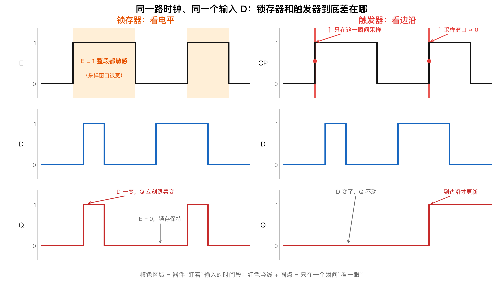
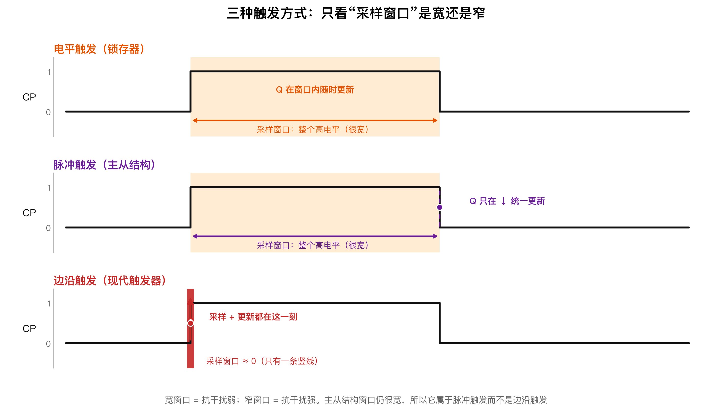
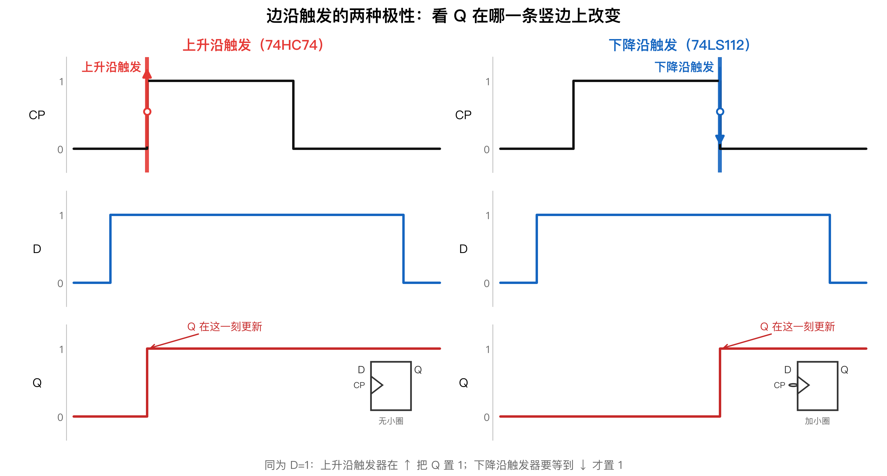

# 触发器的电路结构

> [!warning] 822考纲对照
> **大纲要求**：理解触发器的动作特点
>
> **考试频率**：⭐⭐
>
> ⛔ **不考内容**：详细电路分析

---

## 1. 锁存器 vs 触发器

> [!abstract] 一句话区分
> **锁存看电平，触发看边沿。**

| 特性 | 锁存器（Latch） | 触发器（Flip-Flop） |
|------|----------------|-------------------|
| 敏感信号 | **电平** | **边沿** |
| 更新时机 | $E=1$ 期间 | CP 边沿瞬间 |
| 透明性 | 透明（输出跟随输入） | 不透明 |
| 抗干扰能力 | 弱 | **强** |

### 敏感特性时序对比



> [!tip] 读图顺序
> 1. 先看最上面一行：两条 `E/CP` 波形**完全一样**，都是“低 → 高 → 低”的一个脉冲。
> 2. **左边橙色区域** = 锁存器在整个 `E=1` 期间都盯着 `D`，所以 `D` 一变，`Q` 立刻跟着变。
> 3. **右边红色竖线 + 圆点** = 触发器只在上升沿那一瞬间看一眼 `D`；边沿之后 `D` 再变，`Q` 也不动。
> 4. 结论：**橙色是“一段”，红色是“一点”**——这就是“锁存看电平，触发看边沿”。

> [!personal] ① 锁存 vs 触发——一句话区分
> - **锁存器（Latch）**：**电平触发**——$E=1$ 期间，输出"透明"跟随输入。
> - **触发器（Flip-Flop）**：**边沿触发**——只在 CP 上升沿或下降沿瞬间采样并更新。
>
> **口诀**：锁存看电平，触发看边沿。

---

## 2. 三种触发方式对比

> [!tip] 核心判据
> 输入信号在**什么时间段**内被采样？——这决定了触发方式的本质区别。

|  | 电平触发 | 脉冲触发 | 边沿触发 |
|--|---------|---------|---------|
| **器件类型** | 锁存器 | 主从结构触发器 | 现代触发器 |
| **采样窗口** | $E=1$ 全程 | $CLK=1$ 全程 | 仅边沿瞬间 |
| **抗干扰** | 最弱 | 较弱 | **极强** |
| **动作特点** | 透明跟随 | 两步：准备 → 传送 | 一步到位 |
| **典型器件** | 门控 D 锁存器 | 主从 SR 触发器 | 维持阻塞 D 触发器 |



> [!tip] 只看“窗口”宽窄
> - **电平触发**：窗口 = 整个高电平，窗口内 `Q` 随时更新。
> - **脉冲触发（主从）**：窗口**同样**是整个高电平，只是 `Q` 统一等到 `↓` 才更新 → 所以它是脉冲触发，不是边沿触发。
> - **边沿触发**：窗口 ≈ 0，`↑` 一瞬间完成采样和更新。
>
> 一句话：**窗口宽 = 抗干扰弱，窗口窄 = 抗干扰强。**

### 电平触发（锁存器）

- 输入在 $E=1$ **整个期间**持续有效
- 输出透明跟随输入变化
- 生活化：大门一直敞开，随便进出

### 脉冲触发（主从结构）

- 主控级 = **"漏勺"**：$CLK=1$ 期间持续开启（透明），$S$、$R$ 任何变化实时影响主控级
- 从控级 = **"闸门"**：$CLK$ 下降沿瞬间，主控级锁死 → 从控级打开 → 主控级最终状态推送至 $Q$
- 虽然 $Q$ 翻转发生在边沿，但**输入采样贯穿了半个周期的电平时间**
- 生活化：白天前门开着进院子，日落瞬间前门关、后门开，放人出去

> [!personal] ② 主从结构的本质——脉冲触发，不是边沿触发
> **主控级 = "漏勺"**：$CLK=1$ 整个高电平期间持续开启（透明），$S$、$R$ 的任何变化都会实时改变主控级内部状态。
>
> **从控级 = "闸门"**：$CLK$ 下降沿瞬间，主控级锁死 → 从控级打开 → 将主控级最终状态推送至 $Q$。
>
> **结论**：虽然 $Q$ 翻转发生在边沿，但输入采样贯穿了半个周期的电平时间。新教材精确定义为**"脉冲触发（Pulse-Triggered）"**。

### 边沿触发（现代触发器）

- 仅在 CP **上升沿或下降沿瞬间**采样
- 采样窗口极窄，抗干扰能力**极强**
- 生活化：门平时焊死，日出瞬间开一条缝，直接从后门出去

> [!personal] ③ 三种触发方式全景对比
> **核心判据**：输入信号在什么时间段内被采样？
>
> | | 电平触发（锁存器） | 脉冲触发（主从结构） | 边沿触发（现代触发器） |
> |---|---|---|---|
> | **采样窗口** | $E=1$ 全程 | $CLK=1$ 全程 | 仅边沿瞬间 |
> | **抗干扰** | 最弱 | 较弱 | **极强** |
> | **动作** | 透明跟随 | 两步：准备 → 传送 | 一步到位 |
> | **典型器件** | 门控 D 锁存器 | 主从 SR 触发器 | 维持阻塞 D 触发器 |
>
> **生活化记忆**：
> - **电平触发**：大门一直敞开，白天随便进出。
> - **脉冲触发**：白天前门开着进院子，日落瞬间前门关、后门开，放人出去。
> - **边沿触发**：门平时焊死，日出瞬间开一条缝，直接从后门出去。

---

## 3. 边沿触发的两种极性



> [!tip] 读图方法
> 两条 `CP` 波形一模一样，区别只在 **`Q` 是在哪一条竖边上改变的**：
> - `Q` 在**左边那条竖边**（↑，低→高）改变 → 上升沿触发；
> - `Q` 在**右边那条竖边**（↓，高→低）改变 → 下降沿触发。
>
> 同是 `D=1`：上升沿触发器在 `↑` 就把 `Q` 置 1；下降沿触发器要等到 `↓` 才置 1。

### 上升沿触发

- 逻辑符号：方框内 `>`，**无**小圆圈
- 典型芯片：74HC74

### 下降沿触发

- 逻辑符号：方框内 `>`，**外加**小圆圈
- 典型芯片：74LS112

### 判沿三看（画波形第 0 步）

> [!abstract] 核心结论
> **触发沿只由「电路结构 + 符号小圆圈」决定，与功能表、特性方程无关。**
> 逻辑功能（SR / JK / D / T）和触发方式（电平 / 脉冲 / 边沿、$\uparrow$ / $\downarrow$）是两个**互相独立**的维度：同一个 JK 触发器既可能是上升沿触发，也可能是下降沿触发。

| 优先级 | 判据 | 怎么读 |
|---|---|---|
| ① 最高 | **电路结构** | 主从结构（主从 SR、主从 JK）**一律按 $CP\downarrow$ 输出**，见 [[08-SR触发器（主从SR触发器）\|主从SR触发器]] |
| ② 最常用 | **CP 端小圆圈** | 有三角 `>` 才是边沿触发；**无圈 = 上升沿，有圈 = 下降沿** |
| ③ 兜底 | **题面文字** | 明说“上升沿触发 / 下降沿触发”时直接采用 |

> [!tip] 冲突时怎么办
> **结构 > 符号 > 文字。** 主从结构就是典型：符号常画成“三角 + 小圆圈”，看符号是下降沿，但它本质是**脉冲触发**（采样窗口贯穿整个高电平），只是从外部看等效于 $CP\downarrow$ 输出 —— 所以波形必须按下降沿定时刻。

```
CP 端有三角 `>` 吗？
├─ 没有 → 锁存器：电平触发，不讨论"沿"
│          （E 端有小圆圈 = 低电平有效）
└─ 有   → 边沿触发，再看三角外侧有没有小圆圈
           ├─ 无圈 `>`  → 上升沿（74HC74）
           └─ 有圈 `>o` → 下降沿（74LS112）
```

**口诀**：有箭无圈是上升，有箭有圈是下降，无箭是锁存。

> [!warning] 小圆圈的位置决定含义
> - 圈在 **CP 端**（三角旁）→ 判**触发沿**
> - 圈在 **$S$、$R$、$\bar{S}_D$、$\bar{R}_D$ 端** → 只表示**低电平有效**，与触发沿无关
> - 圈在 **$Q$ 端外侧** → 只是取反输出
>
> 题目爱在异步端放圈做干扰，别把它读成“下降沿”。

**检查清单**：

- [ ] 有三角才是触发器，没三角是锁存器（电平触发，没有“沿”）
- [ ] 先判结构：主从 → 直接 $CP\downarrow$
- [ ] 非主从：看 CP 端有无小圆圈
- [ ] 级联电路：第二级时钟是 $Q_0$，按 **$Q_0$** 的沿判，不是 $CP$ 的沿
- [ ] 不要用功能表 / 特性方程去“推”触发沿

---

## 4. 逻辑符号速查表

| 触发类型 | 符号特征 | 典型芯片 | 判断口诀 |
|----------|----------|----------|----------|
| 上升沿触发 | `>` 无圆圈 | 74HC74 | **有箭无圈** = 上升 |
| 下降沿触发 | `>o` 有圆圈 | 74LS112 | **有箭有圈** = 下降 |
| 高电平触发 | 无 `>` | 门控锁存器 | **无箭** = 锁存器 |

---

## 5. 知识脉络

```
触发方式演进：
电平触发（锁存器） → 脉冲触发（主从结构） → 边沿触发（现代触发器）
  抗干扰最弱              抗干扰较弱              抗干扰极强
  采样窗口最大            采样窗口较大            采样窗口极窄
```

> [!note] 前后关联
> - **前置**：[[03-D锁存器]] — 电平触发的典型代表
> - **后续**：[[05-D触发器]] — 边沿触发的典型代表
> - **后续**：[[08-SR触发器（主从SR触发器）]] — 脉冲触发的典型代表

---

*创建日期: 2026-03-27*
*最后更新: 2026-10-25*
