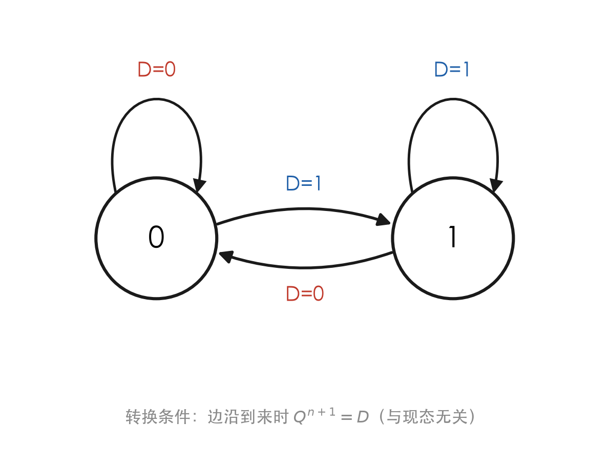
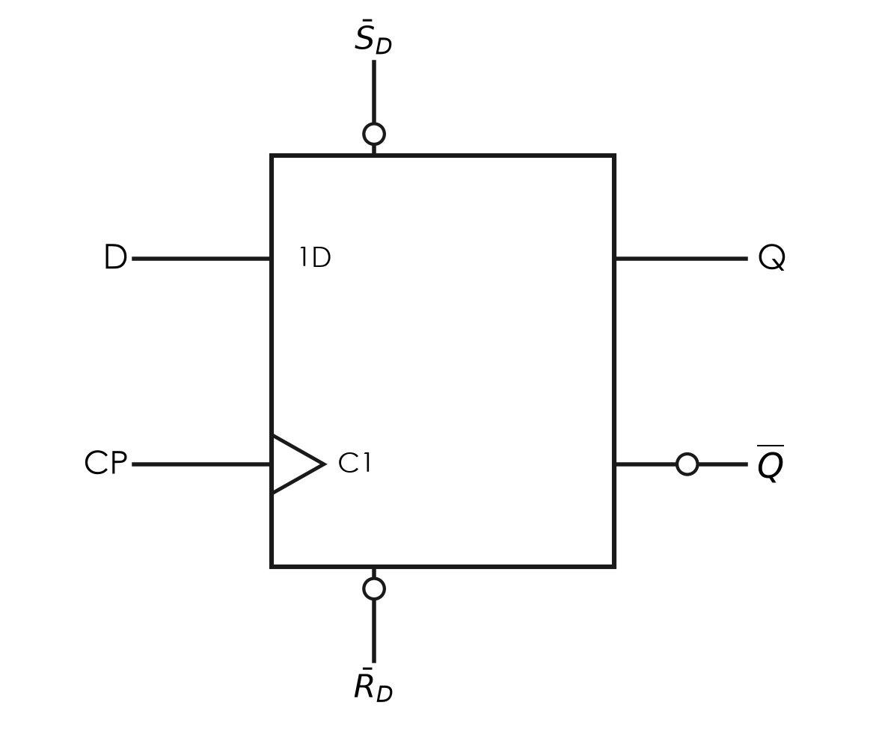
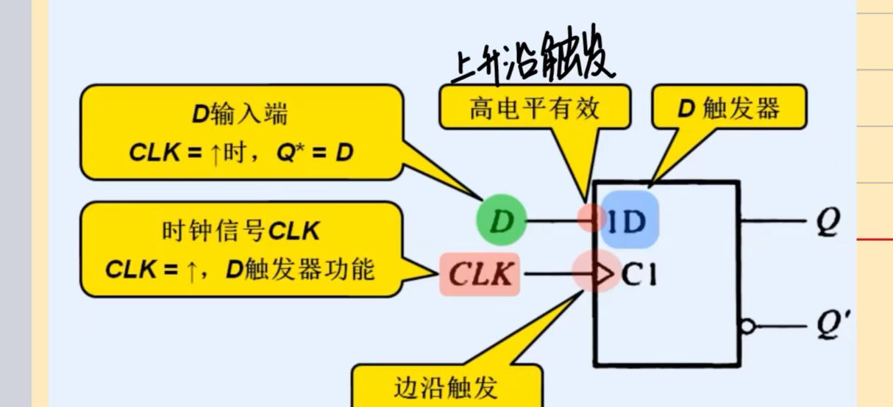
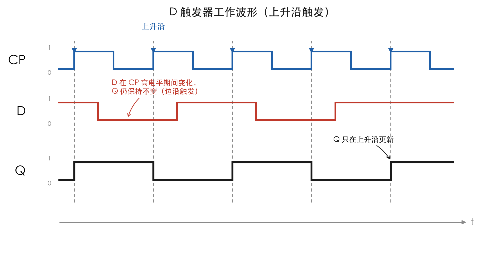

# D触发器

> [!warning] 822考纲对照
> **大纲要求**：熟练掌握D触发器的特性方程，能根据特性方程画出输出波形
>
> **考试频率**：⭐⭐⭐⭐⭐ 必考

---

## 1. 基本概念

> [!info] 定义
> D触发器是一种具有**置0**和**置1**功能的触发器，其输出状态在时钟脉冲边沿到来后等于D端的输入值。

### 触发器特点
- 具有两个稳定状态（0状态和1状态）
- 在时钟脉冲**上升沿**（或下降沿）触发
- 具有记忆功能：状态一旦确定，就能自行保持
- 输出状态由时钟边沿到来前瞬间的D信号决定

### 与锁存器的区别
| 特性 | 锁存器 | 触发器 |
|------|--------|--------|
| 敏感信号 | **电平敏感** | **边沿敏感** |
| 状态更新 | E=1期间持续更新 | 仅在边沿瞬间更新 |
| 抗干扰 | 较弱 | 较强 |

---

## 2. 特性表

> [!info] D触发器特性表
> 描述输入信号D、现态$Q^n$与次态$Q^{n+1}$之间逻辑关系的真值表。

| D | $Q^n$ | $Q^{n+1}$ | 功能说明 |
|---|-------|-----------|----------|
| 0 | 0 | 0 | 置0 |
| 0 | 1 | 0 | 置0 |
| 1 | 0 | 1 | 置1 |
| 1 | 1 | 1 | 置1 |

> [!tip] 记忆技巧
> 无论现态是什么，次态**始终等于D**！

---

## 3. 特性方程 ⭐核心

$$Q^{n+1} = D$$

> [!tip] 理解
> - $Q^n$：时钟边沿到来前的状态（现态）
> - $Q^{n+1}$：时钟边沿到来后的状态（次态）
> - D：数据输入端
> - **次态等于D，与现态无关**

---

## 4. 状态图

> [!info] 状态图说明
> - 圆圈表示触发器的两个状态（0 和 1）
> - 带箭头的方向线表示状态转换方向
> - 方向线旁的数字表示转换条件（D 的值）
> - 自环表示“保持原状态”：状态 0 遇 D=0 仍为 0，状态 1 遇 D=1 仍为 1

### 状态转换规律
| 现态 | D值 | 次态 | 说明 |
|------|-----|------|------|
| 0 | 0 | 0 | 保持0 |
| 0 | 1 | 1 | 0→1 |
| 1 | 0 | 0 | 1→0 |
| 1 | 1 | 1 | 保持1 |

---

## 5. 逻辑符号

> [!tip] 符号读法
> - `D`：数据输入端，框内标 `1D` 表示受时钟控制的 D 输入
> - `CP` 端框内的三角符号 `>`：表示**边沿触发**；`C1` 表示该端是时钟控制端
> - `Q`、$\overline{Q}$：输出端，$\overline{Q}$ 线上的小圆圈表示取反输出
> - 上、下两端带小圆圈的 $\bar{S}_D$、$\bar{R}_D$：异步置位/复位端，小圆圈表示**低电平有效**

> [!note]- 原始课件截图（溯源）
> 

---

## 6. 异步置位/复位端

> [!info] 功能
> 实际D触发器通常具有异步置位端$\bar{S}_D$和异步复位端$\bar{R}_D$，可不受时钟控制直接置位/复位。

### 异步控制功能表

| $\bar{S}_D$ | $\bar{R}_D$ | CP | D | Q | $\bar{Q}$ | 功能 |
|-------------|-------------|-----|---|---|-----------|------|
| 0 | 1 | × | × | 1 | 0 | 异步置1 |
| 1 | 0 | × | × | 0 | 1 | 异步置0 |
| 0 | 0 | × | × | 1 | 1 | 禁止状态 |
| 1 | 1 | ↑ | 0 | 0 | 1 | 正常工作 |
| 1 | 1 | ↑ | 1 | 1 | 0 | 正常工作 |

> [!danger] 常见错误
> - 异步置位/复位**优先级最高**，不受时钟控制
> - $\bar{S}_D$和$\bar{R}_D$**不能同时为0**，否则出现不定状态
> - 正常工作时必须使$\bar{S}_D = \bar{R}_D = 1$

---

## 7. 工作波形（考纲要求：画输出波形）

> [!info] 读图要点
> - 竖直虚线对准每个 **CP 上升沿**，触发器只在这一瞬间“看”一次 D
> - `D` 在 CP 高电平期间怎么变都不影响 `Q`，`Q` 只在下一次上升沿才跟着变
> - 所以 `Q` 的波形 = 每个上升沿采样到的 `D`，并保持到下一个上升沿

### 画输出波形的三步法

1. **标沿**：在 CP 波形上标出每个触发沿（上升沿触发标 `↑`，下降沿触发标 `↓`）。
2. **采样**：看每个沿**到来瞬间**的 D 值，由 $Q^{n+1}=D$ 定出该沿之后 Q 的取值。
3. **保持**：相邻两个沿之间 Q 保持不变，逐段连成阶梯波；若异步端有效，直接置位/复位，不用看 CP。

> [!warning] 常见扣分点
> - 误用“沿前后一段时间内 D 的值”，应为**沿时刻**的 D
> - 把 Q 的跳变画在 CP 高电平中间，而不是对着触发沿
> - 异步置位/复位有效时仍按 D 更新（异步端优先级最高）

