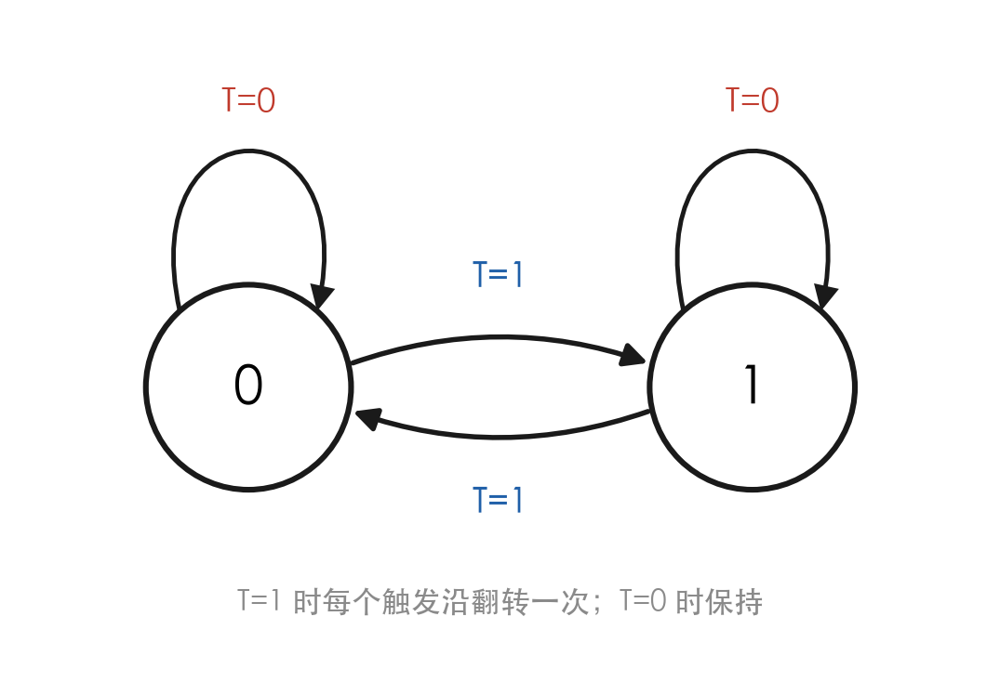
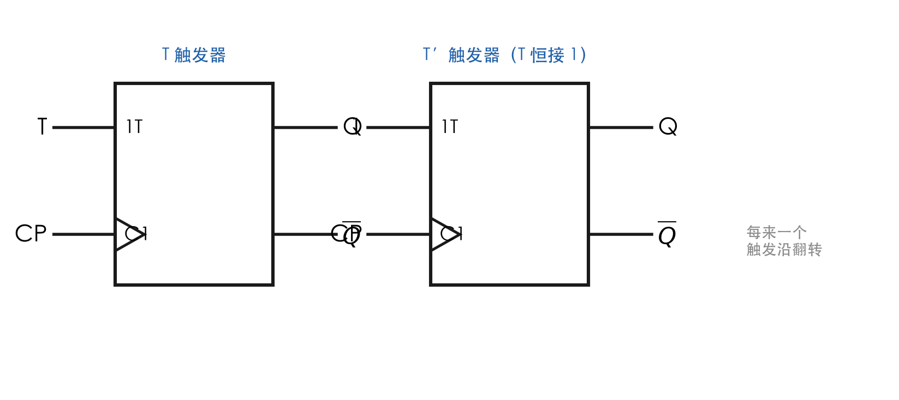
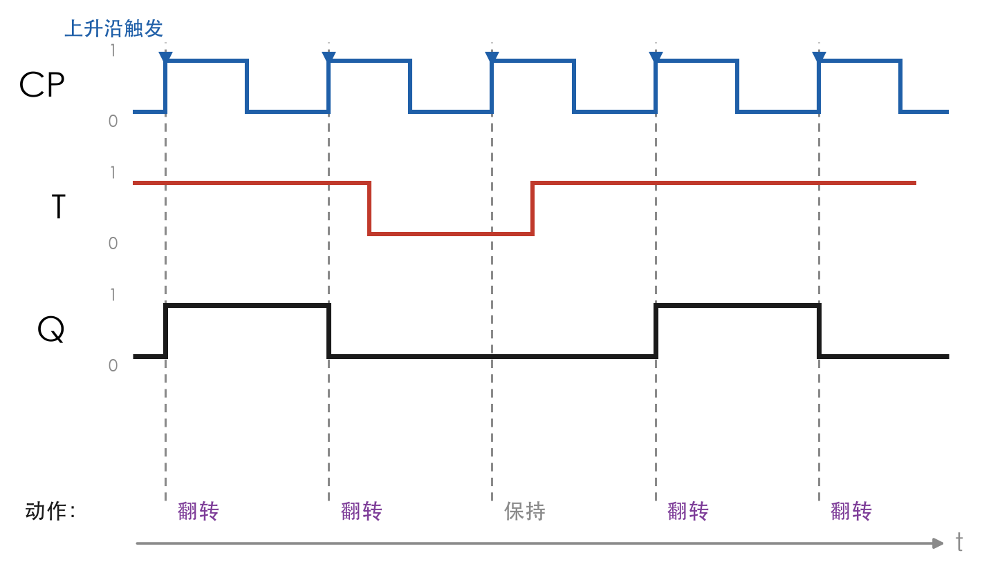
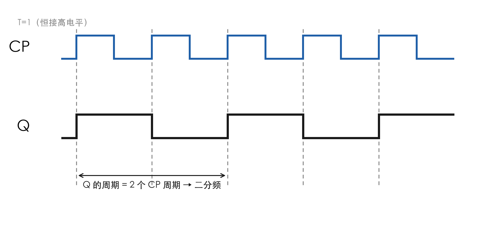

# T触发器与T'触发器

> [!warning] 822考纲对照
> **大纲要求**：掌握T触发器和T'触发器的特性方程
>
> **考试频率**：⭐⭐⭐

---

## 1. T触发器

> [!info] 定义
> T触发器是一种具有**保持**和**翻转**两种功能的触发器，由控制信号T决定工作模式。

### 特性表

| T | $Q^n$ | $Q^{n+1}$ | 功能 |
|---|-------|-----------|------|
| 0 | 0 | 0 | **保持** |
| 0 | 1 | 1 | **保持** |
| 1 | 0 | 1 | **翻转** |
| 1 | 1 | 0 | **翻转** |

### 特性方程 ⭐核心

$$Q^{n+1} = T\bar{Q}^n + \bar{T}Q^n = T \oplus Q^n$$

> [!tip] 理解
> - T=0：$Q^{n+1} = Q^n$（保持）
> - T=1：$Q^{n+1} = \bar{Q}^n$（翻转）

### 功能总结

| T | 功能 | 说明 |
|---|------|------|
| 0 | 保持 | 状态不变 |
| 1 | 翻转 | 状态取反 |

### 状态图

> [!info] 读图要点
> - 两条自环都是 `T=0`，两条弧线都是 `T=1` —— 状态图里**只有 T，没有别的输入**
> - `T=0`：无论处在 0 还是 1，都自环停在原地（保持）
> - `T=1`：无论处在 0 还是 1，都跳到对面（翻转）
> - 所以 T 触发器的状态图是"**要么不动，要么对跳**"，没有"指定跳到哪个状态"这回事 —— 这正是它比 JK 弱的地方

### 逻辑符号（T 与 T′）

> [!info] 符号读法
> - 左：$T$ 触发器。框内 `1T` 表示受控制端控制，三角 `>` + `C1` 表示边沿触发
> - 右：$T'$ 触发器。输入端的 `1` **不是数字 1 的信号名，而是"恒接高电平"**，表示 T 永远为 1
> - 两个符号的 CP 端三角都**没有小圆圈** → 上升沿触发；有小圆圈则改为下降沿
> - $T'$ 在器件手册中常见写法是 $T$ 端接固定电平，或用 JK 的 $J=K=1$ 代替

### 工作波形（T 控制）

> [!info] 读图要点
> - 竖直虚线对准每个 **CP 上升沿**，只在这一瞬间读一次 $T$
> - $T=1$ 的区间里，每个触发沿都翻转一次；$T=0$ 的区间里，触发沿来了也不动
> - 图中中间的 $T=0$ 段就是"保持"：两个沿都被无视，$Q$ 是一条长水平线
> - 注意 $T$ 在沿之间怎么变都不影响本拍结果

### 画输出波形的三步法

1. **标沿**：看三角处小圆圈，确定上升沿还是下降沿，把每个触发沿标出来。
2. **采样**：取每个沿**前瞬间**的 $T$。$T=1$ 就翻转，$T=0$ 就保持（也可代入 $Q^{n+1}=T\oplus Q^n$）。
3. **保持**：两沿之间 $Q$ 画水平线；翻转时把竖线画在触发沿上，不要画在 $T$ 的跳变处。

> [!warning] 常见扣分点
> - 把 $T$ 的跳变当成触发条件（$T$ 只是"要不要翻转"的开关，触发靠 CP 沿）
> - $T=0$ 时误判为"清零"（$T=0$ 是**保持**，不是置 0）
> - $T'$ 与 $T$ 混淆：$T'$ 恒翻转，每个沿必变；$T$ 要看电平

---

## 2. T'触发器

> [!info] 定义
> T'触发器是T触发器的特例，T端固定接高电平，**每来一个时钟脉冲就翻转一次**。

### 特性方程 ⭐核心

$$Q^{n+1} = \bar{Q}^n$$

> [!tip] 特点
> - 只有一个输入端：时钟信号CP
> - 每来一个CP脉冲，Q翻转一次
> - **计数工作状态**

> [!info] 逻辑符号
> $T'$ 与 $T$ 的符号完全相同，唯一区别是 $T$ 端**恒接 1**，见上一节"逻辑符号（T 与 T′）"的右半部分。

### 应用

1. **计数器**：累计输入脉冲个数
2. **分频器**：$Q$ 频率 = $CP$ 频率 ÷ 2

> [!info] 读图要点
> - 每个 CP 上升沿处 $Q$ 必翻转，所以 $Q$ 的一个完整周期 = **两个** CP 周期
> - 看箭头标度：$Q$ 的周期是 2 个 CP 周期 → 二分频
> - 分频 ≠ 延时：$Q$ 与 CP 同频段但频率减半，相位由第一个触发沿决定

---

## 3. 用JK触发器构成T/T'触发器

### JK → T触发器

**转换方法**：$J = K = T$

### JK → T'触发器

**转换方法**：$J = K = 1$

---

## 4. 用D触发器构成T/T'触发器

### D → T触发器

**转换方法**：$D = T \oplus Q$

### D → T'触发器

**转换方法**：$D = \bar{Q}$

> [!tip] 最简实现
> 只需将$\bar{Q}$接到D端！

---

## 5. 四种触发器特性方程汇总

| 触发器 | 特性方程 | 功能 |
|--------|----------|------|
| D | $Q^{n+1} = D$ | 置0、置1 |
| JK | $Q^{n+1} = J\bar{Q}^n + \bar{K}Q^n$ | 保持、置0、置1、翻转 |
| T | $Q^{n+1} = T \oplus Q^n$ | 保持、翻转 |
| T' | $Q^{n+1} = \bar{Q}^n$ | 翻转 |
| SR | $Q^{n+1} = S + \bar{R}Q^n$（约束$SR=0$） | 保持、置0、置1 |

---

## 🔗 知识关联

- **前置知识**：[[05-D触发器|D触发器]]、[[06-JK触发器|JK触发器]]
- **相关内容**：[[09-触发器逻辑功能转换|功能转换]]
- **应用**：[[考研专业课/数字电子技术/6-时序逻辑电路/|第六章：时序逻辑电路]]

*创建日期: 2026-03-27*
*最后更新: 2026-10-23*
