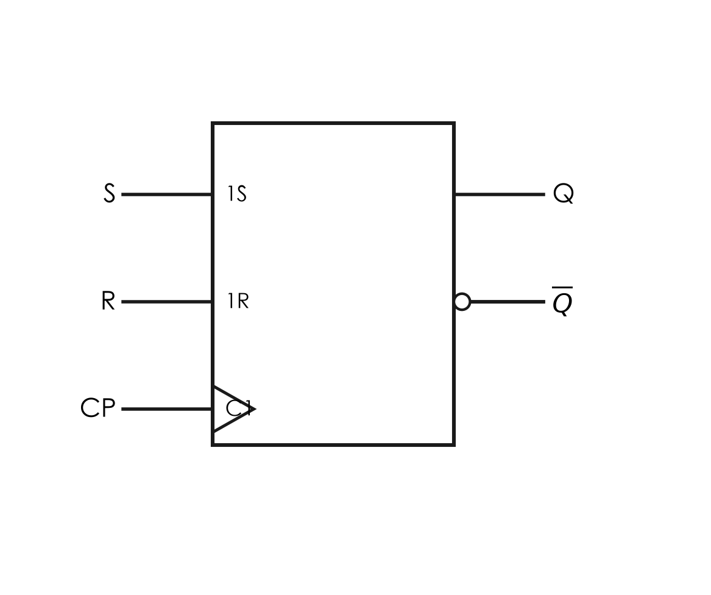
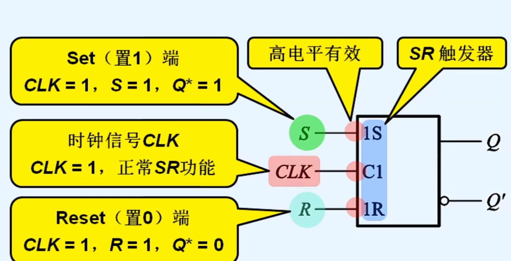
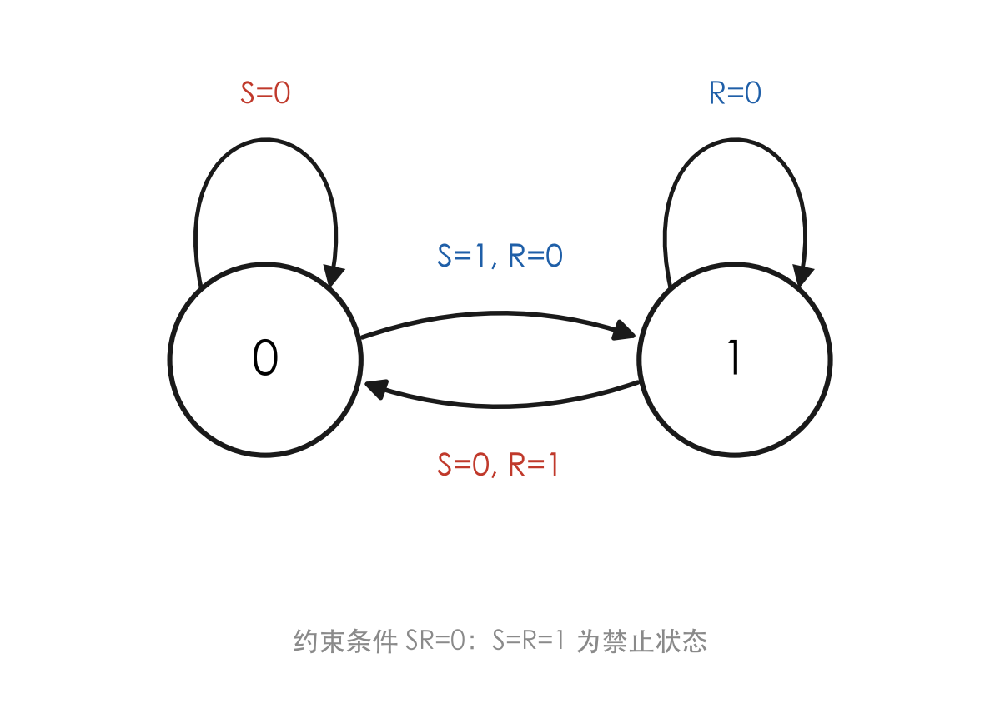
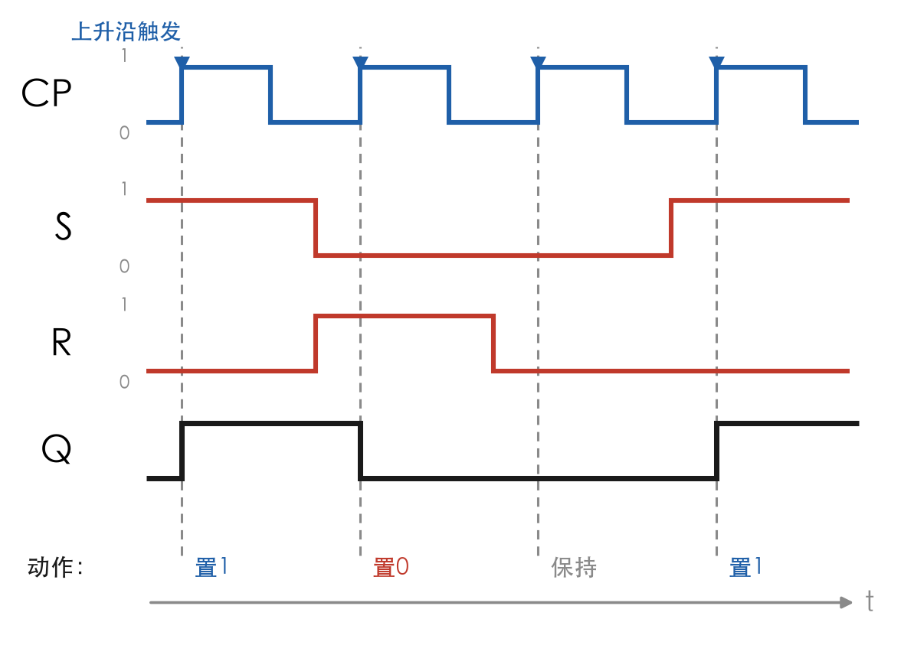

# SR触发器

> [!warning] 822考纲对照
> **大纲要求**：了解SR触发器的特性方程及约束条件
>
> **考试频率**：⭐⭐

---

## 1. 基本概念

> [!info] 定义
> SR触发器是仅有**置位**和**复位**功能的触发器，与SR锁存器功能相同，但采用边沿触发方式。

### SR触发器特点
- 两个输入端：S（置位端）和R（复位端）
- 具有保持、置0、置1三种功能
- **有约束条件**：$SR = 0$

---

## 2. 特性表

| S | R | $Q^n$ | $Q^{n+1}$ | 功能 |
|---|---|-------|-----------|------|
| 0 | 0 | 0 | 0 | **保持** |
| 0 | 0 | 1 | 1 | **保持** |
| 0 | 1 | 0 | 0 | **置0** |
| 0 | 1 | 1 | 0 | **置0** |
| 1 | 0 | 0 | 1 | **置1** |
| 1 | 0 | 1 | 1 | **置1** |
| 1 | 1 | 0 | 不确定 | **禁止** |
| 1 | 1 | 1 | 不确定 | **禁止** |

---

## 3. 特性方程

$$\left\{ \begin{array}{l}
Q^{n+1} = S + \bar{R}Q^n \\
SR = 0 \quad (\text{约束条件})
\end{array} \right.$$

> [!danger] 约束条件
> **$SR = 0$**：即S和R不能同时为1！

---

## 4. 与JK触发器对比

| 特性 | SR触发器 | JK触发器 |
|------|----------|----------|
| 输入端 | S、R | J、K |
| 约束条件 | **有**（$SR=0$） | **无** |
| S=R=1 | 禁止状态 | 翻转功能 |
| 功能数 | 3种 | 4种 |

> [!tip] 记忆
> JK触发器是SR触发器的改进版：
> - J对应S（置1）
> - K对应R（置0）
> - J=K=1时实现翻转（SR触发器禁止）

---

## 5. 逻辑符号

> [!info] 符号读法
> - 框外 $S$、$R$ **没有小圆圈** → 高电平有效，与或非门型 SR 锁存器一致
> - 框内 `1S`、`1R`：受控制端控制的置位/复位输入
> - $CP$ 端三角 `>` + `C1`：**边沿触发**。主从结构从外部看等效于"CP 下降沿统一输出"，所以教材常直接画成边沿符号
> - $\bar{Q}$ 线上的小圆圈：取反输出
> - **对比记忆**：把 $S$、$R$ 换成 $J$、$K$ 就是 JK 触发器 —— 符号几乎一样，区别只在 $SR=0$ 这条约束

> [!note]- 原始课件截图（溯源）
> 

---

## 6. 状态图

> [!info] 读图要点
> - 与基本 SR 锁存器的状态图**形状完全相同**：$S=1$ 使 0→1，$R=1$ 使 1→0，$S=0$ 或 $R=0$ 时自环保持
> - 唯一差别在**"什么时候看 $S$、$R$"**：锁存器看电平，触发器看触发沿
> - 依然**不能**画 $S=R=1$ 的转换 —— 这是 $SR=0$ 约束直接禁掉的

---

## 7. 工作波形

> [!info] 读图要点
> - 竖直虚线对准每个 **CP 下降沿**：主从结构在 $CP=1$ 期间由主锁存器接收 $S$、$R$，到 $CP$ 下降沿才把状态送到输出
> - 每个下降沿之后 $Q$ 的取值由**沿前瞬间**的 $S$、$R$ 决定：$S=1,R=0$ 置 1，$S=0,R=1$ 置 0，$S=R=0$ 保持
> - 图中 $S$、$R$ 的跳变都避开触发沿，所以节奏很清晰；如果输入紧贴沿变化，就会出现**一次翻转**（主从结构的一次变化问题），这也是它被边沿触发器取代的原因之一

### 画输出波形的三步法

1. **标沿**：确认三角处有无小圆圈，定出上升沿还是下降沿（主从 SR 按 $CP\downarrow$ 算）。
2. **采样**：取沿**前瞬间**的 $S$、$R$，按"$S$ 置 1、$R$ 置 0、都无效则保持"定次态；遇到 $S=R=1$ 直接判为不合法。
3. **保持**：两沿之间 $Q$ 画水平线，跳变竖线对准触发沿。

> [!warning] 常见扣分点
> - 沿用锁存器的"电平敏感"思路，$S=1$ 一出现就让 $Q$ 变
> - 忽略约束 $SR=0$，把 $S=R=1$ 画成某个确定状态
> - 触发沿方向搞反（把 $CP\uparrow$ 当成输出时刻）

---

## 8. 为什么使用较少

> [!info] 原因
> 1. **有约束条件**，使用不便
> 2. **功能不如JK触发器完整**（无翻转功能）
> 3. 集成芯片产品少

在实际应用中，D触发器和JK触发器更为常用。

---

## 🔗 知识关联

- **前置知识**：[[02-SR锁存器（基本 RS 触发器和同步 RS 触发器）|SR锁存器]]
- **对比学习**：[[06-JK触发器|JK触发器]]

---

## 📝 个人笔记

> [!personal] 学习心得
> （此处记录个人理解和易错点）

*创建日期: 2026-03-27*
*最后更新: 2026-10-23*
