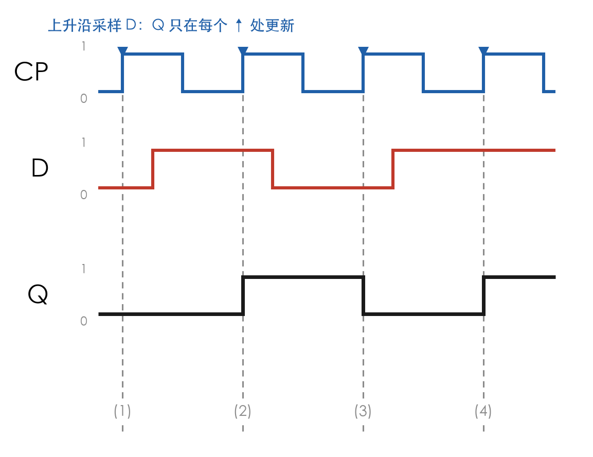
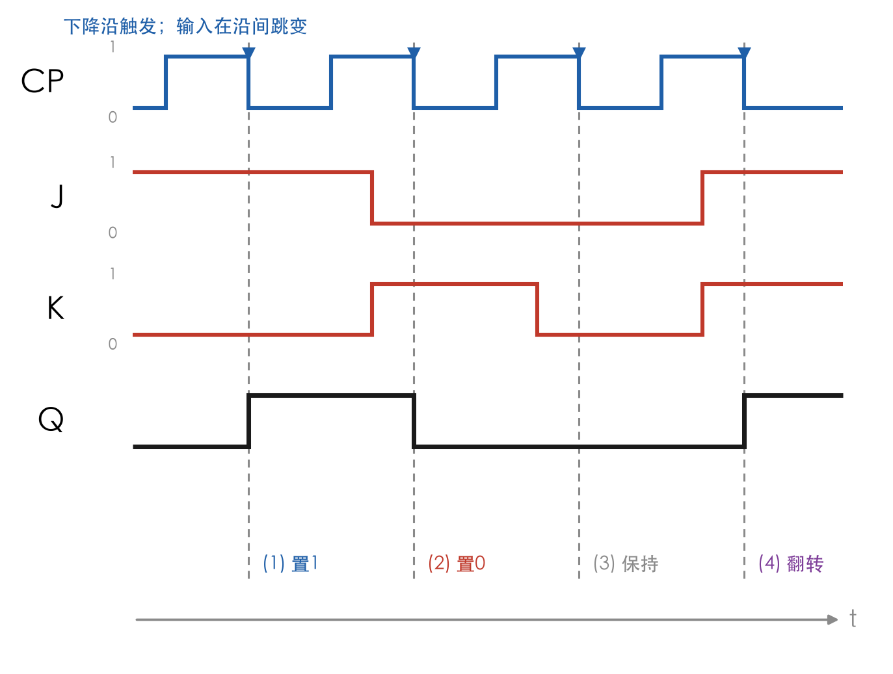
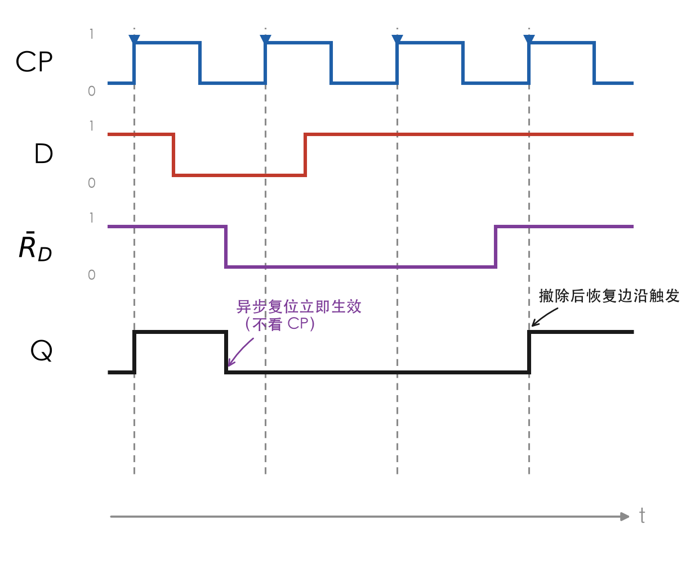
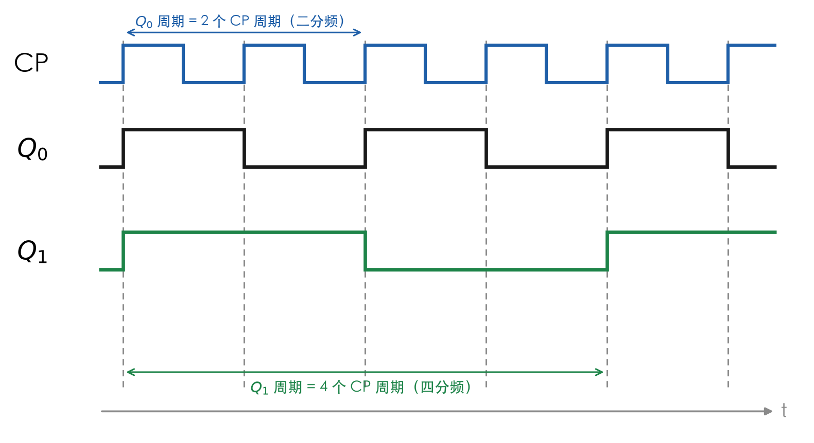

# 触发器波形分析

> [!warning] 822考纲对照
> **大纲要求**：能根据触发器（重点是JK-FF和D-FF）的特性方程熟练地画出输出波形
>
> **考试频率**：⭐⭐⭐⭐⭐ 必考

---

## 1. 波形分析基本方法

### 分析步骤（四步法）

1. **确定触发沿**：看逻辑符号判断上升沿还是下降沿触发
2. **标记触发时刻**：在CP波形上标出所有触发沿
3. **读取输入值**：确定每个触发沿**前瞬间**的输入信号值
4. **计算次态**：根据特性方程确定次态，画出Q波形

> [!tip] 核心原则
> - Q只在**触发沿瞬间**改变
> - 两个触发沿之间Q**保持不变**
> - 必须看**触发沿前瞬间**的输入值

> [!note]- 图示速览：触发器波形分析四步法
> ![[考研专业课/数字电子技术/📎 附件/触发器波形分析四步法.excalidraw.md]]
>
> 先标有效沿，再读沿前输入；不要让 $Q$ 跟着 $D/J/K$ 连续变化。

---

## 2. D触发器波形分析

### 特性方程
$$Q^{n+1} = D$$

### 分析要点
- 上升沿触发：在CP↑时刻采样D值
- 下降沿触发：在CP↓时刻采样D值
- Q的次态 = D在触发沿前瞬间的值

> [!example] 例1：D触发器波形分析
> 上升沿触发D触发器，初态Q=0

**波形图**：

> [!info] 读图要点
> - 四条竖直虚线对准 4 个 **CP 上升沿**，标号 (1)–(4) 就是 4 次采样时刻
> - $D$ 在第 1 个 CP 高电平期间就由 0 升到 1，但 $Q$ 一直等到**下一个上升沿**才跟着变
> - 这正是"边沿触发"与"电平敏感"的分水岭：锁存器早就跟着变了，触发器不会

**逐步分析**：

| 触发沿 | D值（前瞬间） | $Q^{n+1}$ |
|--------|---------------|-----------|
| (1) | 0 | 0 |
| (2) | 1 | 1 |
| (3) | 0 | 0 |
| (4) | 1 | 1 |

---

## 3. JK触发器波形分析 ⭐重点

### 特性方程
$$Q^{n+1} = J\bar{Q}^n + \bar{K}Q^n$$

### 功能速查表

| J | K | $Q^{n+1}$ | 功能 |
|---|---|-----------|------|
| 0 | 0 | $Q^n$ | 保持 |
| 0 | 1 | 0 | 置0 |
| 1 | 0 | 1 | 置1 |
| 1 | 1 | $\bar{Q}^n$ | 翻转 |

> [!example] 例2：JK触发器波形分析
> 下降沿触发JK触发器，初态Q=0

**波形图**：

> [!info] 读图要点
> - 竖直虚线对准 4 个 **CP 下降沿**，标号 (1)–(4) 是 4 次采样时刻
> - (1) $J=1,K=0$ → 置 1；(2) $J=0,K=1$ → 置 0；(3) $J=K=0$ → 保持；(4) $J=K=1$ → 翻转
> - 4 个沿把**四种功能依次演了一遍**，这种情况最容易在考试里出现，务必按顺序对照特性表
> - 注意 $J$、$K$ 的每个跳变都刻意错开触发沿，避免"沿上跳变"的歧义

**逐步分析**：

| 触发沿 | J | K | $Q^n$ | $Q^{n+1}$ | 功能 |
|--------|---|---|-------|-----------|------|
| (1) | 1 | 0 | 0 | 1 | 置1 |
| (2) | 0 | 1 | 1 | 0 | 置0 |
| (3) | 0 | 0 | 0 | 0 | 保持 |
| (4) | 1 | 1 | 0 | 1 | 翻转 |

---

## 4. 带异步控制的波形分析 ⭐重要

> [!danger] 绝对优先级法则（做题第一眼看这里）
> **最高优先级**：先看 $\bar{S}_D$ 和 $\bar{R}_D$。只要其中有一个为 0（低电平有效），立刻决定 $Q$ 的状态（置 1 或清 0）。此时**无视** $CP$ 的任何边沿，也**无视** $D$ 端的任何输入。
>
> **次级优先级**：只有当 $\bar{S}_D = 1$ 且 $\bar{R}_D = 1$ 时（即放弃了异步最高控制权），触发器才恢复为"普通模式"。此时再去寻找 $CP$ 的上升沿或下降沿，并根据 $D$ 的状态画波形。

### 异步信号优先级
$$\bar{S}_D/\bar{R}_D > CP$$

> [!danger] 注意
> 异步置位/复位信号**立即生效**，不需要等待时钟边沿！

### 分析方法
1. **首先**处理异步信号（$\bar{S}_D$、$\bar{R}_D$）
2. 异步信号作用期间，CP和D/J/K信号**无效**
3. 异步信号**撤除后**，恢复正常触发

> [!example] 例3：带异步复位的D触发器

> [!info] 读图要点
> - $\bar{R}_D$ **一跌到低电平，$Q$ 立刻清 0**，不等任何 CP 沿 —— 图中间那条陡降线就是"异步"
> - $\bar{R}_D=0$ 期间来的两个上升沿（$t=3$、$t=5$）全被无视，$Q$ 一直保持 0
> - $\bar{R}_D$ 回到高电平后，恢复边沿触发：$t=7$ 的上升沿上 $D=1$，$Q$ 才又变 1

**分析**：
- 第1个CP↑：D=1，Q变1
- $\bar{R}_D$变低：Q立即变0（不受CP控制）
- 第2、3个CP↑：$\bar{R}_D$仍为低，Q保持0
- $\bar{R}_D$变高后：恢复正常触发

---

## 5. 多触发器级联分析

### 分析方法
1. 先分析**第一级**触发器
2. 根据第一级输出，分析**第二级**
3. 逐级向后推进

> [!example] 例4：两级D触发器级联（四分频器）

**电路连接**（这题的关键是"谁当谁的时钟"）：

- 第一级 FF0：$D_0 = \bar{Q}_0$，时钟为 $CP$
- 第二级 FF1：$D_1 = \bar{Q}_1$，**时钟不是 CP，而是 $Q_0$**
- 两级都工作在 $T'$ 状态（每来一个触发沿翻转一次）

**分析**：

| 触发器 | 时钟来源 | 翻转时刻 | 输出周期 | 分频效果 |
|--------|----------|----------|----------|----------|
| FF0 | $CP$ | 每个 $CP\uparrow$ | 2 个 CP 周期 | $f_0 = f_{CP}/2$ |
| FF1 | $Q_0$ | 每个 $Q_0\uparrow$ | 4 个 CP 周期 | $f_1 = f_0/2 = f_{CP}/4$ |

> [!info] 读图要点
> - $Q_0$ 在每个 $CP$ 上升沿翻转 → $Q_0$ 周期 = 2 个 CP 周期（二分频）
> - $Q_1$ 只在 **$Q_0$ 的上升沿**翻转（图中 $t=1,5,9$）→ $Q_1$ 周期 = 4 个 CP 周期（四分频）
> - 级联结论：$n$ 级 $T'$ 触发器串联，末级输出频率为 $f_{CP}/2^n$
> - **注意顺序**：$Q_1$ 的跳变时刻由 $Q_0$ **上升沿**决定；若把第二级改成下降沿触发，跳变点会挪到 $Q_0\downarrow$（$t=3,7,11$），分频比不变但相位不同

> [!warning] 常见错误
> - 把第二级的 D 端当成"接 $Q_0$"（那是数据路径接法，得到的是移位寄存器）—— 本题是**时钟路径接法**
> - 认为每级都直接以 CP 为时钟，于是把 $Q_1$ 画成与 $Q_0$ 同频
> - 忘记先给 FF0 定初态，导致整条波形整体反相

---

## 6. 常见错误与避免方法

> [!danger] 错误警示

| 错误类型 | 表现 | 避免方法 |
|----------|------|----------|
| 触发沿判断错误 | 上升沿画成下降沿 | 仔细看逻辑符号 |
| 输入值读取错误 | 看了触发沿后的值 | 必须看**前瞬间**的值 |
| 忘记保持特性 | Q随输入连续变化 | 两个触发沿间Q不变 |
| 异步信号遗漏 | 忽略$\bar{S}_D/\bar{R}_D$ | 先处理异步信号 |
| J=K=1处理错误 | 以为是保持 | J=K=1是**翻转** |

---

## 7. 综合练习

### 练习1：D触发器
上升沿触发D触发器，初态Q=0，根据CP和D波形画出Q波形。

点击查看答案

**分析步骤**：
1. 标记所有CP上升沿
2. 读取每个上升沿前瞬间D值
3. Q的次态 = D值

### 练习2：JK触发器
下降沿触发JK触发器，初态Q=0，J和K波形交替变化，画出Q波形。

点击查看答案

**关键点**：
- J=0, K=0 → 保持
- J=0, K=1 → 置0
- J=1, K=0 → 置1
- J=1, K=1 → 翻转

### 练习3：带异步控制
在练习2基础上，增加$\bar{R}_D$信号，分析Q波形。

点击查看答案

**注意**：
- $\bar{R}_D=0$时Q立即变0
- $\bar{R}_D$恢复1后，继续正常触发

---

## 8. 波形分析技巧总结

> [!tip] 高分技巧

1. **先标触发沿**：在CP波形上用箭头标出所有触发沿
2. **画竖虚线**：从触发沿向下画虚线，帮助定位
3. **读前不读后**：只看触发沿**前瞬间**的输入值
4. **先异步后同步**：先处理$\bar{S}_D/\bar{R}_D$，再处理CP
5. **翻转要谨慎**：J=K=1时Q翻转，不是保持

---

## 🔗 知识关联

- **前置知识**：[[05-D触发器|D触发器]]、[[06-JK触发器|JK触发器]]
- **应用章节**：[[考研专业课/数字电子技术/6-时序逻辑电路/|第六章：时序逻辑电路]]

---

## 📝 个人笔记

> [!personal] 学习心得
> （此处记录个人理解和易错点）

---

*创建日期: 2026-03-27*
*最后更新: 2026-10-23*
