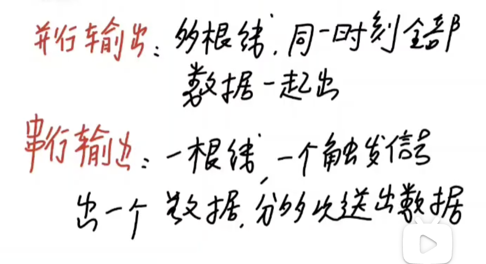
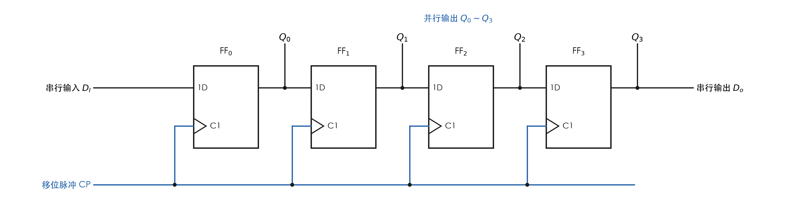
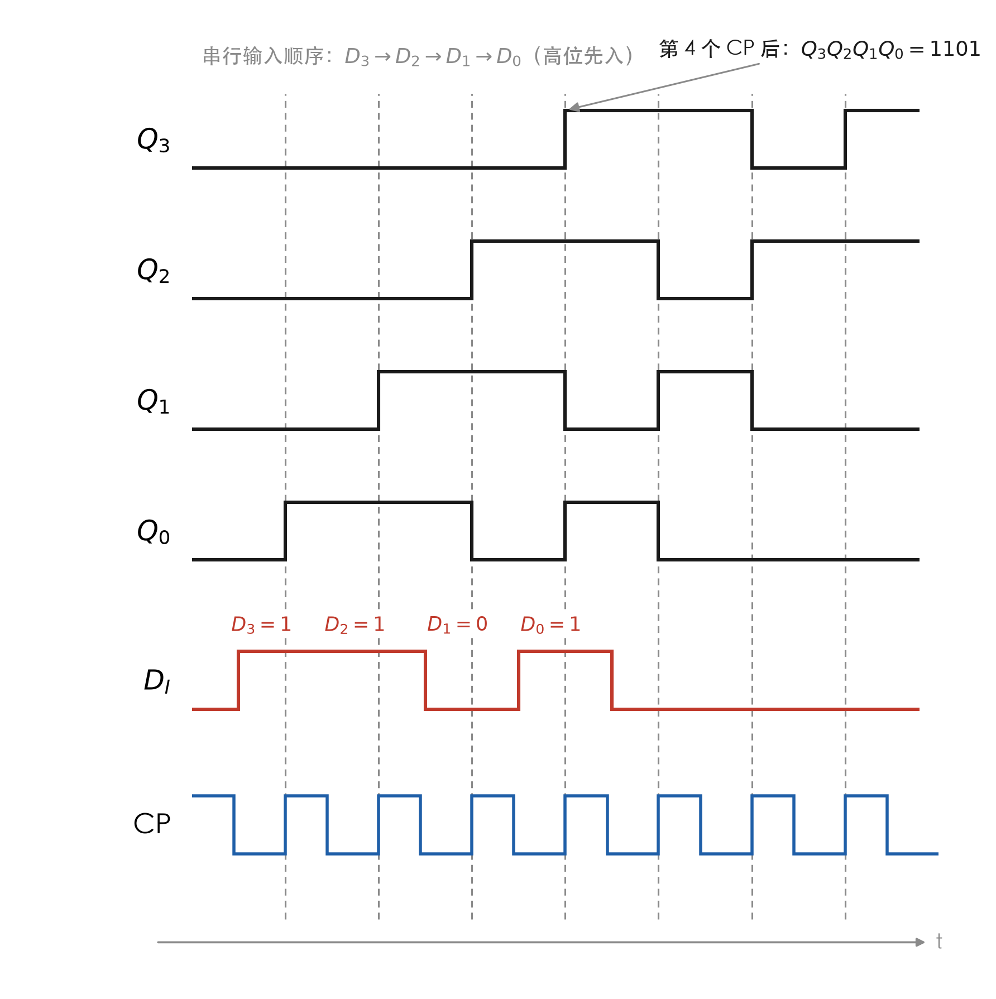
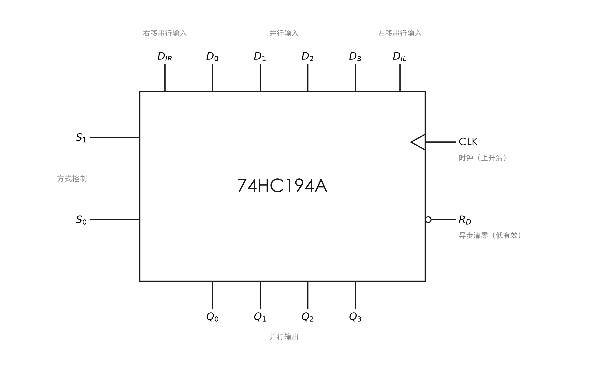
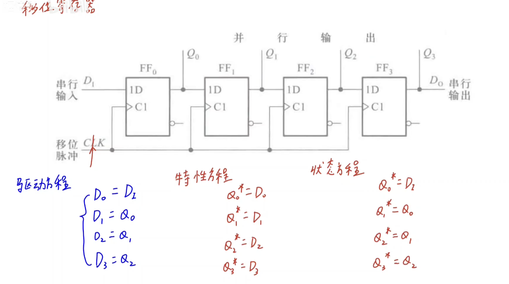

# 05 寄存器和移位寄存器

> [!abstract] 本页解决什么
> 从一张 4 位串入-并出移位寄存器的图出发，走通「看接线 → 列驱动方程 → 代特性方程 → 得状态方程 → 读移位表」这条链路，再补 74HC194 的四种工作方式和环形/扭环形接法。
> 考试落点：**会列三层方程**、**会读/画移位波形**、**会用 194 接计数器**。

## 一、符号速查

| 符号 | 读法 | 本页含义 |
|------|------|---------|
| $D_I$ | 串行输入 | 外部数据逐位送入第一个触发器 |
| $D_o$ | 串行输出 | 取链尾 $Q_3$，先入先出 |
| $Q_0\sim Q_3$ | 并行输出 | 四个触发器的现态，一次读出 |
| $Q_i^*$ | 次态 | 下一个 CP 有效沿之后的状态，也写作 $Q_i^{n+1}$ |
| CP | 移位脉冲 | 所有触发器共用的时钟，故属同步时序电路 |
| $D_{IR}$ / $D_{IL}$ | 右移 / 左移串行输入 | 74HC194 的两个串行入口，分别进 $Q_0$ / $Q_3$ |
| $S_1S_0$ | 方式控制 | 194 的保持 / 右移 / 左移 / 并行置数选择 |
| $R_D$ | 异步清零 | 带小圆圈表示低电平有效，优先级最高 |

---

## 二、寄存器与移位寄存器的分工

### 1. 寄存器：只存不移

$n$ 个 D 触发器**共用 CP**，每个 D 端各自接数据：一个 CP 沿同时写入 $n$ 位，读的时候也同时读出。

- 输入输出都按位并行 → **并行入、并行出**
- 触发器之间没有连线，状态互不影响

### 2. 移位寄存器：把 D 端串起来

把前一级的 $Q$ 接到后一级的 $D$，数据在每个 CP 沿整体挪一格：

- 第一个触发器的 D 接外部串行输入 → **串行入**
- 各触发器 Q 可同时引出 → **并行出**；链尾再引出 → **串行出**

> [!warning] 只能用边沿触发器，不能用电平锁存器
> 锁存器在 CP 高电平期间 $Q$ 一直跟随 $D$。级联后同一个高电平里数据会「一波到底」穿过所有级，移位节拍失控；只有边沿触发器才能做到「一个沿只挪一格」。

### 3. 输出方式：并行输出 vs 串行输出

同一个移位寄存器可以同时提供两种读法，区别只在「用几根线、花几拍」：

| 对比项 | 并行输出 | 串行输出 |
|------|------|------|
| 引出线 | $N$ 根，每级引一根 | 1 根，取链尾 $Q_{N-1}$ |
| 读出方式 | **同一时刻全部数据一起出** | **一个触发信号出 1 位，分 $N$ 次送出** |
| 占用 CP | 读出本身不占拍（但装填要 $N$ 拍） | 读出要 $N$ 拍 |
| 速度 / 成本 | 快，但占线多 | 慢，但省线，适合远距离传输 |
| 典型用途 | 并行总线、一次取走整字 | 串并转换、延时线 |

> [!tip] 一句话记忆
> **并行 = 多根线，一次全出；串行 = 一根线，一个沿出一位，分多次出。**

> [!warning] 两个容易想错的点
> - 并行输出不是「随时都有」：串行数据要先花 $N$ 个 CP 装填，装填期间并行端是残数，不能提前读。
> - 串行输出的每一位要**保持一个 CP 周期**，不是瞬间脉冲；采样仍对准触发沿之后的那一段。

四种输入输出组合：

| 组合 | 输入 | 输出 | 典型电路 |
|------|------|------|------|
| 串入-并出 | 1 根线，$N$ 拍 | $N$ 根线，一次读 | 本页 4 位移位寄存器 |
| 串入-串出 | 1 根线，$N$ 拍 | 1 根线，$N$ 拍 | 延时线 |
| 并入-串出 | $N$ 根线，1 拍置数 | 1 根线，$N$ 拍 | 74HC194 置数后移位 |
| 并入-并出 | $N$ 根线 | $N$ 根线 | 普通寄存器 |

> [!note]- 原始手写图（并行/串行输出，溯源）
> 

---

## 三、4 位串入-并出移位寄存器（本页原图）

### 1. 电路结构



> [!info] 读图要点
> - 接线只有两类：**CP 全部并联**；**$D_i$ 接前一级的 $Q_{i-1}$**（FF$_0$ 的 D 接外部 $D_I$）
> - $Q_0\sim Q_3$ 直接引出，就是并行输出
> - $Q_3$ 再引出一根线，就是串行输出 $D_o$
> - 后面的触发器比前面的晚一拍 → 数据「一格一格搬家」

### 2. 三层方程：驱动 → 特性 → 状态

原图右侧三组式子，正好对应分析时序电路的三层：

**第一层：驱动方程**——写「每个 D 端接的是谁」。这是**连线**，不是器件性质：

$$
\begin{cases}
D_0 = D_I\\
D_1 = Q_0\\
D_2 = Q_1\\
D_3 = Q_2
\end{cases}
$$

**第二层：特性方程**——写 D 触发器自身的规律（来自第 5 章）：

$$Q_i^* = D_i \qquad (i=0,1,2,3)$$

**第三层：状态方程**——把驱动方程代入特性方程，得到「下一拍每个触发器变成什么」：

$$
\begin{cases}
Q_0^* = D_I\\
Q_1^* = Q_0\\
Q_2^* = Q_1\\
Q_3^* = Q_2
\end{cases}
$$

> [!tip] 三层各管什么
> - **驱动方程 = 接线**：D 端连着谁
> - **特性方程 = 器件**：D 触发器永远有 $Q^*=D$
> - **状态方程 = 代入结果**：下一拍状态只由前一级现态决定
>
> 考试写「列驱动方程，代入特性方程求状态方程」，**直接写第三层会丢过程分**。

> [!note]- 为什么移位寄存器可以不列状态表
> 状态方程里每个 $Q_i^*$ 只依赖一个量，既没有与或组合，也没有交叉反馈，所以不必像一般同步时序电路那样枚举 $2^4$ 个状态；给一个初态逐拍移位即可。这也是移位寄存器能「看一眼就知道功能」的原因。

### 3. 移位表：1101 串行送入

设初态 $Q_3Q_2Q_1Q_0=0000$，把数码 $D_3D_2D_1D_0=1101$ **高位先送**：

| CP 序号 | $D_I$ | $Q_3Q_2Q_1Q_0$ | 说明 |
|:---:|:---:|:---:|------|
| 初态 | — | 0000 | — |
| 1 | $D_3=1$ | 0001 | 第 1 位进入 $Q_0$ |
| 2 | $D_2=1$ | 0011 | 前一位挪到 $Q_1$ |
| 3 | $D_1=0$ | 0110 | 继续右移 |
| 4 | $D_0=1$ | 1101 | 4 位到齐，$Q_3Q_2Q_1Q_0=1101$ |
| 5 | 0 | 1010 | 开始从 $D_o$ 移出 |
| 6 | 0 | 0100 | — |

> [!info] 表的读法
> 每行只做一件事：**新的一位挤进 $Q_0$，其余全部往后挪一格，$Q_3$ 被挤出去**。
> 所以 4 位数码要 **4 个 CP** 才装填完，第 $N$ 个 CP 之后并行端才得到完整数据。

### 4. 工作波形



> [!info] 读图要点
> - 所有跳变都对准 **CP 上升沿**（边沿触发）
> - $D_I$ 在相邻两沿之间改变，**沿到来瞬间**的值才被采入
> - 每一级的波形 = 上一级波形**延迟一个 CP 周期**；$Q_3$ 比 $D_I$ 晚 4 拍
> - 第 4 个沿后 $Q_3Q_2Q_1Q_0=1101$；第 4~7 个沿依次把 1、1、0、1 送到 $D_o$

## 四、74HC194 多功能双向移位寄存器

> [!note] 型号
> 课件符号写作 **74HC194A**，教材常写 74HC/HCT194，老教材写 74LS194，**功能表完全一致**，只差工艺和电平。



> [!info] 引脚读法（按课件符号）
> - **上排六个输入**：最左 $D_{IR}$ 是右移串行输入，中间 $D_0\sim D_3$ 是并行输入，最右 $D_{IL}$ 是左移串行输入
> - **下排 $Q_0\sim Q_3$**：并行输出
> - **左 $S_1$、$S_0$**：方式控制，两位拼起来选功能
> - **右 CLK 带边沿三角**：上升沿触发；**$R_D$ 带小圆圈**：低电平异步清零，优先级最高
>
> 记忆：**串行入口贴在两端（$D_{IR}$ 在左、$D_{IL}$ 在右），并行输入居中，输出在下**——刚好对应「两端串、中间并」。

### 1. 功能表

| $R_D$ | $S_1$ | $S_0$ | CLK | 功能 | 次态 |
|:---:|:---:|:---:|:---:|------|------|
| 0 | × | × | × | 异步清零 | 全部为 0 |
| 1 | 0 | 0 | × | 保持 | $Q_i^*=Q_i$ |
| 1 | 0 | 1 | ↑ | 右移 | $D_{IR}\to Q_0$，$Q_0\to Q_1\to Q_2\to Q_3$ |
| 1 | 1 | 0 | ↑ | 左移 | $D_{IL}\to Q_3$，$Q_3\to Q_2\to Q_1\to Q_0$ |
| 1 | 1 | 1 | ↑ | 并行置数 | $Q_i^*=D_i$ |

> [!warning] 方向陷阱
> 这里的「右移」= 数据从 $Q_0$ 移向 $Q_3$（低位 → 高位），和程序里 `>>` 的方向相反。**判断只看数据从哪个触发器走到哪个触发器**，不要凭「图上往右」的直觉。

### 2. 用 194 接环形 / 扭环形计数器

| 接法 | 反馈线 | 预置初值 | 状态数（即模值） |
|------|------|------|:---:|
| 环形计数器 | $D_{IR}\leftarrow Q_3$ | 0001 | $n$ |
| 扭环形计数器 | $D_{IR}\leftarrow \overline{Q_3}$ | 0000 | $2n$ |

- 4 位环形：0001 → 0010 → 0100 → 1000 → 0001，**不用译码**就能直接得到 4 个节拍信号。
- 4 位扭环形：0000 → 0001 → 0011 → 0111 → 1111 → 1110 → 1100 → 1000 → 0000，共 8 个状态。
- 详细状态图和自启动检查见 [[06-计数器]]。

---

## 五、做题模板

### 1. 看图列方程（四步）

```
① 数触发器个数 N、确认 CP 是否共用 → 同步时序电路
② 逐个写驱动方程：每个 D 端接的是谁
③ 写特性方程：Q* = D
④ 代入得状态方程 → 从初态逐拍推出状态序列
```

### 2. 判断功能（看状态方程的形状）

| 状态方程特征 | 功能 |
|------|------|
| $Q_i^*=Q_{i-1}$，无反馈 | 移位寄存器（串并转换 / 延时） |
| $Q_0^*=Q_3$ 或 $Q_0^*=\overline{Q_3}$ | 环形 / 扭环形计数器 |
| 含与或项、译码反馈 | 任意模值计数器、序列检测 |

### 3. 画波形三步

1. **标沿**：在 CP 上标出触发沿（本页为上升沿）。
2. **采样**：每个沿到来瞬间读 $D_I$ 或前一级 $Q$。
3. **保持**：两次采样之间电平不变，每级比前一级晚一个周期。

---

## 六、易错点

| 易错点 | 正确做法 |
|------|---------|
| 用电平锁存器搭移位寄存器 | 必须用边沿触发器；锁存器在 CP 高电平期间直通，多级会失控 |
| 把驱动方程直接当状态方程 | 先写 $D_i=\cdots$，再代 $Q_i^*=D_i$，过程分在这里 |
| 以为一个 CP 就能读出串行数据 | $N$ 位要 $N$ 个 CP 才装填完 |
| 串行输出取错端 | 取链尾 $Q_3$，不是 $Q_0$ |
| 左右移凭直觉 | 教材规定 $Q_0\to Q_3$ 为右移，与编程习惯相反 |
| 串行入口认错端 | $D_{IR}$ 在符号最左、进 $Q_0$；$D_{IL}$ 在最右、进 $Q_3$ |
| 忽略 $R_D$ | 低电平异步清零优先级最高，$S_1S_0$ 和 CLK 都压不住 |

---

## 七、与前后章节的连接

- [[5-锁存器和触发器/05-D触发器|D 触发器]]：特性方程 $Q^*=D$ 是第二层方程的来源。
- [[4-组合逻辑电路/06-数据选择器|数据选择器]]：194 内部每位 D 前就是一个四选一。
- [[06-计数器]]：环形、扭环形计数器就是给移位寄存器加反馈。
- [[07-常见错误与考点总结]]：时序部分的高频扣分点。

> [!note]- 原始手写图（三层方程标注，溯源）
> 
