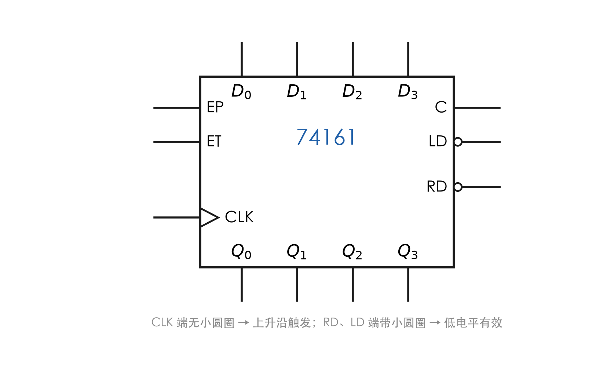
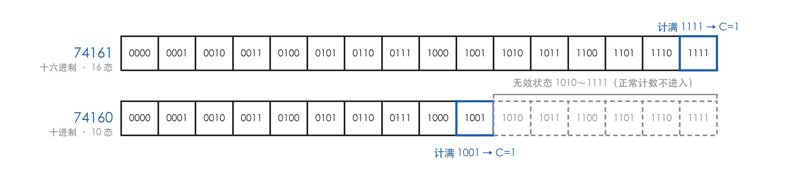
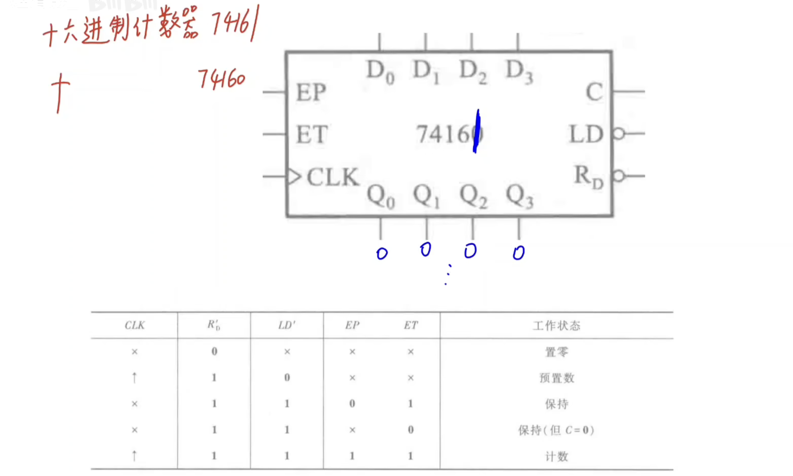
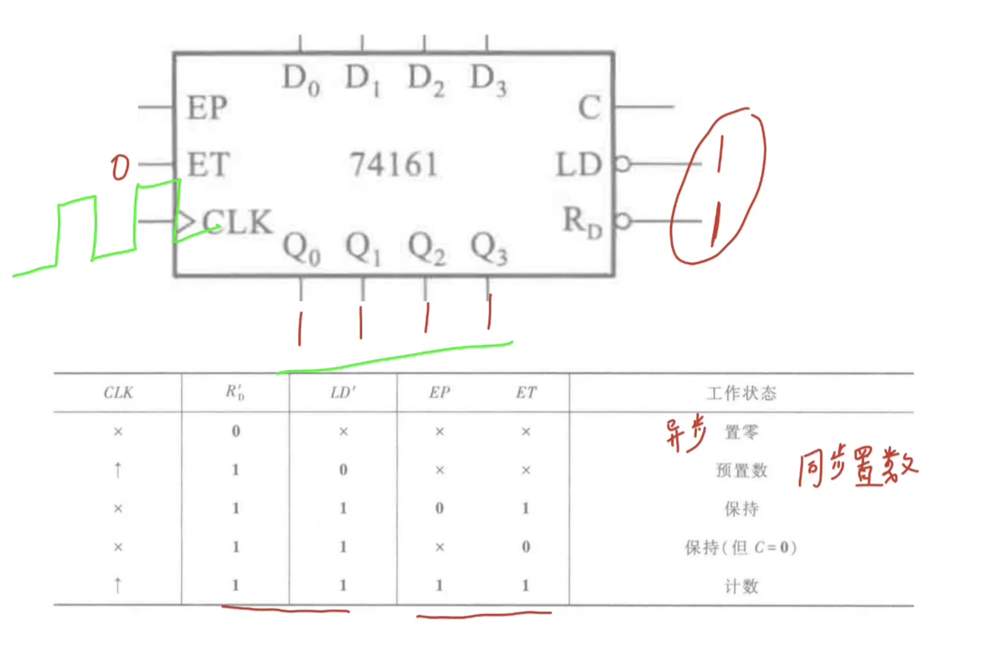

# 06 计数器

> [!abstract] 本页解决什么
> 计数器就是会「自己数数」的时序电路：每来一个时钟沿，状态按固定规律加 1。
> 本页从集成计数器 **74161 / 74160**（十六进制 / 十进制）入手，走通「认符号 → 读功能表 → 分清异步清零 / 同步置数 → 确认计数条件 → 用 C 判断进位」这条链路。
> 考试落点：**会读 74161 功能表**、**会区分异步与同步**、**会分清 160 与 161 只差计数进制**、**会用 EP·ET 控制计数与保持**。

## 一、符号速查

| 符号 | 读法 | 本页含义 |
|------|------|---------|
| CLK（CP） | 时钟 / 计数脉冲 | 74161 为**上升沿**触发（端上无小圆圈） |
| $\overline{R_D}$（$\overline{CR}$） | 清零端 | 低电平有效，**异步**：不看时钟，立即清零 |
| $\overline{LD}$（$\overline{PE}$） | 置数端 | 低电平有效，**同步**：等下一个上升沿才装入 $D$ |
| EP（CEP） | 并行计数使能 | 与 ET 同时为 1 才允许计数 |
| ET（CET） | 串行计数使能 | 同时控制进位输出 $C$ |
| $D_0\sim D_3$ | 并行数据输入 | 置数时装入的 4 位初值 |
| $Q_0\sim Q_3$ | 状态输出 | 当前计数值，$Q_3$ 为最高位 |
| C（TC） | 进位输出 | 计满时送出进位：161 在 1111，160 在 1001 |

> [!tip] 型号对照
> 课件写 **74161**，教材写 **74LVC161**，老教材写 74LS161——引脚名不同、功能完全一致：
> $\overline{R_D} \leftrightarrow \overline{CR}$，$\overline{LD} \leftrightarrow \overline{PE}$，EP $\leftrightarrow$ CEP，ET $\leftrightarrow$ CET，C $\leftrightarrow$ TC。

---

## 二、74161 的逻辑符号



> [!info] 读图要点
> - **上排四个 $D$**：并行数据入口，置数时从这里装入
> - **下排四个 $Q$**：计数结果，按 $Q_3Q_2Q_1Q_0$ 读成二进制数
> - **左边三根**：EP、ET 是「允许计数」的两个开关；CLK 端**没有小圆圈**，所以是上升沿触发
> - **右边三根**：C 是进位输出；LD、RD **带小圆圈**，都是低电平有效
> - 控制优先级：$\overline{R_D}$ > $\overline{LD}$ > EP/ET

---

## 三、功能表：五行就是五个动作

| CLK | $\overline{R_D}$ | $\overline{LD}$ | EP | ET | 工作状态 | 输出怎么变 |
|:---:|:---:|:---:|:---:|:---:|------|------|
| × | 0 | × | × | × | **异步置零** | 立即 $Q_3Q_2Q_1Q_0=0000$ |
| ↑ | 1 | 0 | × | × | **同步置数** | 沿到后 $Q_i=D_i$ |
| × | 1 | 1 | 0 | 1 | 保持 | $Q$ 不变，$C$ 仍可能为 1 |
| × | 1 | 1 | × | 0 | 保持（$C=0$） | $Q$ 不变，进位被封锁 |
| ↑ | 1 | 1 | 1 | 1 | **计数** | 每个上升沿 $+1$ |

> [!note] 原图上的红笔在标什么
> - **红圈 1（LD、RD）**：两个控制端都拉高 = 清零和置数都不动作，计数器才专心计数
> - **四条红竖线（$Q_0\sim Q_3$）**：计数结果是四位一起读，不能只看一位
> - **绿色阶梯波（CLK）**：时钟信号；CLK 端无小圆圈 → 数上升沿
> - **表下红横线**：$\overline{R_D}$ 一列标「异步」，EP、ET 两列标「同时为 1 才计数」

### 1. 两个「带圈」的端：一个异步，一个同步

这是整张表最容易扣分的地方，必须分清：

| 对比项 | 异步置零（$\overline{R_D}=0$） | 同步置数（$\overline{LD}=0$） |
|------|------|------|
| 是否看时钟 | **不看**，随时生效 | **必须等**下一个上升沿 |
| 响应时刻 | 立即回到 0000 | 沿到之后才变成 $D$ |
| 置成什么 | 固定 0000 | $D_3D_2D_1D_0$ 任意初值 |
| 用于构成 N 进制 | 反馈清零法 | 反馈置数法 |

> [!warning] 别把「清零方式」和「置数方式」混在一起
> 161、160 是**异步清零**；163、162 是**同步清零**。但四者的**置数都是同步的**。
> 所以「161 能异步清零」对，「161 能异步置数」错——置数一定要等沿。

### 2. 为什么「保持」有两行

两行的差别在 **ET 还兼管进位输出**：

$$C_{161} = Q_3 Q_2 Q_1 Q_0 \cdot ET \qquad C_{160} = Q_3 Q_0 \cdot ET$$

- **EP=0、ET=1**：触发器不翻转，但 $C$ 没有断。若此时恰好 $Q=1111$，$C$ 仍为 1。
- **ET=0**：连 $C$ 一起封死，输出恒为 0。

> [!tip] 多片级联时为什么要两个使能
> 低位片的 $C$ 接高位片的 **ET**（串行进位，逐级传递）；各片的 **EP** 并联接同一个计数允许信号（组内并行进位）。这样既保证低位计满才允许高位动作，又不会让进位逐级拖慢整个计数器。

### 3. 计数：EP 和 ET 同时为 1

- 每个 CLK 上升沿，$Q_3Q_2Q_1Q_0$ 加 1：`0000 → 0001 → … → 1111 → 0000`
- 4 位二进制共 16 个状态，所以 74161 是**模 16（十六进制）计数器**
- 四个触发器**共用 CLK**，状态同时更新，属于**同步**计数器
- $Q_0\sim Q_3$ 同时是分频输出：$Q_0$ 为 $\mathrm{CLK}/2$，$Q_1$ 为 $/4$，$Q_2$ 为 $/8$，$Q_3$ 为 $/16$
- 进位 $C$ 只在计满且 $ET=1$ 时为 1，宽度约一个时钟周期：74161 在 $1111$，74160 在 $1001$

> [!tip] 一句话背下这张表
> **清零最横（不等钟）→ 置数次之（等一个沿）→ 两个使能都点头才计数 → 否则保持。**

### 4. 74160：功能表一模一样，只改「数到几」

蓝笔把 **74161 改成 74160**，就是在说这件事：**同一个封装、同一张功能表，只换计数进制**。



> [!info] 这张图在说什么
> - 74161 是**十六进制**计数器：`0000 → 1111`，16 个状态
> - 74160 是**十进制（8421BCD）**计数器：`0000 → 1001`，10 个状态
> - 蓝笔在四个 $Q$ 下标 0：两者都是四位输出，计数都从 0000 起
> - 蓝笔下面的省略号：差别不在起点，而在**数到哪儿停**——161 数满 1111，160 数满 1001

**160 与 161 的对照**

| 芯片 | 进制 | 有效状态 | 进位条件 | 清零方式 |
|------|------|------|------|------|
| 74160 | 十进制（BCD） | $0000\sim1001$ | $C=Q_3Q_0\cdot ET$ | 异步 |
| 74161 | 十六进制 | $0000\sim1111$ | $C=Q_3Q_2Q_1Q_0\cdot ET$ | 异步 |
| 74162 | 十进制（BCD） | $0000\sim1001$ | $C=Q_3Q_0\cdot ET$ | 同步 |
| 74163 | 十六进制 | $0000\sim1111$ | $C=Q_3Q_2Q_1Q_0\cdot ET$ | 同步 |

> [!warning] 160 的两个盲点
> - **进位不在 1111 出**：160 数到 1001 就回头，$C$ 在 $Q_3=Q_0=1$（即 1001）且 $ET=1$ 时为 1。
> - **1010～1111 是无效状态**：正常计数不会进入；若上电落到这些状态，要按「检查自启动」处理，不能默认它一定回 0000。
> - 功能表的其余四行（异步置零、同步置数、两种保持、计数）与 161 完全相同。

> [!tip] 选片口诀
> **十六进制用 161，十进制用 160；要同步清零就换 163 / 162。**
> 记法看**型号末位**：奇数（161/163）是二进制，偶数（160/162）是 BCD。

> [!note]- 原始课件截图（160/161 对照，溯源）
> 

---

## 四、做题模板：看到 160/161 先问四句

```
① RD 接什么？   接译码门 = 反馈清零；接 1 = 不清零
② LD 接什么？D 端接什么？  接译码门 = 反馈置数；接 1 = 不置数
③ EP、ET 接什么？  都接 1 = 一直计数；接控制信号 = 可控计数
④ 数到哪个状态动作？  记下初态与动作状态，算模值
   （一片 160 最多做到 10 进制，一片 161 最多做到 16 进制）
```

### 这张表直接推出的两种 N 进制接法

| 方法 | 用哪个端 | 译码哪个状态 | 主循环 |
|------|------|------|------|
| 反馈清零（异步） | $\overline{R_D}$ | $S_N$（第 $N$ 个脉冲之后的状态） | $S_0\sim S_{N-1}$，$S_N$ 只闪现一下 |
| 反馈置数（同步） | $\overline{LD}$ | $S_{N-1}$（第 $N-1$ 个脉冲之后的状态） | $M\sim S_{N-1}$，共 $N=S_{N-1}-M+1$ 个 |

- 异步清零：$S_N$ 是**瞬态**，主循环里要用虚线画，且可能产生窄脉冲干扰后级。
- 同步置数：动作发生在沿上，$S_{N-1}$ 是**稳态**，主循环干净；模值由「译码状态 $X$」和「$D$ 端初值 $M$」共同决定：

$$N = X - M + 1$$

例：9 进制取 $D=0000$，则译码 $X=8$（1000）；若取 $D=0111$，则译码 $X=1111$，循环 $0111\sim1111$ 仍是 9 个状态。

---

## 五、易错点

| 易错点 | 正确做法 |
|------|---------|
| 把 161 的清零当同步 | 161 是**异步清零**：$\overline{R_D}=0$ 立即回 0；163 才是同步清零 |
| 把置数也当异步 | 161 的置数是**同步**的，$\overline{LD}=0$ 后要等上升沿 |
| 只给 EP=1 就以为能计数 | 必须 **EP=ET=1**，少一个就保持 |
| 以为 ET=0 只是不计数 | ET 还封锁进位 $C$；EP=0、ET=1 时 $C$ 仍可能为 1 |
| 忘记 CLK 是上升沿 | 符号无小圆圈 = 上升沿，画波形时 $Q$ 在 ↑ 之后更新 |
| 把 C 当普通输出 | 只在计满且 ET=1 时为 1：161 在 1111，160 在 1001 |
| 把 160 的进位也当 1111 出 | 160 在 **1001** 出进位，$C=Q_3Q_0\cdot ET$ |
| 认为 160 与 161 功能表不同 | 功能表完全相同，只差**计数进制**和**进位条件** |
| 让 160 一直数到 1111 | 160 数到 1001 就回 0000，1010～1111 是无效状态 |
| 算模值只数到译码状态 | 异步清零译码 $S_N$、主循环到 $S_{N-1}$；同步置数译码 $S_{N-1}$、循环从 $M$ 起 |

---

## 六、与前后章节的连接

- [[05-寄存器和移位寄存器]]：194 加反馈 → 环形 / 扭环形计数器。
- [[02-同步时序电路分析]]：把 74161 内部看成 4 个 T 触发器 + 进位链，可用三层方程分析。
- [[07-常见错误与考点总结]]：N 进制三种接法（异步清零 / 同步清零 / 同步置数）速查。

> [!note]- 原始课件截图（溯源）
> 
