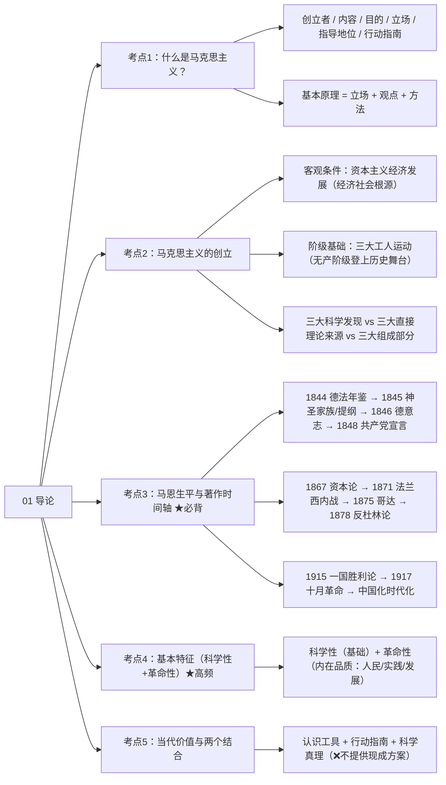

# 01-导论｜马克思主义的创立、发展与鲜明特征

> [!info] 考情定位与使用说明
> - **题型靶向**：`【仅考选择题】`（每年必出 1 道单选或 1 道多选，**绝不考 34 题分析题**）。核心考法是**「帽子题配对」「著作定性匹配」「张冠李戴避坑」**。
> - **视频来源**：[空卡《1小时学完马原》P1：01导论（08:34）](https://www.bilibili.com/video/BV1QoKJ64Ene/?p=1)
> - **配套《1000题》范围**（空卡布置）：单选 `P1-2 T1-7`；多选 `P25 T1-2`。
> - **背诵方法**：第一遍看高亮关键词与表格扫雷；第二遍直接滑到每节末尾的「假装当老师·遮挡自测」，遮住折叠块开口复述（留存率 90%）。

---

## 🗺️ 全节思维导图（还原视频框架）

---

## 一、马恩生平与经典著作时间轴（视频 [00:00–03:55]）`【仅考选择·高频必背】`

空卡在视频前半段用一条完整的人物故事线串起了马克思（1818.5.5 出生于德国律师家庭）与恩格斯（1820 出生于工厂主家庭）的核心著作。**考研政治单选第 1 题极爱考著作与历史地位的一一对应！**

> [!note]- 原始视频板书截图（溯源：P1 时间轴）
> ![[考研政治/1-马原/assets/01-导论-马恩生平时间轴1.jpg]]
> ![[考研政治/1-马原/assets/01-导论-马恩生平时间轴2.jpg]]

### 1.1 马克思与恩格斯创立阶段著作全表

| 年份（年龄） | 关键事件 / 经典著作 | 核心历史地位与考纲「帽子」词（必背秒选） |
| :--- | :--- | :--- |
| **1841**（23岁） | 博士毕业，任《莱茵报》主编 | 批判沙皇专制与林木盗窃法（开始由唯心转向唯物） |
| **1844** | 创办**《德法年鉴》**（马恩巴黎咖啡馆相见） | 发表上面的一系列论文，表明完成了==两个转变==：**① 从唯心主义向唯物主义转变；② 从革命民主主义向共产主义转变**，为创立马克思主义==奠定了思想前提==。 |
| **1845** | **《神圣家族》** | 马克思、恩格斯==第一次合写的批判著作==。 |
| **1845** 春 | **《关于费尔巴哈的提纲》** | 恩格斯称为==“包含着新世界观天才萌芽的第一个文件”==（核心：确立了科学的**实践观**）。 |
| **1846**（1845-1846） | **《德意志意识形态》** | ==首次系统阐述了历史唯物主义的基本观点==（第一次把唯物史观系统讲清楚）。 |
| **1847** | 正义者同盟 $\rightarrow$ **共产主义者同盟** | 世界上==第一个无产阶级政党==。 |
| **1848.2**（30岁） | **《共产党宣言》** | 为共产主义者同盟起草的党纲；==标志着马克思主义的公开问世==！ |
| **1864** | 国际工人协会（**第一国际**）成立 | 马克思是它的==灵魂==。 |
| **1867** | **《资本论》**（第一卷出版） | 被誉为==“工人阶级的圣经”==（系统阐述**剩余价值学说**）。 |
| **1871** | 巴黎公社 $\leftarrow$ **《法兰西内战》** | 科学==总结了巴黎公社的历史经验==。 |
| **1875** | **《哥达纲领批判》** | 进一步丰富了==科学社会主义==学说（提出共产主义第一阶段与高级阶段、按劳分配等）。 |
| **1878**（60岁） | 恩格斯**《反杜林论》** | 全面阐述马克思主义理论体系，被称为==“马克思主义的百科全书”==。 |
| **1883后** | 《家庭、私有制和国家的起源》《路德维希·费尔巴哈和德国古典哲学的终结》 | 1883年马克思逝世后，恩格斯整理出版《资本论》二、三卷，并撰写这两部著作，进一步丰富发展了马克思主义。（1895年恩格斯逝世） |

### 1.2 列宁主义与中国化时代化阶段（视频 [03:35–04:20]）

| 年份 | 历史节点 / 著作 | 核心考点与「帽子」词 |
| :--- | :--- | :--- |
| **1915 / 1916** | 列宁《论欧洲联邦口号》《无产阶级革命的军事纲领》 | 提出==“一国或数国首先胜利论”==（帝国主义时代资本主义政治经济发展不平衡，社会主义革命可能在一国或数国首先发生并取得胜利）。 |
| **1917** | **俄国十月社会主义革命** | 使社会主义==从理想开始变为现实==（从理论到现实），建立了世界上**第一个社会主义国家（苏俄）**，开创了世界历史的新纪元，创立了**列宁主义**。 |
| **1919** | **五四运动** | **中国无产阶级**开始作为独立的政治力量登上历史舞台，促进了马克思主义在中国的传播。 |
| **1920** | **陈望道**翻译《共产党宣言》 | 第一个中文全译本（“真理的味道非常甜”）。 |
| **1921** | **中国共产党成立** | 坚持把马克思主义基本原理**同中国具体实际相结合、同中华优秀传统文化相结合**（两个结合），先后产生了毛泽东思想和中国特色社会主义理论体系（含习近平新时代中国特色社会主义思想）。 |

> [!tip] 空卡秒记口诀：著作定性防混
> - **《德法年鉴》**：**两个转变**（唯心$\to$唯物、革命民主$\to$共产），奠定**思想前提**（注意：**还没正式诞生**！）。
> - **《神圣家族》**：第一次**合写**；**《费尔巴哈提纲》**：**天才萌芽**第一个文件；**《德意志意识形态》**：首次系统阐述**历史唯物主义**。
> - **《共产党宣言》（1848）**：**公开问世**（正式诞生标志）！
> - **《资本论》**：工人阶级的**圣经**；**《反杜林论》**：恩格斯写的**百科全书**。

---

## 二、考点1 & 考点2：马克思主义是什么？如何创立？（视频 [04:00–05:55]）`【仅考选择】`

> [!note]- 原始视频板书截图（溯源：P1 考点1～考点3讲义）
> ![[考研政治/1-马原/assets/01-导论-考点1与考点2讲义.jpg]]

### 2.1 考点1：什么是马克思主义与马克思主义基本原理？

1. **六个维度理解「马克思主义」**：
   - **从创立者/继承者讲**：是由马克思、恩格斯创立并为后继者所不断发展的科学理论体系。
   - **从研究对象/主要内容讲**：是关于==自然、社会和人类思维发展一般规律==的学说（**注意**：是“一般规律”，不是具体科学的具体规律！）。
   - **从历史使命/最终目的讲**：是关于社会主义**必然**代替资本主义、最终实现共产主义的学说。
   - **从阶级属性/政治立场讲**：是关于==无产阶级解放、全人类解放和每个人自由而全面发展==的学说。
   - **从地位讲**：是无产阶级政党和社会主义国家的**指导思想**。
   - **从意义和作用讲**：是指引人民创造美好生活的**行动指南**。
2. **什么是「马克思主义基本原理」**：
   - 是对马克思主义==立场、观点和方法==的集中概括，是马克思主义在其形成、发展和运用过程中经过实践反复检验而确立起来的具有**普遍真理性**的理论。

### 2.2 考点2：马克思主义创立的条件、来源与组成部分（必考三维对应表！）

- **社会根源（经济社会客观条件）**：==资本主义经济的发展==（资本主义固有矛盾即生产社会化与生产资料私人占有之间的矛盾尖锐化）。
- **阶级基础（现实需求）**：**无产阶级**在反抗资产阶级剥削和压迫的斗争中，逐步从**自发走向自觉**。
  - **标志事件**：**19 世纪 30-40 年代三大工人运动**（==法国里昂工人起义、英国宪章运动、德国西里西亚纺织工人起义==），标志着==现代无产阶级作为独立的政治力量登上了历史舞台==（区分：中国无产阶级登上历史舞台是 1919 五四运动）。
- **主观条件与理论架构（三行四列对位表，横向纵向都必背！）**：

| 维度 | 第一列（哲学线） | 第二列（政治经济学线） | 第三列（科学社会主义线） |
| :--- | :--- | :--- | :--- |
| **自然科学前提** （19世纪三大科学发现） | **能量守恒与转化定律** | **细胞学说** | **生物进化论** |
| **直接理论来源** （19世纪西欧三大先进思潮） | ==德国古典哲学== （黑格尔辩证法“合理内核”+费尔巴哈唯物主义“基本内核”） | ==英国古典政治经济学== （亚当·斯密、大卫·李嘉图） | ==英法空想社会主义== （圣西门、傅立叶、欧文） |
| **三大组成部分** （及其在整个体系中的定位） | **马克思主义哲学** （地位：==基础 / 世界观方法论基础==） | **马克思主义政治经济学** （地位：==主要内容 / 研究对象==） | **科学社会主义** （地位：==核心、结论、归宿==） |
| **各部分自身的「基石/枢纽」** | 基石：==世界的物质统一性原理== | 基石：==剩余价值学说== 理解政治经济学的枢纽：==劳动二重性理论== | 理论基础（两大伟大发现）： ==唯物史观 + 剩余价值学说== |

> [!warning] 常见干扰项（❌ 错 vs ✅ 对）
> - ❌ **错误说法**：「马克思主义直接吸收了十九世纪西欧三大先进思潮的全部内容 / 机械相加。」
> - ✅ **正确说法**：是**批判地继承、吸收其合理成分**并加以改造。
> - ❌ **错误说法**：「劳动二重性学说是马克思主义政治经济学的基石。」
> - ✅ **正确说法**：**劳动二重性**是理解政治经济学的==枢纽==；**剩余价值学说**才是马克思主义政治经济学的==基石==；而**世界的物质统一性原理**是整个马克思主义（及马哲）的==基石==！
> - ❌ **错误说法**：「三大伟大发现是唯物史观、剩余价值学说和辩证唯物主义。」
> - ✅ **正确说法**：马克思一生的==两大伟大发现==是**唯物史观**和**剩余价值学说**，正是这两大发现使社会主义**从空想变成了科学**！

---

## 三、考点4 & 考点5：基本特征与当代价值（视频 [05:55–08:34]）`【仅考选择·超高频】`

> [!note]- 原始视频板书截图（溯源：P1 考点4与考点5讲义）
> ![[考研政治/1-马原/assets/01-导论-考点4与考点5讲义.jpg]]

### 3.1 考点4：马克思主义的基本特征

- **如果用一句话概括**：==科学性与革命性的统一==。
- **如果用四个词概括**：==科学性、人民性、实践性、发展性==。
  - **内在逻辑关系**：**科学性是基础**；**人民性、实践性、发展性集中体现为革命性**（革命性是马克思主义的内在品质，建立在科学性基础之上）。

| 四大特征 | 核心定位与唯一专属「帽子」词（张冠李戴重灾区！） |
| :--- | :--- |
| **1. 科学性** | ① 是对自然、社会和人类思维发展本质和规律的**正确反映**。 ② **突出特征和理论优势**（也是马克思主义具有强大生命力的**根本原因**）：具有==科学的世界观和方法论基础==，即**辩证唯物主义和历史唯物主义**。 |
| **2. 人民性** | ① 人民性是马克思主义的==本质属性==、==最鲜明的品格==。 ② **人民至上**是马克思主义的==政治立场==。 ③ 是以**阶级性**为深刻基础的，是无产阶级先进性的体现。 ④ 马克思主义博大精深，归根到底就是一句话：==为人类求解放==。 |
| **3. 实践性** | ① 实践性是马克思主义理论==区别于其他理论的显著特征==（或根本特征）。 ② **实践的观点**是马克思主义==首要的和基本的观点==。 |
| **4. 发展性** | ① 是不断发展的**开放的学说**，具有==与时俱进的理论品质==。 ② 不断吸收人类历史上一切优秀文明成果而不断丰富自己（既坚持又发展，反对教条主义）。 |

### 3.2 考点5：马克思主义的当代价值与重要表述

1. **三大当代价值**：
   - （1）观察当代世界变化的==认识工具==；
   - （2）指引当代中国发展的==行动指南==；
   - （3）引领人类社会进步的==科学真理==。
2. **二十大核心表述与「根脉/魂脉」拆解**（视频重点勾画）：
   - **名言**：“中国共产党为什么能，中国特色社会主义为什么好，归根到底是**马克思主义行**，是**中国化时代化的马克思主义行**。”
   - **为什么马克思主义“行”？（根本原因）**：因为马克思主义是==科学的世界观和方法论==（辩证唯物主义和历史唯物主义）。
   - **魂脉 vs 根脉**：
     - **魂脉**：==马克思主义==；
     - **根脉**：==中华优秀传统文化==（中华优秀传统文化也是中华民族的**根和魂**）。

> [!warning] 常见干扰项（❌ 错 vs ✅ 对）
> - ❌ **万能错项（见到必排）**：「马克思主义为中国革命、建设、改革提供了==现成的方案 / 具体道路 / 固定模式 / 具体方法==。」
> - ✅ **正确说法**：马克思主义只提供科学的世界观和**方法论指导 / 行动指南**，**绝不提供现成方案或具体解决路径**！
> - ❌ **帽子错配**：「实践性是马克思主义的政治立场 / 本质属性。」
> - ✅ **秒杀口诀**：**政治立场看人民（人民至上/本质属性/最鲜明品格），区别其他看实践（显著特征/首要基本观点），与时俱进看发展**。

---

## 📌 【考纲 & 历年真题补全】P1 视频未展开的高频细节

1. **📌【考纲补全】马克思恩格斯实现“两个转变”的对比著作**：
   - **马克思**：1844年发表在《德法年鉴》上的《〈黑格尔法哲学批判〉导言》《论犹太人问题》。
   - **恩格斯**：1844年发表在《德法年鉴》上的《政治经济学批判大纲》《英国状况——评托马斯·卡莱尔的“过去和现在”》。
2. **📌【考纲补全】《自然辩证法》（恩格斯）**：
   - 视频提了《反杜林论》，考纲同时要求掌握恩格斯的《自然辩证法》——奠定了**马克思主义自然观和自然科学方法论**的基础。
3. **📌【真题高频陷阱】科学社会主义与空想社会主义的区别**：
   - 19世纪英法空想社会主义（圣西门、傅立叶、欧文）虽然抨击了资本主义的种种弊端，提出了许多美妙的天才设想，但**唯心史观**使他们看不到人民群众特别是**无产阶级**的力量，找不到实现社会主义的正确道路（拒绝阶级斗争和暴力革命）。

---

## 🎙️ 假装当老师·遮挡自测（念逐字稿留存 90%）

请遮住下方折叠块，对着问题大声像讲课一样复述出来，再点开核对：

1. **1844《德法年鉴》、1845《神圣家族》与《提纲》、1846《德意志意识形态》、1848《共产党宣言》、1867《资本论》、1878《反杜林论》各自的唯一标志语是什么？** ⌜⌟
2. **马克思主义的三大直接理论来源、三大组成部分，以及哲学/政经/科社各自的“基石/理解枢纽/理论基础”分别是什么？** ⌜⌟
3. **“一句话概括基本特征”是什么？“人民性、实践性、发展性”各自对应的专属帽子词是什么？** ⌜⌟
4. **“马克思主义行”的根本原因是什么？中国的“魂脉”和“根脉”分别是什么？选择题里见到什么词直接排掉？** ⌜⌟

> [!note]- 点击核对本节复述标准答案
> 1. **著作定性**：
>    - 1844《德法年鉴》：完成**两个转变**（唯心$\to$唯物、革命民主$\to$共产），奠定**思想前提**。
>    - 1845《神圣家族》：马恩**第一次合写**；1845《关于费尔巴哈的提纲》：包含新世界观**天才萌芽**的第一个文件。
>    - 1846《德意志意识形态》：**首次系统阐述历史唯物主义**基本观点。
>    - 1848《共产党宣言》：标志马克思主义**公开问世**。
>    - 1867《资本论》：工人阶级的**圣经**；1878《反杜林论》：马克思主义的**百科全书**。
> 2. **三来源与三部分**：
>    - **三大直接理论来源**：德国古典哲学、英国古典政治经济学、英法空想社会主义（自然科学前提是细胞学说、能量守恒与转化定律、生物进化论）。
>    - **三大组成部分**：马哲（基础，基石是**世界物质统一性原理**）、马政经（主要内容，基石是**剩余价值学说**，理解枢纽是**劳动二重性理论**）、科社（核心与结论，理论基础是**唯物史观+剩余价值学说**两大发现）。
> 3. **四大特征帽子词**：
>    - 一句话：**科学性与革命性的统一**（科学性是基础，人民/实践/发展集中体现为革命性）。
>    - **人民性**：**本质属性、最鲜明的品格**；人民至上是**政治立场**；归根到底一句话是**为人类求解放**。
>    - **实践性**：**区别于其他理论的显著特征**；实践观点是**首要的和基本的观点**。
>    - **发展性**：与时俱进的理论品质（开放的学说）。
> 4. **当代价值与避坑**：
>    - 根本原因：具有**科学的世界观和方法论基础**（辩证唯物主义和历史唯物主义）。
>    - 魂脉是**马克思主义**，根脉是**中华优秀传统文化**。
>    - 避坑：见到“提供**现成方案 / 具体道路 / 固定模式**”直接打 ❌！
