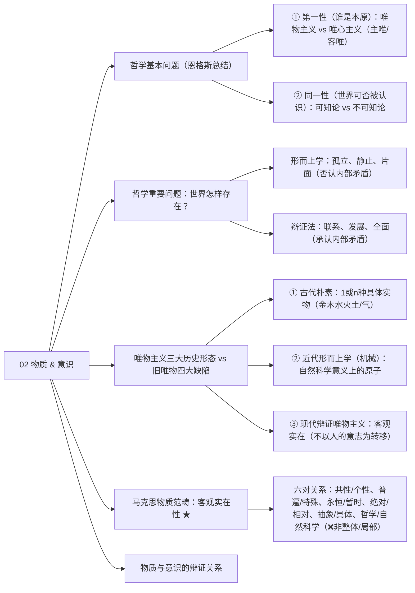

# 02-物质&意识｜哲学基本问题、各大流派秒判与物质范畴

> [!info] 考情定位与使用说明
> - **题型靶向**：
>   - **哲学基本问题与派别判断（主观唯心 / 客观唯心 / 三种唯物主义）**：`【仅考选择题】`（每年单选必考 1 道“名人名言/古诗文站队题”）。
>   - **物质与意识的辩证关系**：`【选择题 + 分析题储备】`。
> - **视频来源**：[空卡《1小时学完马原》P2：02物质&意识（09:18）](https://www.bilibili.com/video/BV1QoKJ64Ene/?p=2)
> - **配套《1000题》范围**（空卡布置）：单选 `P2 T9-11`（第8题放到03节做）；多选 `P26 T3-7`。

---

## 🗺️ 全节思维导图（还原视频一页纸板书）

> [!note]- 原始视频板书截图（溯源：P2 完整思维导图）
> ![[考研政治/1-马原/assets/02-物质与意识-完整板书.jpg]]

---

## 一、哲学基本问题与唯心主义两大派别秒杀（视频 [00:00–03:30]）`【仅考选择·单选必考】`

### 1.1 面对世界现象的两个动作与哲学基本问题

我们面对大千世界的现象，只有两个基本动作：**认识世界**（形成意识/精神/思维）和**改造世界**（接触物质/存在）。
恩格斯总结：**全部哲学，特别是近代哲学的重大的基本问题，是==思维和存在的关系问题==（或精神和物质、意识和物质的关系问题）。** 它包含两个方面：

| 哲学基本问题的两个方面 | 核心提问 | 划分出的哲学阵营 | 常见拓展概念 |
| :--- | :--- | :--- | :--- |
| **第一方面（首要方面）** | **① 谁是本原？（谁为第一性）** 物质和精神何者是第一性、何者是第二性？ | **唯物主义**：物质第一性，物质决定意识（一元论）。 **唯心主义**：意识第一性，意识决定物质。 | **一元论**：承认世界只有一个本原（包括唯物主义一元论和**彻底的**唯心主义一元论）。 **二元论**（如笛卡尔）：认为物质和精神都是世界本原 $\rightarrow$ 最终滑向**不彻底的唯心主义**。 |
| **第二方面** | **② 有无同一性？（世界是否可知）** 思维能否认识或正确认识存在？ | **可知论**：思维和存在具有同一性，世界可以被认识（**一切唯物主义者** + **彻底的唯心主义者**如黑格尔都是可知论！）。 **不可知论**：否认认识世界的可能性，或者至少否认彻底认识世界的可能性（代表：休谟、康德，属于**不彻底的唯心主义**）。 | 不可知论把人的认识局限于现象界，认为人无法认识事物的本质（“自在之物”）。 |

### 1.2 主观唯心主义 vs 客观唯心主义（空卡口诀秒杀）

唯心主义内部根据“作为世界本原的精神是**人肚子里的主观精神**，还是**脱离人而独立存在的神秘客观精神**”，分为两大派别：

> [!tip] 空卡秒杀口诀：**“主观我心人，客观理道神”**

| 哲学派别 | 核心判定词（题干出现即秒选） | 经典名言与代表人物（视频逐一拆解） |
| :--- | :--- | :--- |
| **主观唯心主义** （本原是**人的主观精神**，夸大为主观意志即**唯意志论**） | ==我、心、人、理性（人的理性）、观念（人的感知观念）、感觉、思想、意志== | - **笛卡尔**：“我思故我在” - **康德**：“人的**理性**为自然界立法”（理性为自然法则） - **贝克莱**：“存在就是被感知”、“**世界是观念的集合**”（注：贝克莱这里的“观念”指人的感觉印象） - **王阳明（陆王心学）**：“心外无物，心外无理”、“吾心即是宇宙” - **孟子**：“万物皆备于我” / **慧能**：“仁者心动” |
| **客观唯心主义** （本原是**脱离人的客观精神**） | ==理（理念/天理）、道、神（上帝）、绝对观念、宗教、绝对精神、宇宙精神== | - **柏拉图**：“理念论”（现实世界是理念世界的影子） - **黑格尔**：“**绝对精神**”/“**绝对观念**”（注意：带“绝对”二字的观念/精神是客观唯心！） - **老子**：“**道**生一，一生二，二生三，三生万物” - **朱熹（程朱理学）**：“**理**在事先”、“未有此气，已有此理” - 宗教神创论（上帝创世）、宿命论（生死有命，富贵在天） |

> [!warning] 常见干扰项（❌ 错 vs ✅ 对）—— 空卡视频现场互动提问陷阱！
> - **陷阱1（“观念”二字辨析）**：
>   - 看到“世界是**观念**的集合”（贝克莱：我的感觉观念）$\rightarrow$ ✅ **主观唯心主义**！
>   - 看到“世界是**绝对观念 / 理念**的产物”（黑格尔/柏拉图）$\rightarrow$ ✅ **客观唯心主义**！
> - **陷阱2（可知论与唯心主义的关系）**：
>   - ❌ **错误说法**：「唯物主义都是可知论，唯心主义都是不可知论。」
>   - ✅ **正确说法**：**彻底的唯心主义（如黑格尔）也是可知论**（认为绝对精神能认识它自己创造的世界）；只有**不彻底的唯心主义（二元论/休谟/康德）**才是不可知论。

---

## 二、哲学重要问题与唯物主义三大历史形态（视频 [03:30–07:45]）`【仅考选择·超高频】`

### 2.1 哲学重要问题：世界是怎样存在的？（辩证法 vs 形而上学）

- **形而上学**：认为世界是==孤立的、静止的、片面的==。
- **辩证法**：认为世界是==联系的、发展的、全面的==。
- **二者的根本区别（分水岭）**：==是否承认事物的内部矛盾是事物发展的根本动力和源泉==！（辩证法承认矛盾，形而上学否认矛盾）。

### 2.2 唯物主义的三种历史形态对比

| 历史形态 | 把“物质”归结为什么？ | 典型命题 / 代表 | 局限性（为什么被超越？） |
| :--- | :--- | :--- | :--- |
| **① 古代朴素唯物主义** | 归结为**1种或n种具体的“实物”** | 中国：**五行说**（金木水火土）、**阴阳二气**（王夫之/张载“气者，理之依也”）、**形神论**（范缜“形存则神存，形谢则神灭”）。 古希腊：泰勒斯（水）、赫拉克利特（火）、德谟克利特（早期朴素原子论）。 | 具有直观性、猜测性，缺乏科学论证，把物质等同于某一种或几种具体物质形态。 |
| **② 近代形而上学唯物主义** （半截子唯物主义 / 机械唯物主义） | 归结为自然科学意义上的**“原子”**（认为原子是最小的、不可再分的物质微粒，原子的属性就是一切物质的属性） | 17-18世纪英法唯物主义（培根、霍布斯、洛克、狄德罗）、19世纪德国**费尔巴哈**。 | **四大缺陷**（见下方详表）：**机械性、形而上学性、直观性（缺乏实践观）、不彻底性（半截子：自然观唯物，历史观唯心）**。 |
| **③ 现代辩证唯物主义** （马克思主义唯物主义） | 归结为一切具体物质的共性——**“客观实在”**（不以人的意志为转移） | 马克思、恩格斯、列宁（列宁物质定义）。 | 克服了旧唯物主义的一切缺陷，把唯物主义与**辩证法**、**实践观**、**唯物史观**有机统一起来。 |

### 2.3 旧唯物主义（近代形而上学唯物主义） vs 马克思主义唯物主义 四维终极对比表

这是空卡板书右下方最核心的表格，**几乎每年多选题必考一行**：

| 对比维度 | 旧唯物主义（半截子、不彻底的唯物主义） | 马克思主义唯物主义（现代辩证唯物主义） | 核心区分点详解（空卡精讲） |
| :--- | :--- | :--- | :--- |
| **1. 辩证法** | ❌ **没有辩证法**（是形而上学，用孤立、静止的眼光看世界） | ✅ **有唯物辩证法**（联系、发展、承认矛盾） | 旧唯物主义受当时牛顿经典力学影响，用机械力学的尺度衡量一切。 |
| **2. 认识论** | **消极被动的“机械反映论”**（直观反映论，像照镜子/拍照一样机械复写，不懂实践的作用） | **积极能动的“能动反映论”**（以**实践**为基础，不仅反映现象还能透过现象把握本质和规律，并具有创造性） | 旧唯物主义与马克思在认识论上的共同点是**都坚持反映论**（从物到感觉和思想）；区别在于**是否引入实践和辩证法**！ |
| **3. 意识观** | ❌ **忽视意识的主观形式**（认为一种物质只能决定一种意识；甚至庸俗唯物主义认为“人脑分泌思想就像肝脏分泌胆汁”，把意识直接等同于物质） | ✅ **客观内容 + 主观形式的统一**（意识的内容来自客观物质世界，但表现形式带有人的主观色彩，“仁者见仁，智者见智”） | 面对同一个月亮（同一客观物质），李白写出豪放诗，林黛玉写出悲伤词，因为意识是**客观内容与主观形式的统一**，且对物质有**能动反作用**。 |
| **4. 历史观** | **唯心史观**（**“半截子唯物主义”**：在**自然观**上是唯物的，但一进入到**社会历史领域**就陷入唯心主义，认为英雄人物/思想动机决定历史） | **唯物史观**（将唯物主义贯彻到社会历史领域，是**彻底的**唯物主义） | **区分唯物史观与唯心史观的分水岭**：对==社会存在与社会意识何者为第一性==的不同回答！ |

> [!warning] 常见干扰项（❌ 错 vs ✅ 对）
> - ❌ **错误说法**：「旧唯物主义被称为“半截子唯物主义”，是因为它在自然观上也是半唯物半唯心的。」
> - ✅ **正确说法**：旧唯物主义在**自然观上是唯物的**！“半截子”特指它**在自然观上唯物，在历史观上唯心**（没有把唯物主义贯彻到社会历史领域）。

---

## 三、马克思的「物质」范畴与物质意识辩证关系（视频 [04:05–09:18]）`【选择+分析大题储备】`

### 3.1 列宁的物质定义与物质的唯一特性

- **列宁物质定义**：“物质是标志**客观实在**的哲学范畴，这种客观实在是人通过感觉感知的，它不依赖于我们的感觉而存在，为我们的感觉所复写、摄影、反映。”
  - 从**物质与意识的对立统一关系**中去把握物质（因为物质和意识是哲学里最大的两个概念，没法用更高属概念定义，只能用二者关系定义）。
  - 同时体现了**唯物论**（不依赖于我们的感觉而存在）和**可知论**（人通过感觉感知、复写、摄影、反映）。
- **物质的唯一特性**：==客观实在性==（即**不以人的意志为转移**）。（注意区分第03节：物质的**根本属性/存在方式**是**运动**！**唯一特性**是**客观实在性**！）

### 3.2 哲学上的“物质（客观实在）”与“具体物质形态（无限样本）”的六对关系（视频右下角必背！）

马克思是如何定义“物质”的？他把世界上无限多的具体物质样本（桌子、椅子、水、火、原子、磁场、太阳系……）摆在一起，抽出它们共同的特性——**不以人的意志为转移（客观实在性）**。
因此，**哲学上的“物质”概念** 与 **具体科学中的“具体物质形态”** 之间，满足以下**六对关系（全部打 ✅，唯独一对打 ❌）**：

| 序号 | 哲学上的“物质”（客观实在） | 具体的物质形态（水、火、原子、桌子等） | 选择题判断 |
| :---: | :---: | :---: | :---: |
| ① | **共性** | **个性** | ✅ 正确 |
| ② | **普遍** | **特殊** | ✅ 正确 |
| ③ | **永恒**（物质本身不生不灭） | **暂时**（具体形态有生有灭） | ✅ 正确 |
| ④ | **绝对** | **相对** | ✅ 正确 |
| ⑤ | **抽象**（需通过抽象思维概括） | **具体**（感官可直接感知） | ✅ 正确 |
| ⑥ | **哲学概念** | **自然科学概念** | ✅ 正确 |
| 🚫 **避坑** | ❌ **整体（总和）** | ❌ **局部（部分）** | ❌ **绝对错误！**（哲学上的物质不是各种具体物质形态机械相加的“总和”或“整体与部分关系”！） |

### 3.3 物质与意识的辩证关系（板书左上角三角模型）

1. **区别（对立）**：
   - **物质**是本原（第一性），是客观实在；**意识**是派生物（第二性），是==客观内容和主观形式的统一==。二者不能等同（把意识等同于物质是庸俗唯物主义；把物质等同于意识是唯心主义）。
2. **联系（统一）**：
   - **① 物质决定意识**：意识在根源上由物质产生，内容来自客观物质世界。
   - **② 意识对物质具有能动的反作用**：意识可以通过**指导实践**来**改造客观物质世界**。
   - **③ 相互转化与依赖的中介——实践**：物质可以转化为（变成）意识，意识也可以通过**实践**转化为物质（变成现实的东西），但**意识转化为物质必须依赖于物质条件和实践活动**！

> [!tip] 34 题分析题原理背诵卡（如需用到唯物论原理）
> - **【原理亮剑句】**：辩证唯物主义认为，物质决定意识，意识是客观世界的主观映象，是客观内容和主观形式的统一；同时，意识对物质具有能动的反作用，正确的意识能够指导人们的实践活动，促进客观事物的发展。
> - **【方法论句】**：这要求我们一切从实际出发，实事求是，把发挥主观能动性与尊重客观规律结合起来，通过实践把观念的存在转化为现实的存在。

---

## 🎙️ 假装当老师·遮挡自测（念逐字稿留存 90%）

1. **哲学基本问题的两个方面分别是什么？分别划分出了什么派别？“世界是观念的集合”和“绝对观念”分别是什么派别？口诀是什么？** ⌜⌟
2. **辩证法与形而上学的根本区别是什么？唯物主义的三种历史形态分别把物质归结为什么？** ⌜⌟
3. **旧唯物主义（半截子唯物主义）在“辩证法、认识论、意识观、历史观”四个维度上和马克思主义唯物主义有什么区别？** ⌜⌟
4. **物质的“唯一特性”是什么？哲学上的物质与具体物质形态是哪六对关系？不是什么关系？** ⌜⌟

> [!note]- 点击核对本节复述标准答案
> 1. **基本问题与主客观唯心**：
>    - 第一方面：**思维和存在何者为第一性（谁是本原）** $\rightarrow$ 划分**唯物主义**与**唯心主义**。
>    - 第二方面：**思维和存在有无同一性（世界是否可知）** $\rightarrow$ 划分**可知论**与**不可知论**。
>    - 口诀：**“主观我心人，客观理道神”**。“世界是观念的集合”（人的感觉观念）是**主观唯心**；“绝对观念/理念/理/道/神”是**客观唯心**。
> 2. **辩证法 vs 形而上学 & 三种唯物主义**：
>    - 根本区别：**是否承认矛盾**（内部矛盾是事物发展的根本动力）。
>    - 三种唯物主义：① **古代朴素唯物主义**（1种或n种具体实物，如金木水火土、气）；② **近代形而上学唯物主义**（自然科学意义上的**原子**）；③ **现代辩证唯物主义**（**客观实在**）。
> 3. **旧唯物 vs 马哲四维对比**：
>    - ① 辩证法：旧唯物无辩证法（形而上学） vs 马哲有辩证法；
>    - ② 认识论：旧唯物是**机械/直观反映论** vs 马哲是**能动反映论**；
>    - ③ 意识观：旧唯物忽视意识的主观形式与能动反作用 vs 马哲认为意识是**客观内容与主观形式的统一**且有能动作用；
>    - ④ 历史观：旧唯物是**唯心史观**（自然观唯物、历史观唯心，故称半截子） vs 马哲是**唯物史观**（区分标志是社会存在与社会意识的关系）。
> 4. **物质唯一特性与六对关系**：
>    - 物质的唯一特性：**客观实在性**（不以人的意志为转移）。
>    - 六对关系：**共性与个性、普遍与特殊、永恒与暂时、绝对与相对、抽象与具体、哲学概念与自然科学概念**。
>    - 避坑：**绝不是“整体与局部 / 总和与部分”的关系**！
