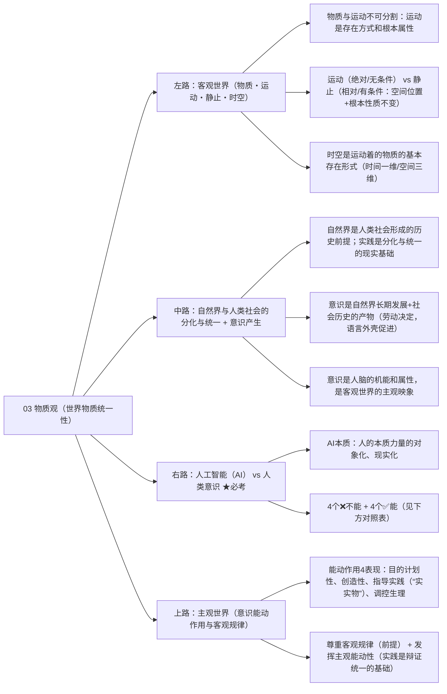

# 03-物质观｜运动与静止、时空观、意识与人工智能、主观能动性

> [!info] 考情定位与使用说明
> - **题型靶向**：
>   - **物质与运动、运动与静止、物质运动与时空**：`【仅考选择题·单选/多选高频】`（必考古诗文/名人名言判断：是唯心、形而上学还是相对主义诡辩论）。
>   - **意识的起源本质 + 人工智能（AI）**：`【选择题·近5年多选顶流必考】`（AI 能做什么 vs 不能做什么）。
>   - **主观能动性与客观规律的辩证统一、人与自然和谐共生**：`【选择题 + 34题分析题核心储备】`。
> - **视频来源**：[空卡《1小时学完马原》P3：03物质观（11:52）](https://www.bilibili.com/video/BV1QoKJ64Ene/?p=3)
> - **配套《1000题》范围**（空卡布置）：单选 `P2 T8`、`P2-3 T12-21`；多选 `P26-28 T8-21`。

---

## 🗺️ 全节思维导图（还原视频一页纸完整板书）

> [!note]- 原始视频板书截图（溯源：P3 完整思维导图）
> ![[考研政治/1-马原/assets/03-物质观-完整板书.jpg]]

---

## 一、物质与运动、运动与静止、物质运动与时空（视频 [00:00–05:15]）`【仅考选择·超高频】`

### 1.1 物质与运动：不可分割（板书左下第一把菜刀🔪）

- **核心定位**：**运动**是标志一切事物和现象的变化及其过程的哲学范畴。运动是物质的==存在方式==和==根本属性==。（再强调一次：物质的**唯一特性**是**客观实在性**；物质的**根本属性/存在方式**是**运动**！）
- **不可分割的两个方面（设想拆开就会犯两种错误）**：
  1. **物质是运动的物质（设想无运动的物质 $\rightarrow$ ❌ 形而上学）**：世界上没有不运动的物质。否认运动，把事物看作绝对僵死不变的，就会陷入**形而上学**（如“刻舟求剑”、“飞矢不动”）。
  2. **运动是物质的运动（设想无物质的运动 $\rightarrow$ ❌ 唯心主义）**：物质是一切运动变化和发展过程的实在基础和承担者。如果否认物质承担者，认为“**事物是不存在的，存在的只有运动**”或“不是风动，不是幡动，仁者心动”，就会陷入**唯心主义**。

### 1.2 运动与静止：绝对与相对的对立统一

- **什么是静止？** 静止是物质运动在一定条件下的稳定状态，包括两种情形（**只要满足其一即为相对静止**）：
  - ① **特定空间相对位置**暂时未变（如你坐在高铁上，相对于高铁座椅你是静止的）；
  - ② **事物的根本性质**暂时未变（处于量变阶段，尚未发生质变，如今天的你和昨天的你虽然细胞在代谢，但依然是你）。
- **辩证关系**：
  - **运动**是==绝对的、无条件的==（无时无刻不在变）；**静止**是==相对的、有条件的、暂时的==。
  - **联系**：运动和静止相互依赖、相互渗透、相互包含，“**动中有静，静中有动**”（例：毛泽东“**坐地日行八万里，巡天遥看一千河**”——“坐地”是相对静止，“日行八万里”是绝对运动）。
  - **核心帽子词**：==静止是运动的特殊状态==，==静止是运动的衡量尺度==！（如果不承认相对静止，我们就无法衡量运动，甚至无法区分事物）。
- **割裂运动与静止会犯的两种错误（历年单选最爱考的三句名言对比！）**：

| 错误倾向 | 核心症结 | 必背典型名言 / 命题（视频黑板重点精讲） |
| :--- | :--- | :--- |
| **① 形而上学不变论** （夸大静止，否认运动） | 把相对静止夸大为绝对静止 | - **“刻舟求剑”**、**“飞矢不动”**（芝诺） - **“天不变，道亦不变”**（董仲舒） |
| **② 相对主义诡辩论** （夸大运动，否认静止） | 只承认绝对运动，彻底否认相对静止（导致事物失去质的稳定性） | - 庄子：**“方生方死，方死方生；方可方不可，方不可方可”** - 克拉底鲁：**“人连一次也不能踏进同一条河流”**（❌ 诡辩论！） |
| **✅ 唯物辩证法** （运动与静止的统一） | 既承认绝对运动，又承认相对静止 | - 赫拉克利特：**“人不能两次踏进同一条河流”**（✅ 辩证法！第一次踏入时承认它是同一条河即相对静止；第二次踏入时河水已流走即绝对运动） - 王夫之：**“静者静动，非不动也。静即含动，动不舍静”** |

### 1.3 物质运动与时间、空间：不可分割（板书左下第二把菜刀🔪）

- **核心定位**：**时间和空间是==运动着的物质的基本存在形式==**（或固有属性）。
  - **时间**是指物质运动的持续性、顺序性，特点是==一维性==（不可逆性，如“机不可失，时不再来”、“盛年不重来，一日难再晨”）。
  - **空间**是指物质运动的广延性、伸张性，特点是==三维性==（长、宽、高）。
- **物质运动与时空不可分割**：没有脱离物质运动的“空洞”时空，也没有不在时空中进行的物质运动。
- **时空的三大特征**：
  1. **客观性**：时空是**客观实在**的，不是人的主观感性直观形式。
     - ❌ **反面典型1（唯心主义时空观）**：康德认为“时空是人的先天感性直观形式”（把时空当成主观观念）。
     - ❌ **反面典型2（形而上学机械唯物主义“绝对时空观”）**：牛顿认为**“时空是一切事物的贮藏所”**（好像时空是一个独立于物质之外的大空盒子，把物质拿走盒子还在——**错误在于割裂了时空与物质运动的联系**！爱因斯坦广义相对论“引力场使时空弯曲”直接证明了时空随物质运动速度与质量分布而变化，有力证实了辩证唯物主义时空观）。
  2. **绝对性与相对性的统一**：时空作为物质运动的存在形式，其客观实在性是不变的、无条件的，因而是**绝对的**；但受具体物质运动特性制约，人们对时空的观念也是可变的、发展的，因而是**相对的**。
  3. **无限性与有限性的统一**：**整个物质世界**在时间上无始无终、空间上无边无际，是**无限的**；但每一个**具体事物**在时间上有生有灭、空间上有边界，是**有限的**。无限存在于有限之中，通过有限表现出来。

---

## 二、自然界与人类社会、意识的起源与本质（视频 [05:15–08:30]）`【选择+分析大题储备】`

### 2.1 从自然界到人类社会的分化与统一（板书中部）

1. **分化与统一的关系**：
   - **自然界**是人类社会形成和存在的==历史前提==和自然基础；人类社会反过来影响和改变自然界。
   - **实践**是使物质世界**分化**为自然界与人类社会的历史前提，又是使自然界与人类社会**统一起来**的==现实基础==！
2. **自然规律 vs 社会规律**：
   - **自然界**中的一切活动是**自发的、盲目的、无意识的**；
   - **人类社会**中的一切活动是**自觉的、有意识、有目的的**（打上了人意识的印记），但二者**都是客观的**（都不以人的意志为转移）。
3. **方法论——人与自然和谐共生**：
   - 人类通过**劳动实践**协调人与自然的关系，实现人与自然的==合理物质变换==。
   - 树立生态文明理念：**尊重自然、顺应自然、保护自然**（尊重自然是首要态度）。

### 2.2 意识的起源与本质（板书右下部大脑图标🧠）

1. **意识的起源（两个产物）**：
   - **① 意识是自然界长期发展的产物**（经历了三个决定性环节）：
     $$\text{一切物质都具有的反应特性（无生命物理化学反应）} \longrightarrow \text{低等生物的刺激感应性（如向日葵向阳）} \longrightarrow \text{高等动物的感觉和心理} \longrightarrow \text{人类的意识}$$
   - **② 意识更是社会历史的产物**：
     - ==社会实践，特别是劳动，在意识的产生和发展中起着决定性的作用==！（劳动为意识的产生和发展提供了客观需要和可能）。
     - **语言**是在劳动中并和劳动一起产生出来的，==语言是意识的物质外壳==，语言促进了意识的发展。
2. **意识的本质**：
   - **生理基础**：意识是==人脑的机能和属性==（人脑是意识的器官，但**人脑本身不会自动产生意识**，狼孩虽有人脑却无人类社会实践，故无人的意识）。
   - **内容与形式**：意识是==客观世界的主观映象==，是**客观内容和主观形式的统一**。

---

## 三、人工智能（AI）与人类意识的本质区别（视频 [08:30–09:50]）`【多选必考顶流】`

空卡在板书右下角专门用红绿勾叉整理的「人工智能」辨析框，是近年考研政治**必考多选题**！

- **人工智能的本质**：是把人的部分智能活动机械化，是==人的本质力量的对象化、现实化==（本质上仍是无意识的机械物理电子过程）。

| 人工智能（AI）❌ **绝对没有 / 不能做到的（选了就错）** | 人工智能（AI）✅ **具有 / 可以做到的（正确选项）** |
| :--- | :--- |
| 1. ❌ **不具有人类的“意识”**（没有情感、信念、意志等心理活动） | 1. ✅ 可以从人脑中**分离（延伸）出部分意识活动**（模拟人的某些思维过程，并在某些计算/检索功能上超越人脑） |
| 2. ❌ **不具有“社会性”**（无法真正理解人类社会关系与社会意义） | 2. ✅ 可以**承担人类的部分社会功能**（如客服、辅助医疗、自动驾驶） |
| 3. ❌ **不能真正理解人类的“自然语言”**（不懂一语双关、言外之意背后的真实社会体验） | 3. ✅ 使用的是**“机器语言” / 程序算法语言** |
| 4. ❌ **没有“潜意识”和真正的“创造性思维”** | 4. ✅ 只能处理**能够被约化（编码）为数字信号的内容** |
| 5. ❌ **不能取代或超越人类意识**，更不能成为实践的主体 | 5. ✅ 是人类意识能动作用的产物，扩展了人类脑力劳动的边界 |

---

## 四、意识的能动作用与主观能动性、世界物质统一性（视频 [09:50–11:52]）`【选择+34题大题必背】`

### 4.1 意识能动作用的四大表现（空卡口诀：“实实物” + 目的计划 + 创造 + 调控）

意识的能动作用（即人特有的积极认识世界和改造世界的能力与活动）主要表现在四个方面：
1. **第一，意识活动具有==目的性和计划性==**（人在行动前先在头脑中画好蓝图，区别于蜜蜂筑巢的本能）。
2. **第二，意识活动具有==创造性==**（“意识活动是一个主动的创造性过程”：不仅能反映事物的外部现象，而且能追溯过去、推测未来，创造出**世界上原本没有的观念东西**）。
3. **第三，意识具有==指导实践改造客观世界的作用==**——空卡核心口诀：**“实实物”**：
   - 意识本身不能直接改变客观世界（在脑子里想一万遍树也不会变成桌子），必须：**通过==实==践，使用==实==际的物质手段（工具），作用于==物==质对象**，才能把观念的存在变成现实的存在！
4. **第四，意识具有==调控人的行为和生理活动的作用==**（如笑一笑十年少、望梅止渴、心理暗示对免疫力的影响）。

### 4.2 主观能动性与客观规律性的辩证统一（板书正上方）

- **辩证关系**：
  1. **尊重客观规律是正确发挥主观能动性的==前提==**。
  2. **只有充分发挥主观能动性，才能正确认识和利用客观规律**。
  3. **==实践==是客观规律性与主观能动性统一的基础**！
- **对“规律”的动词搭配秒杀表（视频右上角 eg 必背！）**：
  - ✅ **正确搭配**：人们可以**发现、认识、利用、尊重**规律；还可以**改变规律发生作用的条件和形式**（如建水库把水患变为水利）。
  - ❌ **错误搭配（见到必排）**：人们可以**发明、创造、消灭、改造、改变、制定、废除**规律！（规律是客观的，绝不能被创造、消灭或改变！能改变的只是**规律发生作用的条件**！）。
- **正确发挥主观能动性的三个前提条件**：
  - ① 从实际出发（前提）；② **实践**是基本途径；③ 依赖于一定的**物质条件和物质手段**（巧妇难为无米之炊）。

### 4.3 世界的物质统一性原理（唯物论总结大帽子）

- **地位**：世界的物质统一性原理是==辩证唯物主义最基本、最核心的观点==，是==马克思主义的基石==！
- **内容**：世界是统一的，即世界的本原是一个（一元论）；世界的统一性在于它的**物质性**（自然界是物质的，人类社会本质上也是物质的，人的意识统一于物质）；物质世界的统一性是**多样性的统一**（不是单一无差别的统一）。
- **最高方法论**：**一切从实际出发，实事求是**（这是唯物主义一元论的根本要求）。

> [!tip] 34 题分析题原理背诵卡（主观能动性与客观规律）
> - **【材料触发词】**：材料中出现“科学施策、因地制宜、顺应规律、人类治理生态/攻克科技难关、既要敢想敢干又要脚踏实地”。
> - **【原理+方法论标准句】**：
>   尊重客观规律与发挥主观能动性是辩证统一的，实践是二者统一的基础。第一，尊重客观规律是正确发挥主观能动性的前提，规律是客观的，不以人的意志为转移，我们必须尊重规律、按规律办事；第二，只有充分发挥主观能动性，才能透过现象认识和利用规律，并通过改变规律发生作用的条件来造福人类。这要求我们坚持一切从实际出发，实事求是，把革命热情同科学态度结合起来。

---

## 🎙️ 假装当老师·遮挡自测（念逐字稿留存 90%）

1. **物质的“唯一特性”、“根本属性/存在方式”以及“运动着的物质的基本存在形式”分别是什么？** ⌜⌟
2. **“事物是不存在的，存在的只有运动”、“时空是一切事物的贮藏所”、“人连一次也不能踏进同一条河流”、“人不能两次踏进同一条河流”分别属于什么哲学观点？** ⌜⌟
3. **在意识的产生和发展中，起“决定性作用”的是什么？意识的“物质外壳”是什么？人工智能（AI）的本质是什么？它哪4个没有、哪4个有？** ⌜⌟
4. **意识能动作用的四大表现是什么（“实实物”指什么）？对于客观规律，哪些动词是对的，哪些动词是绝对错的？** ⌜⌟

> [!note]- 点击核对本节复述标准答案
> 1. **三大核心帽子词区分**：
>    - 物质的唯一特性：**客观实在性**；
>    - 物质的根本属性和存在方式：**运动**；
>    - 运动着的物质的基本存在形式：**时间和空间**（时间一维不可逆，空间三维广延性）。
> 2. **四句名言定性**：
>    - “事物是不存在的，存在的只有运动”（设想无物质的运动）$\rightarrow$ **唯心主义**；
>    - “时空是一切事物的贮藏所”（牛顿绝对时空观，割裂时空与物质运动的联系）$\rightarrow$ **形而上学（机械唯物主义）**；
>    - “人连一次也不能踏进同一条河流 / 方生方死”（只认运动，否认相对静止）$\rightarrow$ **相对主义诡辩论**；
>    - “人不能两次踏进同一条河流 / 坐地日行八万里”（绝对运动与相对静止统一）$\rightarrow$ **唯物辩证法**。
> 3. **意识起源与人工智能（AI）**：
>    - 起决定性作用的是**社会实践（特别是劳动）**；意识的物质外壳是**语言**（促进作用）。
>    - AI 的本质：**人的本质力量的对象化、现实化**。
>    - **4个❌没有**：没有人类意识（情感/信念/意志）、没有社会性、不懂自然语言、没有潜意识和真正的创造性思维。
>    - **4个✅有**：可分离部分意识活动、可承担部分社会功能、使用机器语言、处理约化为数字信号的内容。
> 4. **意识能动作用与规律动词**：
>    - 四大表现：① **目的性和计划性**；② **创造性**（创造本没有的观念东西）；③ **指导实践改造客观世界**（“**实实物**”：通过实践、用实际物质手段、作用于物质对象）；④ **调控人的行为和生理活动**。
>    - 规律动词：✅ **发现、认识、利用、尊重规律**，**改变规律发生作用的条件**；❌ 绝不能**发明、创造、消灭、改变、改造规律**！
