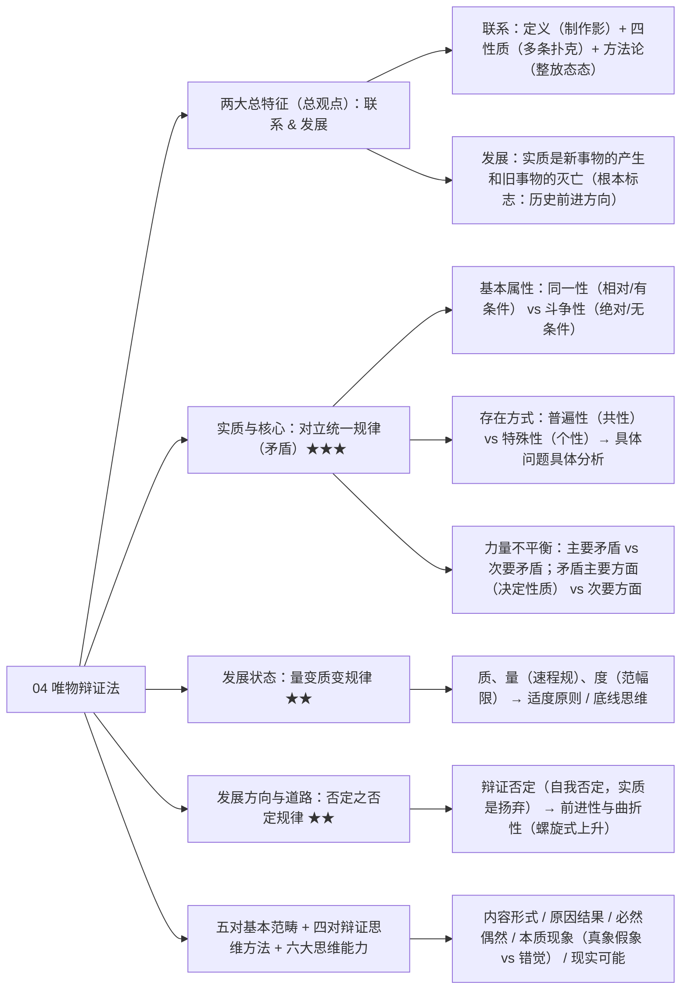
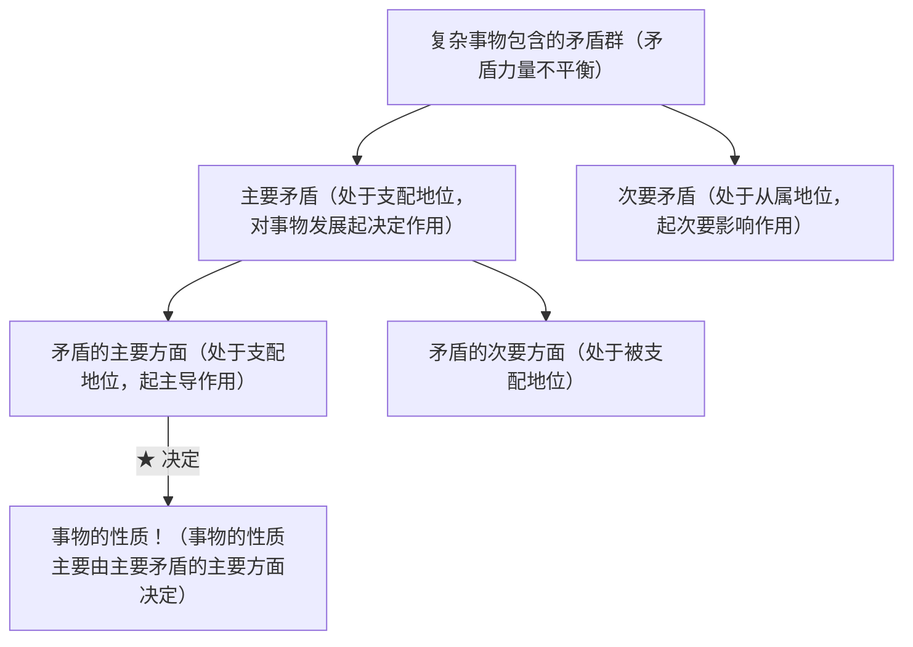

# 04-辩证法｜两大总特征、三大规律、五对范畴与辩证思维

> [!info] 考情定位与使用说明
> - **题型靶向**：`【选择题 + 34题分析大题第一主力（重中之重！）】`
>   - **选择题**重点考：联系四大性质口诀、矛盾同一性与斗争性关系、共性与个性（“爹寓于子”）、度与量变质变、新事物根本标志、辩证否定（扬弃）、**五对基本范畴（原因结果/必然偶然/可能现实/现象本质/内容形式）**。
>   - **34题分析题**第一问几乎每年都在**「矛盾的同一性与斗争性」「矛盾的普遍性与特殊性（共性个性/具体问题具体分析）」「主次矛盾与矛盾主次方面（两点论与重点论）」「量变质变（底线思维）」「辩证否定（守正创新）」**中出题！
> - **视频来源**：[空卡《1小时学完马原》P4：04辩证法（20:37）](https://www.bilibili.com/video/BV1QoKJ64Ene/?p=4)
> - **配套《1000题》范围**（空卡布置）：单选 `P3-7 T22-42`；多选 `P29-33 T22-50`。

---

## 🗺️ 全节思维导图（还原视频三屏完整板书）

---

## 一、唯物辩证法的两大总特征之「联系」（视频 [00:00–03:15]）`【选择+34题大题必背】`

> [!note]- 原始视频板书截图（溯源：P4 第一屏「联系与对立统一规律」）
> ![[考研政治/1-马原/assets/04-辩证法-联系与矛盾板书.jpg]]

### 1.1 唯物辩证法的总架构（板书顶部核心导航）

- **两大总特征（总观点）**：**普遍联系**和**永恒发展**（其中，**联系**构成**发展**，联系是发展的内容，而**矛盾**是联系的根本内容和发展的根本动力/原因）。
- **三大规律**：
  1. **对立统一规律（矛盾规律）**：唯物辩证法的==实质和核心==、==根本规律==（因为它揭示了事物普遍联系的**根本内容**和变化发展的**内在动力**，提供了理解辩证法其他规律和范畴的“钥匙”）；其对应的方法是**矛盾分析法**（认识事物的**根本方法**）。
  2. **量变质变规律**：揭示事物发展的==形式和状态==（渐进性与飞跃性）。
  3. **否定之否定规律**：揭示事物发展的==方向和道路==（前进性与曲折性）。

### 1.2 「联系」的定义、四大性质与方法论（空卡三大口诀秒背！）

| 维度 | 空卡秒背口诀 | 完整考纲内涵与做题踩点拆解 |
| :--- | :--- | :--- |
| **1. 定义** | **“制作影”** （制约、作用、影响） | 联系是指**事物内部各要素之间**和**事物之间**相互**影**响、相互**制**约、相互**作**用的关系。 |
| **2. 四大性质** | **“多条扑克”** （多样性、条件性、普遍性、客观性） | ① **客观性**（**克**）：联系是事物本身所固有的，不以人的意志为转移（❌ 人们不能主观臆造不存在的联系，如“喜鹊报喜、乌鸦报丧、数字吉利”都是主观臆造联系；但✅ **人们可以根据事物固有的客观联系建立新的具体联系**，如修建港珠澳大桥）。 ② **普遍性**（**扑**）：任何事物内部各要素都是相互联系的；任何事物都与其他事物处于联系之中；**整个世界是一个相互联系的统一整体**（⚠️ 陷阱：任何事物都处于普遍联系中 ✅，但**绝不能说“任何两个事物之间都存在直接联系”** ❌，因为联系是有条件的！）。 ③ **多样性**（**多**）：内部联系与外部联系、直接联系与间接联系、必然联系与偶然联系、本质联系与非本质联系。 ④ **条件性**（**条**）：① 条件对事物发展和人的活动具有**支持或制约**作用（有利条件促进，不利条件阻碍）；② **条件是可以改变的**，人们在尊重客观规律的前提下可以创造、改变条件；③ 但改变和创造条件**不是任意的**，必须尊重规律（不能强扭的瓜也硬摘）。 |
| **3. 方法论** | **“整放态态”** （整体性、开放性、动态性） | 马克思主义关于事物普遍联系的原理，要求人们善于分析事物的具体联系，确立==整体性、开放性、动态性==的观念，从动态中考察事物的普遍联系（对应新思想中的**系统观念**）。 |

---

## 二、对立统一规律（矛盾规律）：辩证法的实质与核心（视频 [03:15–11:10]）`【选择+34题大题必背★★★】`

### 2.1 矛盾的两大基本属性：同一性 vs 斗争性（板书中左列）

辩证矛盾（逻辑上不自相矛盾，而是客观事物的对立面统一）具有两个基本属性：**同一性**和**斗争性**。空卡用**“两个人谈恋爱结婚”**的例子把整列讲得极其透彻：

| 对比维度 | 矛盾的斗争性 | 矛盾的同一性 |
| :--- | :--- | :--- |
| **1. 定义** | 矛盾着的对立面之间**相互排斥、相互分离**的性质和趋势（如两个独立的人各有脾气、吵架摩擦）。 | 矛盾双方**相互依存、相互贯通**的性质和趋势，包含两层含义： ① 矛盾双方相互依存，互为存在的前提，**共处于一个统一体中**（如领证结婚成夫妻）； ② 矛盾双方相互贯通，在一定条件下**相互转化**（如夫妻朝夕相处越长越像“夫妻相”；祸兮福之所倚，福兮祸之所伏）。 |
| **2. 特征** | ==无条件的、绝对的==（不管在什么阶段，差异和排斥永远无条件存在）。 | ==有条件的、相对的==（共处和转化都必须具备特定条件，没条件就不能转化）。 |
| **3. 在事物发展中的作用** | **空卡口诀：“毛豆（矛斗）用质量”** ① 在**量变**过程中：斗争推动矛盾双方**力量对比**发生变化，为质变做准备； ② 在**质变**过程中：斗争促使矛盾双方**地位或性质转化**，突破事物的度，实现事物的**质变**。 | ① 同一性是事物存在和发展的**前提**（一方的发展以另一方的发展为条件）； ② 使矛盾双方**相互吸取有利于自身的因素**，在相互作用中各自得到发展； ③ **规定着事物向着自己的对立面转化的基本趋势**（如旧社会孕育新社会因素）。 |
| **4. 辩证关系** | **① 同一性不能脱离斗争性而存在（没有斗争性就没有同一性）**：因为同一是以差别和对立为**前提**的，是包含差别和对立的同一（“和实生物，同则不继”——有差异的对立面结合才能产生新事物，完全等同就没法发展了）。 **② 斗争性也不能脱离同一性而存在（斗争性寓于同一性之中）**：斗争性要受同一性的**制约**，同一性为斗争性提供场所和**联结**（两个八竿子打不着的陌生人不会天天吵架，正因为共处于一个家庭/统一体里才有摩擦）。 |
| **5. 方法论** | **在对立中把握同一，在同一中把握对立**（同中求异、异中求同）；发挥主观能动性，**创造条件促使矛盾向有利方向转化**，促进事物**和谐发展**。 ⚠️ **高频避坑**：**和谐 $\neq$ 无矛盾**！和谐是矛盾双方在一定条件下具体、相对、动态的平衡与协调；我们主张**解决矛盾 / 化解矛盾**（或矛盾双方**融合成一个新事物**），但❌ **绝不能说“调和矛盾”或“消除/消灭一切矛盾”**！（“矛盾调和论”是错误观点，因为矛盾是普遍存在的）。 |

### 2.2 矛盾的存在方式：普遍性 vs 特殊性（共性与个性）（板书中右列上）

1. **矛盾的普遍性（共性 / 无处不在、无时不有）**：
   - **含义**：**矛盾存在于一切事物中（事事有矛盾），存在于一切事物发展过程的始终（时时有矛盾）**。
   - **方法论**：承认矛盾的普遍性，敢于直面矛盾、揭露矛盾、解决矛盾（问题导向）。
2. **矛盾的特殊性（个性 / 三种情形）**：
   - ① **不同事物**的矛盾各有其特点；
   - ② **同一事物在发展的不同过程和阶段**上的矛盾各有其特点；
   - ③ 构成事物的诸多矛盾以及每一矛盾的**不同方面**各有不同的**性质、地位和作用**（空卡口诀：**“地性作”**——地位、性质、作用不同，由此引出下面的**矛盾力量不平衡性**！）。
   - **方法论**：==具体问题具体分析==（对症下药、量体裁衣、因地制宜）——**具体问题具体分析是==马克思主义的活的灵魂==**！
3. **矛盾普遍性（共性）与特殊性（个性）的辩证关系**：
   - **精髓帽子**：==矛盾的普遍性和特殊性辩证关系的原理，是关于事物矛盾问题的精髓==！
   - **二者关系**：**共性是无条件的、绝对的；个性是有条件的、相对的。任何现实存在的事物都是共性和个性的有机统一。**
   - **到底谁寓于谁之中？（空卡“大头儿子小头爸爸”秒记法！）**：
     - **共性（普遍性）= 爹（爸爸的基因）**；**个性（特殊性）= 儿（具体的好几个儿子）**。
     - 爸爸的基因（共性）藏在每一个具体儿子（个性）的身体里 $\Longrightarrow$ ==共性寓于个性之中==（==普遍性寓于特殊性之中==），没有离开个性的共性，也没有离开共性的个性！
     - ⚠️ **对比区分**：**个性（具体的一头白马）包含了共性（马的属性）+ 它自己的特殊属性（白色）**，所以如果问“谁的词条/属性更多？”是**个性包含共性**；但如果问“**谁寓于（存在于）谁之中？**”，永远是**共性（普遍性/一般）寓于个性（特殊性/个别）之中**！（同理：**斗争性（绝对）寓于同一性（相对）之中**；**绝对真理寓于相对真理之中**；**必然性寓于偶然性之中**——规律总结：**永远是“绝对的、共性的、必然的”寓于“相对的、个性的、偶然的”之中！**）

### 2.3 矛盾力量的不平衡性：主次矛盾 vs 矛盾的主次方面（板书右下角）

因为矛盾不同方面的“地位、性质、作用”不同，导致矛盾力量具有**不平衡性**：

- **如何区分题干考的是「主要矛盾」还是「矛盾的主要方面」？**
  - **主要矛盾（抓工作中心 / 办事情 / 解决问题）**：题干中有多个问题/多个任务要办，关键词是**“中心、重点、关键、核心任务、牛鼻子、重中之重、第一要务、突破口”**（如“以经济建设为中心”、“擒贼先擒王”、“牵牛要牵牛鼻子”）。
  - **矛盾的主要方面（看性质 / 评价利弊 / 定性判断）**：题干在探讨**某一个事物的好坏、利弊、性质、主流与支流**（如“看问题要分清主流和支流”、“一国两制下我国的主体仍是社会主义，所以我国性质仍是社会主义国家”、“人工智能虽有风险但总体利大于弊”）。
  - **核心结论**：==事物的性质主要是由主要矛盾的主要方面决定的==！
- **方法论**：坚持==“两点论”和“重点论”的统一==。
  - **重点论**：抓主要矛盾和矛盾的主要方面（重主）；
  - **两点论**：在抓主要矛盾时不忽视次要矛盾，在看主要方面时不忽视次要方面（重主不忽次，统筹兼顾）。

---

## 三、发展观、否定之否定规律与量变质变规律（视频 [11:10–17:45]）`【选择+34题大题必背★★】`

> [!note]- 原始视频板书截图（溯源：P4 第二屏「发展、否定之否定与量变质变」）
> ![[考研政治/1-马原/assets/04-辩证法-否定之否定与量变质变板书.jpg]]

### 3.1 发展的实质与「新事物」不可战胜的原因（板书左上方）

- **发展的实质**：==新事物的产生和旧事物的灭亡==（灭旧产新）。
  - 恩格斯名言：**“一切产生出来的东西，都注定要灭亡（现存的一切都应当灭亡）”** —— 体现了辩证法在对现存事物的肯定的理解中同时包含对现存事物的否定的理解（辩证法的批判性和革命性）。
  - **条件性**：一切事物的发展都**以时间、地点、条件为转移**（✅），绝不以人的主观意志为转移（❌）。
- **什么是新事物？（避坑重灾区！）**：
  - **新事物**是指合乎历史前进方向、具有远大前途的东西；旧事物是指丧失历史必然性、日趋灭亡的东西。
  - ⚠️ **新事物 $\neq$ 新生的事物 $\neq$ 新出现的事物 / 时间上后出现的事物**！（比如新冠病毒新变种、电信诈骗新花样虽然是新出现的，但违背人民利益和历史前进方向，不是哲学上的新事物）。
  - **区分新旧事物的==根本标志==**：看它==是否符合历史前进方向、是否具有远大前途==！
- **为什么新事物必定战胜旧事物？（三大原因）**：
  1. **就新事物与环境的关系而言**：新事物之所以新，是因为有**新的结构和功能**，它适应已经变化了的环境和条件；旧事物的各种要素和功能已不适应新环境。
  2. **就新事物与旧事物的关系而言**：新事物是在旧事物的“母体”中孕育成熟的，它既**否定了旧事物中消极腐朽的东西，又保留了旧事物中合理的、适应新条件的因素**，并添加了旧事物所不能容纳的新内容（注意：是**新事物战胜代替旧事物** ✅，❌ **不是新旧事物相互融合**！）。
  3. **在社会历史领域内**：新事物从根本上**符合人民群众的利益和要求**，能够得到人民群众的拥护。

### 3.2 否定之否定规律：发展的方向与道路（板书左下方·空卡“换眼镜”例子）

1. **辩证否定观的四大核心内容**：
   - **① 否定是事物的==自我否定、自我发展==**，是事物内部矛盾运动的结果（❌ 不是外力否定，也不是一物否定另一物的相互否定）。
   - **② 否定是事物发展的环节**（只有经过否定，旧事物才能向新事物转变），**也是新旧事物联系的环节**（新事物孕育于旧事物母体）。
   - **③ 辩证否定的实质是==“扬弃”==**：即新事物对旧事物**既批判又继承，既克服其消极因素又保留其积极因素**（就像换眼镜：扔掉度数不对的旧镜片，保留完好的旧镜框，换上新镜片）。
   - **反对形而上学否定观**：形而上学把否定看作外力强加的，要么**肯定一切**，要么**否定一切**（“倒洗澡水把澡盆里的孩子也一起倒掉”）。
2. **否定之否定的完整过程**：
   - 事物的辩证发展过程经过三个阶段、两次否定：**肯定 $\xrightarrow{①\text{否定}}$ 否定（弃之） $\xrightarrow{②\text{否定之否定（更高阶段的肯定）}}$ 否定之否定**。
   - **表现形态**：表现为==波浪式前进==或==螺旋式上升==。
   - **核心考点辨析**：
     - ✅ 事物的发展呈现出**周期性**（但每一个周期都进入更高阶段，仿佛向原来出发点的“回复”）；
     - ❌ **绝不是“循环往复”或“直线式前进”**！（只看到前进性看不到曲折性是**直线论**；只看到曲折性看不到前进性是**循环论**）。
3. **方法论**：
   - 事物发展是==前进性（方向）与曲折性（道路）的统一==。我们要对未来充满信心，同时做好克服困难、走曲折道路的准备，**用历史的眼光看问题**（把事物的过去、现在和将来联系起来考察）。

### 3.3 量变质变规律：发展的状态与底线思维（板书右半屏）

1. **质、量、度三概念精准对位（空卡口诀）**：
   - **质**：一事物区别于其他事物的内在规定性（==质与事物的存在是直接同一的==——质变了，这个事物就变成他物了）。
   - **量**：事物的规模、程度、速度等可以用数量关系表示的规定性（空卡口诀：**“速程规”**——速度、程度、规模）。==量与事物的存在不是直接同一的==（在一定范围内水温从 $20^\circ\text{C}$ 升到 $50^\circ\text{C}$，量变了但水还是水）。
   - **度**：保持事物质的稳定性的**数量界限**，即事物的**范围、幅度和限度**（空卡口诀：**“范幅限”**）。度的两端叫**关节点**或**临界点**（左端点可看作**底线**，右端点是上限临界点）。超出度的范围，一物就转化为他物。
2. **量变与质变的辩证关系**：
   - **区别**：**量变**是事物数量的增减和组成要素排列组合的变化，体现了事物发展的==渐进性和连续性==；**质变**是事物性质的根本变化，是事物由一种质态向另一种质态的飞跃，体现了事物发展的==渐进过程和连续性的中断（间断性/飞跃性）==。
   - **联系**：
     - ① **量变是质变的==必要准备==**（没有量变的积累就没有质变）；
     - ② **质变是量变的==必然结果==**，并为新的量变开辟道路（是新量变的前提）；
     - ③ 量变和质变是**相互渗透**的：在总的量变过程中有阶段性和局部性的部分质变；在质变过程中也有旧质在量上的收缩和新质在量上的扩张。
3. **方法论**：
   - 事物的发展是**连续性与阶段性的统一**。
   - **适度原则 & 底线思维**：防微杜渐（防止向坏的质变突破底线）；脚踏实地做好日常量的积累（踏实做日常），当质变条件成熟时果断抓住机遇促成飞跃（果断抓机遇）。

---

## 四、五对基本范畴、四对辩证思维方法与六大思维能力（视频 [17:45–20:37]）`【仅考选择·单选/多选高频】`

> [!note]- 原始视频板书截图（溯源：P4 第三屏「五对范畴与思维能力」）
> ![[考研政治/1-马原/assets/04-辩证法-五对范畴与思维能力板书.jpg]]

### 4.1 唯物辩证法的五对基本范畴全表（古诗文/成语配对必考！）

| 范畴名称 | 概念对位与核心特征 | 辩证关系与选择题高频陷阱 |
| :--- | :--- | :--- |
| **1. 内容与形式** | - **内容**：构成事物一切要素的总和，是事物存在的**基础**，特点是**易变、活跃**。 - **形式**：把诸要素统一起来的结构或表现方式，特点是**相对稳定**。 | ① **内容决定形式**，形式反作用于内容（适合内容则促进，不适合则阻碍）。 ② 方法论：既要重视内容，反对形式主义；又要善于运用形式。 ⚠️ **一句话真题**：**脱离了内容，形式就失去了它的价值和意义**。 |
| **2. 原因与结果** | - **原因**：引起某种现象的现象（通常在**前**）。 - **结果**：被某种现象所引起的现象（通常在**后**）。 | ① **前后相继 $\neq$ 因果关系**！必须有**引起与被引起**的必然联系才叫因果（“在此之后”不等于“由此之故”，如电闪之后雷鸣，电闪不是雷鸣的原因，二者都是云层放电的结果）。 ② 方法论：**“凡事预则立，不预则废”**（辩证地分析事物的因果关系，增强活动的自觉性、预测性和调控性）。 |
| **3. 必然与偶然** | - **必然**：产生于事物**内部的根本矛盾**，是事物发展中**确定不移的、普遍的趋势**，居于**支配地位**。 - **偶然**：产生于事物**外部的非根本矛盾**，是**不确定的、个别表现**，居于**从属地位**。 | ① **没有脱离偶然的必然**：**必然存在于（寓于）偶然之中**，通过大量的偶然表现出来，并为自己开辟道路。 ② **没有脱离必然的偶然**：偶然背后隐藏着必然，受必然的支配，**偶然是必然的表现形式和补充**。 ③ 必然与偶然在一定条件下可以相互转化。 ④ 方法论：必须**重视事物发展的必然规律**，同时也要**善于抓住偶然机遇**（如青霉素的偶然发现推动医学必然发展）。 |
| **4. 本质与现象** （★最高频！） | - **本质**：事物的根本性质，是构成事物诸要素之间的**内在联系**，特点是**深藏于内部、相对稳定、只有靠人的理性思维才能把握**。 - **现象**：事物的外部联系和表面特征，特点是**外露、多变、人的感官可以直接感知**。 | **★ 现象分为「真象」和「假象」**： - **真象**：从**正面**直接表现本质的现象； - **假象**：从**反面**歪曲、颠倒地表现本质的现象（如筷子插进水里看起来折了、太阳东升西落）。 - ⚠️ **超级陷阱**：**真象和假象都是客观的！都是事物本质的表现！** 而**“错觉”才是人脑主观产生的**！（假象 = 客观外在现象；错觉 = 主观认识错误）。 - 方法论：透过现象看本质（不能停留于现象，更不能被假象迷惑）。 |
| **5. 现实与可能** | - **现实**：相互联系着的实际存在的事物的综合。 - **可能**：包含在事物中并预示事物发展前途的种种趋势。 | ① **可能 vs 不可能**：区分标准是**在现实中有无客观根据和条件**！（“不可能”违背客观必然性，在任何条件下都**不能**与可能相互转化，如永动机、石头孵出小鸡）。 ② **现实的可能 vs 抽象（潜在）的可能**：区分标准是**在现实中的根据和条件是否充分**（条件充分=现实可能；条件目前不充分、要很远未来才具备=抽象可能）。 ③ **好的可能 vs 坏的可能**：区分标准是**是否对人有利**（方法论：争取好的可能，防止坏的可能）。 |

### 4.2 客观辩证法与主观辩证法、四对辩证思维方法与六大思维能力（板书右下角）

1. **客观辩证法 vs 主观辩证法**：
   - **客观辩证法**：客观事物或客观存在的辩证法（物质运动规律），采取外部必然性形式。
   - **主观辩证法**：人类认识和思维运动的辩证法（即辩证思维活动规律），采取观念的、逻辑的形式。
   - **关系**：**主观辩证法是客观辩证法的反映**。二者在**本质上是统一的，但在表现形式上是不同的**。
2. **辩证思维的四大基本方法**：
   - ① **归纳与演绎**（从个别到一般 vs 从一般到个别）；
   - ② **分析与综合**（把整体分解为部分 vs 把部分联结为整体，是更深刻认识事物本质的方法）；
   - ③ **抽象与具体**（感性具体 $\xrightarrow{\text{思维抽象}}$ 抽象规定 $\xrightarrow{\text{思维具体}}$ 理性具体，是对辩证思维的高级表达）；
   - ④ **逻辑与历史相统一**（历史是逻辑的基础，逻辑是历史的理论再现，是“修正过”的历史）。
3. **当代六大科学思维能力**：
   - **辩证思维能力**、**历史思维能力**（以史为鉴、历史眼光）、**系统思维能力**（全局整体协同）、**战略思维能力**（高瞻远瞩、统揽全局）、**底线思维能力**（源于量变质变的“度”，防范化解重大风险）、**创新思维能力**（破除迷信、守正创新）。

---

## 💡 34题分析大题「辩证法四大王牌模板」速背卡

> [!tip] 考场看到 34 题第一问考“唯物辩证法 / 矛盾分析法”，直接从以下 4 张王牌里抽 1~2 张套材料！
>
> **【王牌1：矛盾的同一性与斗争性（材料讲“化危为机、变废为宝、互利共赢、协同治理”）】**
> - **原理**：同一性和斗争性是矛盾的两种基本属性。矛盾的同一性是指矛盾双方相互依存、相互贯通，在一定条件下相互转化；矛盾的斗争性是指矛盾双方相互排斥、相互分离。同一性不能脱离斗争性而存在，斗争性寓于同一性之中。
> - **方法论**：这要求我们在分析和解决矛盾时，坚持在对立中把握同一、在同一中把握对立，充分发挥主观能动性，创造条件促使矛盾向有利的方向转化（化危为机）。
>
> **【王牌2：矛盾的普遍性与特殊性（材料讲“试点推广、因地制宜、精准施策、把一般经验与本地实际结合”）】**
> - **原理**：矛盾具有普遍性，事事有矛盾、时时有矛盾；矛盾又具有特殊性，不同事物的矛盾及同一事物不同阶段的矛盾各有特点。矛盾的普遍性与特殊性是辩证统一的（矛盾问题的精髓），共性寓于个性之中，没有离开个性的共性，也没有离开共性的个性。
> - **方法论**：这要求我们既要敢于直面和解决矛盾，又要坚持具体问题具体分析（马克思主义活的灵魂），做到共性与个性的具体的历史的统一。
>
> **【王牌3：主次矛盾与两点论重点论（材料讲“抓住核心关键/牛鼻子，同时兼顾其他方面”）】**
> - **原理**：在复杂事物的发展过程中，主要矛盾居于支配地位、起决定作用；次要矛盾处于从属地位。主要矛盾和次要矛盾相互影响，并在一定条件下相互转化。事物的性质主要是由主要矛盾的主要方面决定的。
> - **方法论**：这要求我们坚持“两点论”和“重点论”的统一，既要善于抓重点、抓关键、抓主要矛盾，又要统筹兼顾，恰当处理次要矛盾。
>
> **【王牌4：量变质变与辩证否定（材料讲“久久为功、防范风险底线、传统文化的守正创新”）】**
> - **原理**：① 量变是质变的必要准备，质变是量变的必然结果，事物的发展是渐进性与飞跃性的统一，必须把握事物的“度”；② 辩证的否定是事物的自我否定，是发展和联系的环节，实质是“扬弃”（既克服又保留）。
> - **方法论**：这要求我们既要脚踏实地重视量的积累、坚持底线思维（适度原则），又要抓住机遇促成质变；对既有事物采取科学分析态度，在继承中发展、守正创新。

---

## 🎙️ 假装当老师·遮挡自测（念逐字稿留存 90%）

1. **联系的定义口诀、四大性质口诀、方法论口诀分别是什么？“任何两个事物之间都存在联系”为什么错？** ⌜⌟
2. **矛盾的同一性和斗争性谁是相对的、谁是绝对的？它们在事物发展中的作用分别是什么（“毛豆用质量”）？可以“调和矛盾”吗？** ⌜⌟
3. **矛盾问题的“精髓”和马克思主义“活的灵魂”分别是什么？共性与个性谁寓于谁之中？事物的性质由谁决定？** ⌜⌟
4. **区分新旧事物的“根本标志”是什么？辩证否定的实质是什么？“假象”和“错觉”谁是客观的、谁是主观的？区分“可能与不可能”、“现实可能与抽象可能”的标准分别是什么？** ⌜⌟

> [!note]- 点击核对本节复述标准答案
> 1. **联系三大口诀**：
>    - 定义：**“制作影”**（相互制约、相互作用、相互影响）；
>    - 四大性质：**“多条扑克”**（多样性、条件性、普遍性、客观性）；
>    - 方法论：**“整放态态”**（整体性、开放性、动态性观念）。
>    - 避坑：联系具有**条件性**，不能说“任何两个事物之间都存在（直接）联系”。
> 2. **矛盾同一性与斗争性**：
>    - 同一性是**相对的、有条件的**；斗争性是**绝对的、无条件的**（斗争性寓于同一性之中）。
>    - 斗争性作用（“毛豆用质量”）：量变时推动双方**力量对比**变化，质变时促使双方**地位或性质转化**。
>    - 同一性作用：存在发展的前提、相互吸取有利因素、规定转化的基本趋势。
>    - 避坑：矛盾只能**解决或化解**（或融合成新事物），**绝不能“调和矛盾”**！
> 3. **精髓、活的灵魂与决定性质**：
>    - 矛盾问题的精髓：**矛盾的普遍性和特殊性（共性与个性）辩证关系原理**；
>    - 马克思主义活的灵魂：**具体问题具体分析**；
>    - 谁寓于谁：**共性（普遍性/爹）寓于个性（特殊性/儿）之中**；
>    - 决定事物性质：**主要矛盾的主要方面**。
> 4. **新事物、扬弃、假象与可能**：
>    - 新旧事物根本标志：**是否符合历史前进方向、是否具有远大前途**（新事物 $\neq$ 新出现的事物）。
>    - 辩证否定实质：**“扬弃”**（自我否定，既克服又保留）。
>    - 假象 vs 错觉：**真象和假象都是客观的**（假象从反面歪曲表现本质）；**错觉是主观的**。
>    - 可能 vs 不可能：看现实中**有无根据**（不可能违背必然性，永远不能转化为可能）；现实可能 vs 抽象可能：看现实中的**根据和条件是否充分**。
