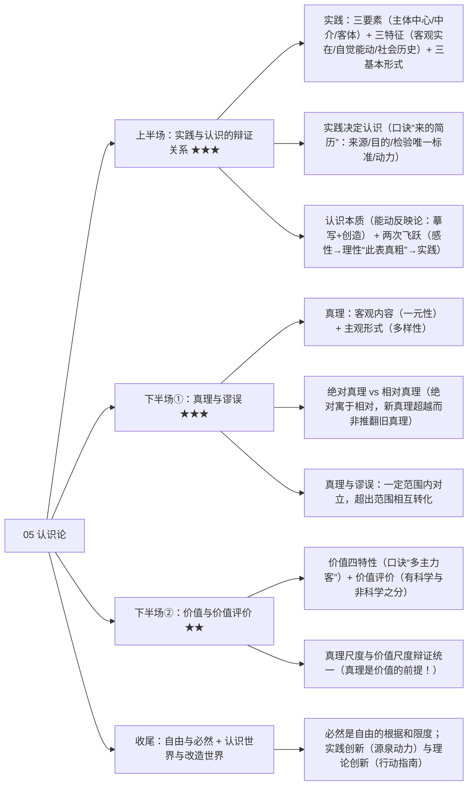

# 05-认识论｜实践与认识、两次飞跃、真理与价值、自由与必然

> [!info] 考情定位与使用说明
> - **题型靶向**：`【选择题 + 34题分析大题第二主力（双子星！）】`
>   - **选择题**重点考：实践的三大要素与三大特征、实践决定认识（“来的简历”）、感性认识 vs 理性认识、非理性因素作用（“激驱控”）、绝对真理 vs 相对真理（“男人女人都是人”）、价值四大特性（“多主力客”）、必然与自由。
>   - **34题分析题**极爱在第二问或第一问考查**「实践与认识的辩证运动（认识的两次飞跃与反复性无限性）」「真理与谬误的对立统一（在试错中探索创新）」「真理尺度与价值尺度的辩证统一（合规律性与合目的性）」「改造客观世界与改造主观世界（从必然走向自由）」**！
> - **视频来源**：[空卡《1小时学完马原》P5：05认识论（15:37）](https://www.bilibili.com/video/BV1QoKJ64Ene/?p=5)
> - **配套《1000题》范围**（空卡布置）：单选 `P7-10 T43-68`；多选 `P34-40 T51-83`。

---

## 🗺️ 全节思维导图（还原视频上下两屏完整板书）

---

## 一、科学的实践观与实践决定认识（视频 [00:00–08:30]）`【选择+34题大题必背★★★】`

> [!note]- 原始视频板书截图（溯源：P5 上半屏「实践与认识」）
> ![[考研政治/1-马原/assets/05-认识论-实践与认识上半板书.jpg]]

### 1.1 实践的本质、三要素、三特征与三形式（板书左上方）

1. **实践的本质定义**：
   - 实践是**人类==能动地改造世界==的社会性的==物质活动==**。（注意：实践是**主观见之于客观**的**物质活动**，不是纯粹的精神/认识活动！）。
2. **实践的三大基本要素（主体 $\xrightarrow{\text{中介}}$ 客体）**：
   - **① 实践主体（处于==中心==地位）**：具有一定的主体能力、从事现实社会实践活动的人。
     - **主体的能力结构** = **自然能力**（体力） + **精神能力**（包括**知识性因素**与**非知识性因素**；其中==知识性因素是首要的能力==！）。
   - **② 实践客体**：实践活动所指向的对象（⚠️ 区分：**客体 $\neq$ 客观存在的一切事物**！只有进入人的实践和认识活动领域、与主体发生相互作用的那部分客观事物，才成为客体）。
   - **③ 实践中介**：各种形式的工具、手段以及运用、操作这些工具的程序和方法（连接主体与客体的桥梁）。
3. **实践的三大基本特征**：
   - **① ==客观实在性（直接现实性）==**：实践是实实在在的物质活动，能把人脑中的观念变成现实的存在（这是**实践区别于认识/意识活动的根本标志**！认识没有直接现实性，只有实践有直接现实性）。
   - **② ==自觉能动性==**：人的实践活动是有目的、有意识的（区别于动物本能活动）。
   - **③ ==社会历史性==**：实践从一开始就是社会性的活动，并且受历史条件的制约、随历史发展而发展。
4. **实践的三大基本形式（3+1）**：
   - **① ==物质生产实践==**（**最基本的实践活动**，劳动）；
   - **② 社会政治实践**（处理人与人、阶级与阶级的社会关系）；
   - **③ 科学文化实践**（科学实验、文化创造等探索性活动）；
   - **+ 派生形式**：现代信息技术发展产生出的**虚拟实践**（具有交互性、开放性、间接性，是三大基本实践的派生形式）。

### 1.2 认识的本质：两条认识路线与两种反映论对比（板书右上角）

1. **哲学史上的两条根本对立的认识路线**：
   - **唯物主义反映论**：坚持==“从物到感觉和思想”==（先有客观事物，人再去反映它）。
   - **唯心主义先验论**：坚持==“从思想和感觉到物”==（认为认识先于物质、先于实践经验而存在，如“生而知之”、“回忆说”）。
2. **唯物主义内部两种反映论的对比**：
   - **旧唯物主义认识论（直观/机械反映论）**：❌ **无辩证法、无实践观**，把认识看成照镜子一样消极、被动地接收外界刺激。
   - **辩证唯物主义认识论（==能动反映论==）**：✅ **引入了实践观和辩证法**！
     - **认识的本质**：认识是==主体在实践基础上对客体的能动反映==。
     - **能动反映论的最大特点**：是==摹写性与创造性的统一==！（既要如实反映客体即摹写性，又要透过现象揭示本质、推测未来并创造出理想客体即创造性；摹写性是创造性的基础，绝不能把二者割裂）。

### 1.3 实践与认识的辩证关系（空卡口诀：“来的简历”）（板书左上中）

- **第一，==实践决定认识==（实践是认识的基础）**——空卡秒背口诀：**“来、的、检、历（力）”**：
  1. 实践是认识的==来源==（**来**：一切真知都来源于实践。⚠️ 避坑：个人获得知识有两条途径——**直接经验**和**间接经验**/读书学习；但无论直接经验还是间接经验，归根到底都**源于实践**！所以“实践是认识的**唯一来源**” ✅，但“实践是获得认识的**唯一途径**” ❌！）。
  2. 实践是认识发展的==动力==（**力**：实践的需要推动认识产生和发展；实践为认识提供新的课题和物质手段；实践锻炼和提高了人的认识能力）。
  3. 实践是认识的==目的==（**的**：认识世界的最终目的是为了**改造世界**！如果认识不回到实践中去指导改造世界，就失去了意义）。
  4. 实践是==检验认识真理性的唯一标准==（**检**）。
- **第二，认识对实践具有能动的反作用**：
  - 正确的认识（科学理论）指导实践会使实践顺利进行，达到预期效果；错误的认识则会把实践引向失败。

### 1.4 认识运动的基本规律：两次飞跃与两类因素（板书中下部）

#### （1）认识过程的第一次飞跃：从实践到认识（即从==感性认识到理性认识==）

| 对比维度 | 感性认识（认识的初级阶段） | 理性认识（认识的高级阶段） |
| :--- | :--- | :--- |
| **反映对象** | 事物的**现象**、外部联系、各个片面 | 事物的**本质**、全体、内部联系和规律性 |
| **三种形式** | **感觉、知觉、表象**（全带感官体验色彩） | **概念、判断、推理**（逻辑思维形式） |
| **突出特点** | ==直接性、具体性==（生动鲜活，但还不深刻） | ==间接性、抽象性==（深刻揭示本质） |
| **辩证关系** | ① **理性认识依赖于感性认识**（感性认识是理性认识的基础，坚持这一点就是认识论上的唯物论）； ② **感性认识有待于发展和深化为理性认识**（坚持这一点就是认识论上的辩证法）； ③ **二者相互渗透、相互包含**（感性中有理性，理性中有感性）。 ⚠️ **割裂二者的错误**：只认理性否认感性 $\rightarrow$ **唯理论**（在实际工作中表现为**教条主义**）；只认感性否认理性 $\rightarrow$ **经验论**（在实际工作中表现为**经验主义**）。 |

- **实现第一次飞跃（从感性认识到理性认识）必须具备的==两个条件==**：
  1. 勇于实践，深入调查，获取**十分丰富和合乎实际的感性材料**（基础前提）；
  2. 必须经过理性思考的作用，将丰富的感性材料加以加工制作——空卡16字口诀：**“此表真粗”**（==去粗取精、去伪存真、由此及彼、由表及里==）。（注意：视频黑板里提醒大家别背成“去真存伪”，一定是**去伪存真、去粗取精**！）。

#### （2）认识过程的第二次飞跃：从==理性认识到实践==（理论指导实践）

- **为什么第二次飞跃比第一次飞跃==更为重要==？（意义更大）**：
  1. 认识世界的目的是为了**改造世界**（只有回到实践才能转化为改造世界的物质力量）；
  2. 理性认识只有回到实践中去，才能得到**检验、修正、补充和发展**。

#### （3）认识过程中的两类因素：理性因素 vs 非理性因素

- **理性因素**（主导作用）：指人的理性直观、理性思维等能力（调控、指导、解释）。
- **非理性因素**（重要补充作用）：主要指认识主体的**情感、意志**，以及以非逻辑形式出现的**幻想、想象、直觉、灵感（第六感）**等。
  - **非理性因素对认识过程的三大积极作用**——空卡口诀：**“激、驱、控”**（==激活作用、驱动作用、控制作用==）。

#### （4）认识运动的总规律：反复性与无限性

- **总过程**：**实践 $\longrightarrow$ 认识 $\longrightarrow$ 再实践 $\longrightarrow$ 再认识**，循环往复以至无穷，每一循环都进到高一级的程度（波浪式前进、螺旋式上升）。
- **为什么认识具有反复性？**
  - **客观原因**：事物的本质暴露有一个过程，且受当时科学技术条件限制；
  - **主观原因**：主体的认识能力、知识水平、立场观点方法受限。

---

## 二、真理与谬误、价值与评价、自由与必然（视频 [08:30–15:37]）`【选择+34题大题必背★★★】`

> [!note]- 原始视频板书截图（溯源：P5 下半屏「真理与价值」）
> ![[考研政治/1-马原/assets/05-认识论-真理与价值下半板书.jpg]]

### 2.1 真理及其客观性、一元性（板书上半部）

1. **什么是真理？**
   - 真理是标志主观同客观相符合的哲学范畴，是人们对客观事物及其规律的**正确反映**（或一定阶段内的正确认识）。
   - ⚠️ **第一大避坑**：**真理的本质是“认识”（主观范畴），❌ 真理绝不是客观事物本身！**
2. **真理的客观性（客观真理）与一元性**：
   - **真理的内容是客观的**（检验标准实践也是客观的）$\Longrightarrow$ 决定了真理具有==一元性==（在同一条件下，对于特定认识客体的真理性认识**只有一个**！不因人的阶级地位、主观愿望不同而有两个真理，“公说公有理婆说婆有理”违背了真理的一元性）。
   - **真理的形式是主观的** $\Longrightarrow$ 真理的表现形式具有**多样性**（可以用中文、英文、数学公式等不同形式表达同一个客观真理）。
   - **关于“有用即真理”（实用主义错误观点）的秒杀**：
     - ✅ **“真理一定是有用的”**（正确！因为真理能正确指导实践）；
     - ❌ **“有用的就是真理”**（错误！谎言对骗子也有用，但谎言不是真理；实用主义把“有用性”当成真理的根本属性，颠倒了因果）。

### 2.2 真理的绝对性与相对性（空卡“男人女人都是人”满分比喻！）

同一个客观真理，同时具有两种属性：**绝对性（绝对真理）**和**相对性（相对真理）**（注意：❌ **不是有两种不同的真理，而是同一个真理的两种属性！**）。

| 对比维度 | 真理的绝对性（绝对真理） | 真理的相对性（相对真理） |
| :--- | :--- | :--- |
| **含义** | ① 主客观统一的**确定性**和发展的**无限性**； ② 任何真理都必然包含同客观对象相符合的客观内容，同谬误有原则界限（不可推翻）； ③ 人类认识按其本性来说，能够正确认识无限发展着的物质世界。 | ① 人们在一定条件下对客观事物及其本质和发展规律的正确认识总是**有限度的、不完善的**； ② **从广度上看**：有待扩展； ③ **从深度上看**：有待深化。 |
| **哲学根源** | 根源于人类认识能力的==无限性（至上性）==（整个人类世世代代的认识能力是无限的）。 | 根源于特定历史阶段具体个人的认识能力的==有限性（非至上性）==。 |
| **辩证关系** | **① 相互依存、相互包含**：==绝对真理寓于相对真理之中==（相对真理中包含着绝对真理的颗粒）！ - **空卡秒记比喻**：把**绝对真理（共性）比作“人”**，把**相对真理（个性）比作具体的“男人、女人”**——“人”这个共性就藏在每一个具体的“男人、女人”身上，所以**绝对（人）寓于相对（男人/女人）之中**！ **② 辩证转化**：人类的认识是一个**永远由相对真理走向绝对真理**的过程。 - ⚠️ **超级避坑**：新的科学理论（更接近绝对真理的新相对真理，如爱因斯坦相对论）对旧的科学理论（如牛顿经典力学）是**✅ 转化、深化、超越、拓展适用边界**，**❌ 绝不是“推翻”或“彻底否定”了旧真理**！（只要是真理，它内部包含的绝对真理颗粒就永远不会被推翻！被推翻的只能是谬误！）。 |
| **割裂错误** | 夸大绝对性、否认真理相对性 $\rightarrow$ **教条主义**（思想僵化）。 | 夸大相对性、否认真理绝对性 $\rightarrow$ **相对主义怀疑论、诡辩论、不可知论**。 |

### 2.3 真理与谬误、实践检验标准的确定性与不确定性（板书中右）

1. **真理与谬误的对立统一**：
   - **对立（有严格界限）**：在**确定的对象和范围内**，真理与谬误的对立是**绝对的**（是对就是对，是错就是错，不能混淆）。
   - **统一（相互依存、相互转化）**：
     - 真理与谬误相比较而存在，相斗争而发展；
     - **超出一定的范围**（如果把真理的适用条件任意扩大），真理就会转化为谬误（如“多吃蔬菜有益健康”是真理，但“只吃蔬菜不吃任何其他营养”就成了谬误）；反之，人们分析失败原因、纠正错误条件，**谬误也能转化为真理**（“失败是成功之母”、“吃一堑长一智”）。
2. **实践是检验真理的唯一标准**：
   - **为什么只有实践能作为检验标准？（是由==真理的本性==和==实践的特点==共同决定的）**：
     - **真理的本性**是主观与客观相符合（光在主观认识圈子里打转无法自证，纯粹客观事物也不会说话）；
     - **实践的特点**是具有==直接现实性==（实践能把主观认识变成客观现实，像桥梁一样把主观和客观连接起来对照）。
   - **实践标准的确定性（绝对性）与不确定性（相对性）**：
     - **确定性（绝对性）**：实践是检验真理的**唯一标准**，此外再无别的标准；凡是经过历史实践终极检验的认识都是不可推翻的。
     - **不确定性（相对性）**：一定历史阶段的具体实践都具有历史局限性，它对真理的检验是一个**动态发展的过程**（不能把当前的实践标准绝对化、僵化）。

### 2.4 价值、价值评价与真理价值的辩证统一（板书下半部）

1. **哲学上的「价值」及其四大基本特性（空卡口诀：“多主力客”）**：
   - **含义**：价值是标志着**客体属性与主体需要**之间特定关系的哲学范畴（即客体能够满足主体需要的效益关系：客体属性对主体有利即为正价值）。
   - **四大基本特性**（口诀：**“多、主、力（历）、客”**）：
     - ① **客观性**（**客**）：客体的属性和主体的需要都是客观的，价值关系不以人的主观愿望为转移；
     - ② **主体性**（**主**）：价值直接同主体相联系，**同一客体对于不同主体的价值是不同的**（如一副近视眼镜对近视眼有价值，对视力正常者无价值——**主客体之间的价值关系不是自然的现成关系，而是主体在实践基础上确立的同客体之间的一种创造性关系**）；
     - ③ **社会历史性**（**力/历**）：主体和客体的关系随社会历史条件变化而变化；
     - ④ **多维性**（**多**）：同一客体有多种属性，可满足主体多方面需要。
2. **价值评价（价值判断）及其特点**：
   - **知识性认识 vs 价值性认识（评价）**：
     - **知识性认识**：以**客体本身的状态**为反映内容，以获得关于客体的**“真”**为目的（不以主体需要为转移）；
     - **价值评价**：以**客体和主体之间的价值关系**为反映内容，以求**“善”和“美”**为目的（评价结果**与评价主体直接相关**，依主体的特点而转移）。
   - ⚠️ **必考避坑**：虽然价值评价与主体相关（不同人评价不同），但**价值评价绝不是“公说公有理婆说婆有理”的纯粹主观随意活动**！价值评价结果**依赖于人们对客体状况和主体需要的认识**，因此**价值评价有==正确与错误、科学与非科学==之分**！
   - **正确价值评价的==最高标准==**：看是否==符合社会历史发展的客观规律==，是否==符合广大人民群众的根本利益==！
3. **真理与价值的辩证统一（真理尺度与价值尺度）**：
   - 人们的实践活动总是受着**真理尺度**（合规律性，按客观规律办事）和**价值尺度**（合目的性，满足人的需要）的制约。**任何成功的实践都是真理尺度和价值尺度的统一。**
   - ⚠️ **谁是谁的前提？（高频单选陷阱！）**：
     - ✅ **真理尺度是价值尺度的前提**（只有先正确认识客观规律即掌握真理，才能去改造客体满足人的需要即实现价值；脱离了真理的价值追求只是空中楼阁）；
     - ❌ 绝不能颠倒说“价值尺度/主体意义是真理的前提”！
     - 同时，价值尺度又是推动人们去发现和发展真理的内在动力。

### 2.5 认识世界与改造世界、从必然走向自由（板书右下角）

1. **人类活动的两个基本方面：认识世界 & 改造世界**：
   - 二者相互依赖、相互制约，在实践基础上统一起来。
   - **改造客观世界**的同时也在**改造主观世界**（改造主观世界的核心是**改造世界观**）。
   - **认识世界和改造世界的过程，也是从==必然走向自由==的过程**：
     - **基本矛盾和根本动力**：**主观和客观的矛盾**是人类认识和实践活动中的基本矛盾，也是人类认识世界和改造世界的根本动力。
2. **两种状态：必然（必然王国）与自由（自由王国）**：
   - **必然**：指客观规律的支配（盲目受规律奴役的状态）；
   - **自由**：是对**必然的认识**和对**客观世界的改造**（自由是**有条件的**：① 认识条件——认识越深刻越自由；② 实践条件——自由以实践为基础，且自由不能危害他人和社会的自由）。
   - **核心关系**：==必然是自由的根据和限度==！（不存在摆脱客观规律约束的绝对自由，“从心所欲，不逾矩”正是自由与必然的统一）。
3. **一切从实际出发、实事求是 & 理论创新与实践创新**：
   - **实事求是**是马克思主义的**精髓和活的灵魂**（对比：具体问题具体分析也是马克思主义活的灵魂；矛盾普遍性与特殊性关系是矛盾问题的精髓）。
   - **实践创新**与**理论创新**的良性互动：
     - **实践创新**为理论创新提供**不竭的动力源泉**；
     - **理论创新**为实践创新提供**科学的行动指南**；
     - 努力实现二者的良性互动（先有实践创新，再推动理论创新，再用理论创新指导新的实践创新）。

---

## 💡 34题分析大题「认识论四大王牌模板」速背卡

> [!tip] 考场看到 34 题问“为什么能取得这一认识 / 如何体现实践与认识的关系 / 科学家如何在试错中成功 / 科技伦理与以人为本”，直接默写以下 4 张王牌！
>
> **【王牌1：实践与认识的辩证运动（材料讲“源于实践需要、深入调研、形成理论再指导工程建设、不断迭代升级”）】**
> - **原理**：① 实践是认识的基础，对认识起决定作用：实践是认识的来源、认识发展的动力、认识的目的，以及检验认识真理性的唯一标准；② 认识对实践具有能动的反作用，正确的认识和科学理论对实践具有巨大的指导作用；③ 认识的发展经历了从实践到认识（感性认识到理性认识）、再从认识到实践的两次飞跃，是一个“实践、认识、再实践、再认识”循环往复、无限发展的过程。
> - **方法论**：这要求我们坚持实践第一的观点，勇于投身实践，在实践中坚持和发展真理，实现理论创新与实践创新的良性互动。
>
> **【王牌2：感性认识与理性认识的辩证统一（材料讲“深入一线掌握大量第一手数据，再经科学分析提炼出规律方案”）】**
> - **原理**：感性认识和理性认识是认识过程中的两个阶段。感性认识反映事物的现象，理性认识反映事物的本质。理性认识依赖于感性认识，感性认识有待于发展和深化为理性认识，二者相互渗透、相互包含。
> - **方法论**：实现从感性认识到理性认识的飞跃，既要勇于实践、深入调查，获取十分丰富和合乎实际的感性材料；又要经过理性思考，将感性材料进行“去粗取精、去伪存真、由此及彼、由表及里”的加工制作。
>
> **【王牌3：真理与谬误、认识的反复性与无限性（材料讲“经历多次失败、从失败中总结教训最终攻克难关”）】**
> - **原理**：真理和谬误是辩证统一的。在一定范围内二者的对立是绝对的，但超出一定条件，二者可以相互转化；谬误往往是正确的先导。由于受主客观条件的限制，人们对事物的认识往往要经历多次反复才能完成。
> - **方法论**：这要求我们不怕失败、勇于探索，善于从错误和失败中总结经验教训，创造条件促使谬误向真理转化。
>
> **【王牌4：真理尺度与价值尺度的统一（材料讲“科技发展既要遵循自然/科学规律，又要造福人民/符合伦理向善”）】**
> - **原理**：人类的实践活动总是受着真理尺度和价值尺度的制约。真理尺度要求人们在实践中遵循客观规律（合规律性）；价值尺度要求人们的实践满足主体需要和人民根本利益（合目的性）。任何成功的实践都是真理尺度和价值尺度的辩证统一，其中真理尺度是价值尺度的前提。
> - **方法论**：这要求我们在实践中坚持合规律性与合目的性的统一，把科学精神与人文精神结合起来，以符合人民根本利益为最高价值标准。

---

## 🎙️ 假装当老师·遮挡自测（念逐字稿留存 90%）

1. **实践的三大基本要素、三大基本特征、三大基本形式分别是什么？实践决定认识的四个方面口诀是什么？“实践是获得认识的唯一途径”对吗？** ⌜⌟
2. **感性认识和理性认识各自的三种形式与特点是什么？从感性认识到理性认识飞跃的两个条件是什么（16字口诀）？非理性因素对认识的三大作用口诀是什么？** ⌜⌟
3. **绝对真理和相对真理谁寓于谁之中？新真理对旧真理是“推翻”还是“超越”？为什么只有实践能作为检验真理的唯一标准？** ⌜⌟
4. **价值的四大基本特性口诀是什么？价值评价有“科学与非科学”之分吗？它的最高标准是什么？真理和价值谁是谁的前提？** ⌜⌟

> [!note]- 点击核对本节复述标准答案
> 1. **实践观与“来的简历”**：
>    - 三要素：**主体**（中心，知识性因素是首要能力）、**客体**、**中介**；
>    - 三特征：**客观实在性（直接现实性）**、**自觉能动性**、**社会历史性**；
>    - 三形式：**物质生产实践**（最基本）、社会政治实践、科学文化实践（+派生虚拟实践）；
>    - 实践决定认识（**“来的简历”**）：**来**源、目**的**、**检**验唯一标准、动**力**。
>    - 避坑：实践是认识的**唯一来源** ✅，但不是唯一**途径** ❌（途径有直接经验和间接经验两种）。
> 2. **感性理性与非理性因素**：
>    - 感性认识（现象）：**感觉、知觉、表象**（直接性、具体性）；理性认识（本质）：**概念、判断、推理**（间接性、抽象性）。
>    - 第一次飞跃两条件：① 获取**十分丰富和合乎实际的感性材料**；② 理性加工16字（**“此表真粗”**：**去粗取精、去伪存真、由此及彼、由表及里**）。
>    - 非理性因素（情感/意志/直觉灵感）三大作用（**“激驱控”**）：**激活、驱动、控制**作用。
> 3. **真理与检验标准**：
>    - **绝对真理（人）寓于相对真理（男人/女人）之中**；新真理对旧真理是**✅ 深化、超越、转化**，**❌ 绝不是推翻**！
>    - 为什么只有实践能检验：由**真理的本性**（主客观相符合）和**实践的特点**（**直接现实性**，能把主观变成客观来对照）共同决定。
> 4. **价值与评价**：
>    - 价值四特性（**“多主力客”**）：**多维性、主体性、社会历史性、客观性**。
>    - 价值评价依赖于对客体状况和主体需要的认识，**有正确与错误、科学与非科学之分**！最高标准是**符合社会历史发展规律和人民根本利益**。
>    - **真理是价值的前提**（❌ 绝不能说价值是真理的前提）。
