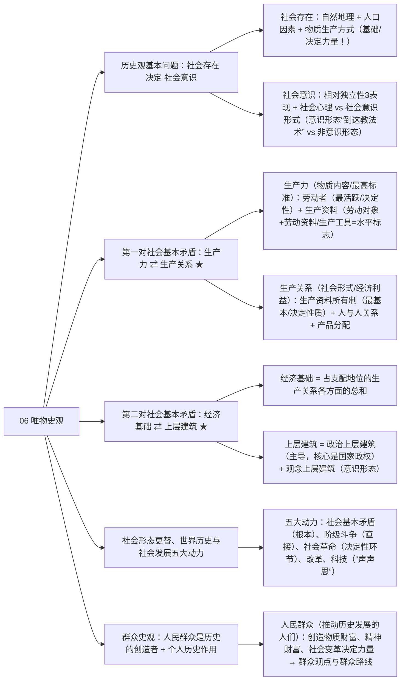
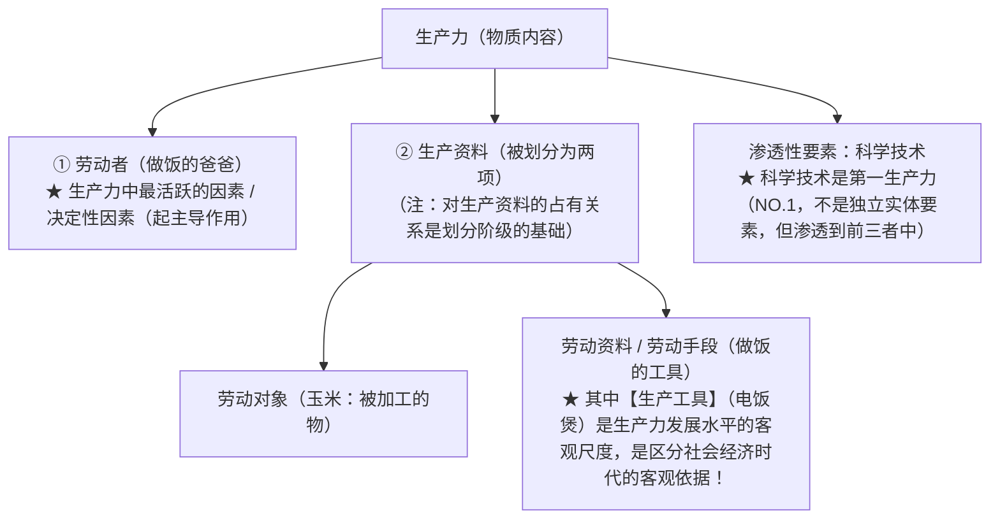

# 06-唯物史观｜社会存在与社会意识、社会基本矛盾、五大动力与群众史观

> [!info] 考情定位与使用说明
> - **题型靶向**：`【选择题核心高频（2-3分） + 34题分析题储备（群众史观/科技作用）】`
>   - **选择题**极爱考**“帽子题与层级包含关系”**：社会存在三要素谁是决定力量、社会意识相对独立性三表现、意识形态 vs 非意识形态（“到这教法术”）、生产力三要素（谁是最活跃因素、谁是区分经济时代标志）、生产关系三方面、政治上层建筑 vs 观念上层建筑、历史五大动力、人民群众与历史人物的作用。
> - **视频来源**：[空卡《1小时学完马原》P6：06唯物史观（14:57）](https://www.bilibili.com/video/BV1QoKJ64Ene/?p=6)
> - **配套《1000题》范围**（空卡布置）：单选 `P11-14 T69-94`；多选 `P40-46 T84-113`。

---

## 🗺️ 全节思维导图（还原视频两屏完整板书）

---

## 一、历史观基本问题、两对社会基本矛盾与五大动力（视频 [00:00–10:35]）`【选择高频+分析大题储备】`

> [!note]- 原始视频板书截图（溯源：P6 第一屏「社会基本矛盾与五大动力」）
> ![[考研政治/1-马原/assets/06-唯物史观-社会基本矛盾板书.jpg]]

### 1.1 历史观的基本问题：社会存在与社会意识（板书顶部）

- **区分唯物史观与唯心史观的根本标志（历史观的基本问题）**：==社会存在与社会意识的关系问题==。
  - **唯物史观**：认为**社会存在决定社会意识**，社会意识是社会存在的反映，并反作用于社会存在。
  - **唯心史观**：认为社会意识决定社会存在（在马克思主义诞生前，唯心史观长期统治历史领域，其两大缺陷是：① 至多考察了人们活动的思想动机，而没有进一步考究思想动机背后的物质动因和经济根源；② 根本否认人民群众在社会历史发展中的决定作用）。

#### （1）社会存在的三大构成要素（板书左上角）

| 社会存在要素 | 核心内涵与考纲「帽子」词 |
| :--- | :--- |
| **1. 自然地理环境** | 人类社会生存和发展的经常的、必要的条件（自然规律是**自发的**，社会规律是通过人的有意识活动实现的、**自觉的**，但二者都是客观的）。 |
| **2. 人口因素** | 重要的社会物质生活条件。 ★ **顺带必背（人的本质）**：马克思在《关于费尔巴哈的提纲》中指出：“**人的本质不是单个人所固有的抽象物，在其现实性上，它是==一切社会关系的总和==。**”（人的自然属性是社会属性的基础，但**社会属性才是人的本质属性**！人的本质是具体的、历史的、变化的，没有抽象不变的人性）。 |
| **3. 物质生产方式** （★ 最核心！） | 即**生产力与生产关系的统一体**。物质生产方式是社会历史发展的==基础==和==决定力量==！（决定社会的结构、性质、面貌和更替）。 |

#### （2）社会意识的结构与「相对独立性」（板书右上角·必考！）

1. **社会意识的层次结构（按高低层次与是否有阶级性划分）**：
   - **低层次（社会心理）**：以**感性认识**为主，是自发的、不系统、不定型的社会意识，表现为人们的**情感、风俗习惯、成见、自发倾向、社会心态**等。
   - **高层次（社会意识形式）**：以**理性认识**为主，是系统化、理论化的社会意识，又分为两类（**单选题极爱考哪几个属于意识形态！**）：
     - **① 属于上层建筑的社会意识形式（即==社会意识形态== = ==观念上层建筑==）**：反映经济基础并为经济基础服务，在阶级社会中具有**鲜明的阶级性**！
       - **空卡秒背口诀**：“==到这教法术==” + 艺术（共 6 个）：**道**德、**哲**学、宗**教**、**法**律思想、**政**治思想、艺**术**！
     - **② 不属于上层建筑的社会意识形式（即==非意识形态==）**：不直接反映特定经济基础，**不具有阶级性**！
       - 包括：**自然科学** + **一部分社会科学**（如**语言学、逻辑学**、管理科学等）。
2. **社会意识的「相对独立性」（三大表现）**：
   - 社会意识在从根本上受到社会存在决定的同时，还具有自己特有的发展形式和规律，主要表现在三个方面：
     - **① 社会意识与社会存在发展的不完全同步性和不平衡性**：社会意识可能超前于社会存在（如科学预见），也可能滞后于社会存在（如旧思想残余）；经济发展水平较高的国家或地区，其社会意识发展水平未必每一项都最高。
     - **② 社会意识内部各种形式之间的相互影响及各自具有的历史继承性**。
     - **③ 社会意识对社会存在具有能动的反作用**：这是社会意识相对独立性的==突出表现==！（先进的社会意识促进社会发展，落后的社会意识阻碍社会发展）。

---

### 1.2 第一对社会基本矛盾：生产力 $\xleftrightarrow{\text{决定 / 反作用}}$ 生产关系（板书中部左列）

#### （1）生产力（生产的==物质内容==，体现人与自然的关系）

- **至高地位帽子词**：生产力是社会发展的==最终决定力量==；生产力是**衡量社会历史发展和社会进步的==最高标准 / 根本尺度==**！（注意对比：人民群众的根本利益是价值评价的最高标准；生产力标准是衡量社会进步的最高标准，二者在根本上是一致的）。
- **生产力的三大实体性要素（空卡“爸爸用玉米和电饭煲做饭”秒记法！）**：

#### （2）生产关系（生产的==社会形式==，体现人与人之间的**经济利益关系**，是最基本的社会关系）

- **生产关系的构成（狭义三方面）**：
  1. **==生产资料所有制关系==**（生产资料归谁所有）：在生产关系中是**最基本的、占支配地位的内容**，是区分不同生产方式、**决定社会经济制度性质的根本标志**！
  2. **生产中人与人的关系**（人们在生产中的地位和相互关系）；
  3. **产品分配关系**。（注：广义生产关系还包括生产、分配、交换、消费四个环节的关系）。

#### （3）生产力与生产关系的辩证运动规律

- **生产力决定生产关系**（生产力的性质和水平决定生产关系的性质和形式；生产力的发展要求生产关系随之变革）；
- **生产关系反作用于生产力**（当生产关系适合生产力发展状况时推动生产力发展；不适合时阻碍生产力发展）；
- **规律**：**生产关系一定要适合生产力状况的规律**（人类社会发展的第一条基本规律）。

---

### 1.3 第二对社会基本矛盾：经济基础 $\xleftrightarrow{\text{决定 / 反作用}}$ 上层建筑（板书中部右列）

1. **什么是经济基础？**
   - 经济基础是指由社会一定发展阶段的生产力所决定的**生产关系的总和**（更精确地说，是指该社会中==占支配地位的生产关系各方面的总和==）。
   - ⚠️ **一句话等式**：**生产力决定生产关系，那个占支配地位的“生产关系”换件马甲（相对于上层建筑而言），就叫“经济基础”！**（即：生产关系 $\approx$ 经济基础）。
2. **什么是上层建筑？（政治上层建筑 + 观念上层建筑）**：
   - 上层建筑是建立在一定经济基础之上的意识形态以及与之相适应的制度、组织和设施，由两部分组成：

| 上层建筑的两部分 | 包含内容 | 二者关系与核心帽子词 |
| :--- | :--- | :--- |
| **① 观念上层建筑** （= **意识形态**） | 口诀：**“到这教法术”+艺术** （道德、哲学、宗教、法律思想、政治思想、艺术） | - **政治上层建筑**以观念上层建筑为**思想指导**； - **观念上层建筑**受政治上层建筑的**控制和影响**； - 在整个上层建筑中，==政治上层建筑居于主导地位==，==国家政权是政治上层建筑的核心==！ |
| **② 政治上层建筑** （主导地位！） | **政治法律制度** + **政治组织和设施**（军队、警察、法庭、监狱、政府机构、政党等） | **★ 国家的起源与实质**： 国家不是从来就有的，它是**阶级矛盾不可调和的产物**；国家的实质是==一个阶级统治另一个阶级的暴力工具==。 |

3. **经济基础与上层建筑的辩证关系及「双重性质判断」**：
   - **经济基础决定上层建筑**；**上层建筑反作用于经济基础**（为自己的经济基础服务，确立或维护其在社会中的统治地位）。
   - ⚠️ **必考深坑：上层建筑反作用的性质取决于什么？**
     - 上层建筑本身直接服务于**经济基础**，但它对整个社会历史发展是起**进步作用**还是**阻碍作用**，归根到底取决于==它所服务的经济基础的性质==，即看它所服务的经济基础==是否适应生产力的发展要求==！（当它为适合生产力发展的先进经济基础服务时，就成为推动社会进步的力量；反之则为阻碍力量）。

---

### 1.4 社会形态更替、世界历史与社会发展五大动力（板书下部）

1. **社会形态（= 经济基础 + 上层建筑的统一体，社会制度是其集中体现）**：
   - **更替的重要手段和决定性环节**：**社会革命**。
   - **社会形态更替的两大特征**：
     - ① **统一性与多样性的统一**（五种社会形态依次更替是历史发展的一般规律即统一性；但不同民族国家可能跨越某一种或几种社会形态即跨越式发展，体现了多样性）；
     - ② **必然性与人们的历史选择性的统一**；
     - ③ **前进性与曲折性的统一**。
2. **交往与世界历史（板书右下角）**：
   - **世界历史形成和发展的基础**：**生产方式的发展**（特别是大工业和世界市场的发展）；
   - **世界历史的基本特征**：**普遍交往**（各民族国家由孤立走向相互依赖）；
   - **历史意义**：世界历史是**通向共产主义的必要条件和现实路径**（对应今天构建“人类命运共同体”）。
3. **社会历史发展的「五大动力」精准帽子对位（单选必背！）**：

| 序号 | 动力名称 | 专属「帽子」定位与核心考点 |
| :---: | :--- | :--- |
| ① | **社会基本矛盾** （生产力与生产关系、经济基础与上层建筑） | 社会发展的==根本动力==！（其中**生产力**是最终决定力量，生产力与生产关系的矛盾是**更为基本的矛盾**）。 |
| ② | **阶级斗争** | **阶级社会**发展的==直接动力==！（仅限于阶级社会，不是一切社会的动力）。 |
| ③ | **社会革命** | **社会形态更替**的==重要手段和决定性环节==（“革命是历史的火车头”，实质是革命阶级推翻反动阶级的统治，解放生产力）。 |
| ④ | **改革** | **同一社会形态（同一社会制度）发展过程中的==量变和部分质变==**，是推动社会发展的又一重要动力（解决非对抗性矛盾，自我完善和发展）。 |
| ⑤ | **科学技术** | 科技革命是推动经济和社会发展的==强大杠杆==。 **空卡口诀——科技改变了3个什么？“声、声、思”**： ① 改变社会**生**产方式；② 改变人们的**生**活方式；③ 改变人们的**思**维方式！ |

---

## 二、群众史观：人民群众是历史的创造者 & 个人在历史中的作用（视频 [10:35–14:57]）`【选择高频+34题大题储备】`

> [!note]- 原始视频板书截图（溯源：P6 第二屏「群众史观与历史人物」）
> ![[考研政治/1-马原/assets/06-唯物史观-群众史观板书.jpg]]

### 2.1 群众史观的层级结构与「人民群众」概念界定（板书左上方）

- **政治层级链条**：**领袖** $\xrightarrow{\text{主持}}$ **政党** $\xrightarrow{\text{领导}}$ **阶级** $\xrightarrow{\text{划分为}}$ **人民群众（人民）**。
- **什么是「人民群众」？（概念辨析重灾区！）**：
  - **质的规定性**：人民群众是指一切==对社会历史发展起推动作用的人们==！
  - **量的规定性**：在任何历史时期，人民群众都包括**绝大多数人口**（其中最稳定的主体部分始终是**从事物质资料生产的劳动群众**）。
  - **历史范畴**：人民群众是一个**历史范畴**，在不同国家和同一国家的不同历史时期，其包含的阶级、阶层内容是变化的。
  - ⚠️ **三大必考避坑（视频黑板红叉精讲）**：
    1. ❌ **“历史的创造者既包括推动历史发展的力量，也包括阻碍历史发展的力量”**（错！只有对历史起**推动作用**的人们即人民群众，才是历史的创造者！反动派、罪犯阻碍历史发展，不属于人民群众，也不是历史的创造者）。
    2. ❌ **“人民群众就是指全体社会成员 / 全部人口”**（错！人民群众占人口绝大多数，但不等于全部人口）。

### 2.2 人民群众在创造历史过程中的决定作用（三大维度）

1. **人民群众是社会历史实践的主体，是历史的创造者（三个创造/决定）**：
   - ① 人民群众是**社会物质财富的创造者**；
   - ② 人民群众是**社会精神财富的创造者**；
   - ③ 人民群众是**社会变革的决定力量**。
2. **从意愿和行动看**：人民群众的总体意愿和行动==代表了历史发展的方向==。
3. **从社会实践结局看**：人民群众的社会实践最终==决定历史发展的结局==。
- **注意制约性**：人民群众创造历史的作用不是随心所欲的，总是受到一定历史阶段的**经济条件、政治条件和精神文化条件**的制约。

### 2.3 无产阶级政党的群众观点与群众路线（方法论必背！）

唯物史观关于人民群众是历史创造者的原理，是无产阶级政党制定**群众观点**和**群众路线**的哲学理论基础：

- **四大群众观点**：
  1. 坚信**人民群众自己解放自己**的观点；
  2. **全心全意为人民服务**的观点；
  3. **一切向人民群众负责**的观点；
  4. **虚心向群众学习**的观点。
- **群众路线（党的生命线和根本工作路线）**：
  - **完整表述**：==一切为了群众，一切依靠群众，从群众中来，到群众中去==。
  - **群众路线的实质**：代表人民群众，为人民谋利益，即**相信群众、依靠群众、密切联系群众、全心全意为人民服务**。

### 2.4 个人（普通个人 vs 历史人物）在社会历史中的作用（板书下半部）

空卡在板书下方专门区分了**“人民群众（群体概念）”**与**“人人 / 个人（个体概念）”**的命题陷阱：

1. **“人人创造历史” vs “人人创造自己的历史”**：
   - ❌ **“人人创造历史”**（错误！这是唯心史观或宿命论的模糊说法，抹杀了人民群众与反动分子的区别，也抹杀了主力军与个体的区别）；
   - ✅ **“人们自己创造自己的历史 / 每个人都在历史中起一定作用”**（正确！**唯物史观从不否认个人在历史上的作用**，任何社会历史都是由无数个人活动构成的，每个人对社会发展都有或大或小、或积极或消极的作用）。
2. **按个人在历史上的作用大小划分：普通个人 vs 历史人物**：
   - **普通个人**：在各自岗位上汇总成推动历史前进的巨大洪流，且普通个人在特定条件下可以转化为历史人物。
   - **历史人物**：在历史发展进程中处于重大历史事件的核心、对历史事件起过重大影响作用的代表人物（历史人物的出现是==必然性与偶然性的统一==——**“时势造英雄”**）。
3. **按历史人物对历史发展作用的性质划分：杰出人物 vs 反动人物**：
   - **划分标准（决定其性质）**：看他==是否符合社会历史发展的客观规律，是否代表人民群众的意愿和利益==！
     - **杰出人物（正面）**：顺应历史规律、代表人民意愿，对历史发展起**促进和加速**作用（应予以肯定和传颂）；
     - **反动人物（反面）**：违背历史规律、逆历史潮流而动，对历史起阻碍作用。
4. **关于历史人物的终极避坑句（视频黑板重点红框！）**：
   - ✅ 历史人物（包括杰出人物）可以**影响、加速或延缓**具体历史事件的发展进程，给历史事件打上个人的印记；
   - ❌ **但不管什么样的历史人物，都==绝不能决定和改变历史发展的总进程和总方向（总趋势）==！**（考题只要出现“某杰出人物改变了历史前进的总趋势/总方向”或“历史人物对历史发展起决定作用”，100% 是唯心史观英雄史观，直接打 ❌！）。

---

## 🎙️ 假装当老师·遮挡自测（念逐字稿留存 90%）

1. **社会存在三要素中谁是“决定力量”？社会意识中哪些属于“意识形态/观念上层建筑”（口诀）？哪些属于“非意识形态”？社会意识相对独立性的突出表现是什么？** ⌜⌟
2. **生产力三要素中，谁是“最活跃/决定性因素”？谁是“生产力发展水平的客观标志/区分经济时代的依据”？生产关系三方面中谁“决定社会性质”？上层建筑的核心是什么？上层建筑反作用的性质取决于什么？** ⌜⌟
3. **社会历史发展的“根本动力”、“阶级社会直接动力”、“社会形态更替决定性环节”分别是什么？科技改变了哪三个方式（口诀）？** ⌜⌟
4. **什么是“人民群众”？“人人创造历史”和“人人创造自己的历史”哪个对？历史人物能否“改变历史发展的总趋势”？** ⌜⌟

> [!note]- 点击核对本节复述标准答案
> 1. **社会存在与社会意识**：
>    - 社会存在三要素（自然地理、人口、物质生产方式）中，**物质生产方式**是社会历史发展的**基础和决定力量**（人的本质是一切社会关系的总和）。
>    - **意识形态（观念上层建筑，有阶级性）**口诀：**“到这教法术”+艺术**（道德、哲学、宗教、法律思想、政治思想、艺术）；**非意识形态（无阶级性）**：自然科学、语言学、逻辑学等。
>    - 社会意识相对独立性三表现中，**对社会存在具有能动的反作用**是其**突出表现**。
> 2. **生产力、生产关系与上层建筑**：
>    - 生产力中，**劳动者**是最活跃、起主导和决定性作用的因素；**生产工具**（属于劳动资料）是生产力发展水平的客观标志和区分经济时代的依据；**科学技术**是第一生产力。
>    - 生产关系中，**生产资料所有制关系**是最基本的，决定社会性质。
>    - 上层建筑中，**政治上层建筑居主导地位**，**国家政权是核心**。上层建筑反作用的性质取决于**它所服务的经济基础的性质（看其服务的经济基础是否适应生产力发展要求）**。
> 3. **五大动力与科技“声声思”**：
>    - 根本动力：**社会基本矛盾**；阶级社会直接动力：**阶级斗争**；社会形态更替决定性环节：**社会革命**；同一社会形态量变和部分质变：**改革**。
>    - 科学技术改变了（**“声声思”**）：**生产方式、生活方式、思维方式**。
> 4. **群众史观与历史人物**：
>    - 人民群众：一切**对社会历史发展起推动作用的人们**（历史范畴，占人口绝大多数）。
>    - ❌ “人人创造历史”错；✅ “人们自己创造自己的历史”对（唯物史观不否认个人在历史中的作用）。
>    - 历史人物（包括杰出人物）只能影响具体历史事件的进程，**绝不能决定或改变历史发展的总进程和总趋势（总方向）**！
