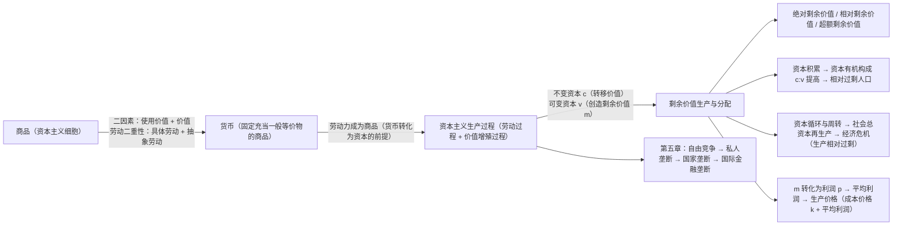
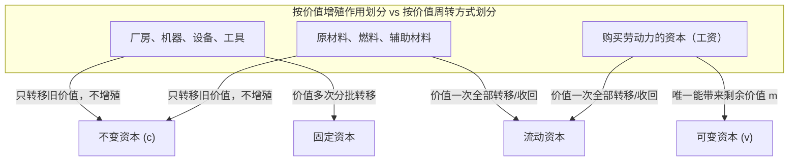

# 07-政治经济学核心考点与计算公式速查｜四、五章选择题 6 分全拿

> [!info] 考情定位与使用说明
> - **题型靶向**：`【100% 仅考选择题！（约 2 道单选 + 2 道多选 = 6 分，绝不考 34 题分析题！）】`
> - **为什么单独建本笔记？**：空卡《1小时学完马原》视频合集聚焦于马哲（第1~3章+导论），而考研政治《马原》试卷中**第四章（资本主义的本质及规律）+ 第五章（资本主义的发展及其趋势）**每年固定占 **6 分选择题**（经常出一道政经计算单选 + 一道商品/剩余价值理解题 + 两道垄断/当代资本主义多选题）。
> - **配套《1000题》范围**：第四章（单选 `T95-145`、多选 `T114-160`）、第五章（单选 `T146-168`、多选 `T161-185`）。
> - **学习策略**：**不背大段文字**！只抓**「二重性一一配对」「政经 7 大计算公式」「根本/直接原因帽子词」**。

---

## 🗺️ 马政经全景逻辑图（从商品 $\to$ 货币 $\to$ 资本 $\to$ 剩余价值 $\to$ 垄断）

---

## 一、商品经济与劳动价值论（第四章第一节）`【仅考选择·单选/多选必考】`

### 1.1 商品经济的产生条件与商品二因素、劳动二重性（终极对位表！）

- **商品经济产生的两个历史条件**：① **社会分工的出现**；② **生产资料和劳动产品属于不同的所有者**（私有制）。
- **商品**是用来**交换**的能满足人们某种需要的**劳动产品**（马克思研究资本主义从分析**商品**开始，因为商品是资本主义社会的“经济细胞”）。

| 维度 | 物质/自然属性线（使用价值 $\leftarrow$ 具体劳动） | 社会/本质属性线（价值 $\leftarrow$ 抽象劳动） |
| :--- | :--- | :--- |
| **1. 商品二因素** | **使用价值**（有用性，如衣服能保暖、面包能充饥） | **价值**（凝结在商品中的无差别的一般人类劳动） |
| **2. 地位与关系** | ① 构成社会财富的**物质内容**； ② 是**自然属性**（一切有用物品都有，永恒范畴）； ③ 是**价值和交换价值的物质承担者**！ | ① 商品特有的**社会属性**（本质属性、历史范畴，体现商品生产者之间相互交换劳动的经济关系）； ② 是**交换价值的基础**，**交换价值是价值的表现形式**。 ★ **对立统一**：商品必须同时具有使用价值和价值；但任何人**不能同时兼得**商品的使用价值和价值（卖者让渡使用价值获得价值，买者支付价值获得使用价值）。 |
| **3. 生产商品的劳动二重性** （★**理解政治经济学的枢纽**） | **具体劳动**（特定形式的劳动，如裁缝做衣服、厨师做面包） - 创造商品的==使用价值==； - 并且在生产中**转移生产资料的旧价值**（把布料的价值转移到衣服里）！ - 体现人与自然的关系（**自然属性**）。 | **抽象劳动**（撇开具体形式的无差别人类脑力体力耗费） - 形成/创造商品的==价值==（是价值的**唯一源泉**！但注意：抽象劳动是**价值的唯一源泉** ✅，具体劳动和自然界共同构成**使用价值的源泉** ✅！）； - 体现商品生产者之间的社会经济关系（**社会属性**）。 |

### 1.2 商品价值量的决定与劳动生产率反套路秒杀表（计算/单选必考！）

- **决定商品价值量的尺度**：不是由个别劳动时间决定的，而是由==社会必要劳动时间==决定的！
- **复杂劳动 vs 简单劳动**：复杂劳动等于**自乘的或多倍的简单劳动**（在商品交换过程中**自发折算**）。
- **★ 劳动生产率变化对「使用价值量（产量）」「单位商品价值量」「商品价值总量」的影响（画表秒杀，永不出错！）**：

| 变化类型 | 使用价值量（商品数量/产量） | 单位商品价值量（由社会必要劳动时间决定） | 同一劳动时间创造的价值总量（$=\text{数量}\times\text{单价}$） |
| :--- | :---: | :---: | :---: |
| **① 部门（社会）劳动生产率提高** | **$\uparrow$ 增加** | **$\downarrow$ 降低**（成反比！） | **不变！**（数量翻倍，单价减半，乘积不变） |
| **② 个别企业劳动生产率提高** | **$\uparrow$ 增加** | **不变！**（单价仍由社会必要劳动时间决定） | **$\uparrow$ 增加！**（数量增加，单价不变，故该企业获得**超额价值/超额剩余价值**） |

### 1.3 货币的产生与五大职能、价值规律与私有制商品经济基本矛盾

1. **货币的本质与五大职能**：
   - **本质**：从商品世界中分离出来**固定地充当一般等价物的商品**。（“金银天然不是货币，但货币天然是金银”）。
   - **货币诞生后的变化**：整个商品世界分化为两极——一极是各种各样的**具体商品**（代表不同的使用价值），另一极是**货币**（代表价值）。这样，**商品内在的使用价值和价值的矛盾，就发展成为外在的商品和货币的矛盾**！
   - **五大职能秒判表**：
     - **① 价值尺度**（最基本职能1）：给商品**标价**（只需要**观念上的货币**，如标价 100 元）。
     - **② 流通手段**（最基本职能2）：**一手交钱一手交货**（商品流通媒介 $W-G-W$，必须是**现实的货币**，可以由纸币/电子货币代为执行，可能引发**通货膨胀**）。
     - **③ 贮藏手段**：退出流通领域作为财富保存（足值的金属货币或黄金白银）。
     - **④ 支付手段**：**钱货分离 / 延期支付 / 先消费后付款或先付款后交货**（看到**“清偿债务、交租金、发工资、缴税款、分期付款、定金、押金”**一律秒选**支付手段**！可能引发债务链断裂的货币危机）。
     - **⑤ 世界货币**：在世界市场上充当一般等价物。
2. **价值规律**：
   - **基本内容**：商品的价值量由生产商品的社会必要劳动时间决定；商品交换以价值量为基础，按照**等价交换**的原则进行。
   - **表现形式**：==商品的价格围绕商品的价值自发波动==（到垄断阶段和生产价格形成后，演变为围绕**生产价格**或**垄断价格**波动，但没有违背价值规律）。
3. **私有制基础上商品经济的基本矛盾**：==私人劳动和社会劳动的矛盾==！（它是商品经济其他一切矛盾如使用价值与价值、具体劳动与抽象劳动、个别劳动时间与社会必要劳动时间矛盾的**根源**，在资本主义制度下进一步发展成资本主义的基本矛盾）。

---

## 二、剩余价值学说与政经 7 大计算公式全解（第四章第二节）`【仅考选择·重中之重★★★】`

### 2.1 劳动力成为商品与货币转化为资本（板书级高频考点）

- **资本总公式及其矛盾**：$G\text{（货币）} - W\text{（商品）} - G'\text{（更多的货币，}G'=G+\Delta G\text{）}$。解决资本总公式矛盾（等价交换却产生了价值增殖 $\Delta G$）的关键，在于说明**劳动力成为商品**！
- **劳动力成为商品是==货币转化为资本的前提==**。
  - **劳动力成为商品的两个基本条件**：① 劳动者有人身自由；② 劳动者一无所有（没有生产资料和生活资料来源）。
- **劳动力商品的价值与使用价值（特殊性）**：
  - **劳动力商品的价值**（即工资的本质）由三部分生活资料的价值构成：① 维持劳动者**本人生存**所必需的生活资料价值；② 维持劳动者**家属的生存**所必需的生活资料价值；③ 劳动者接受**教育和训练**所支出的费用。（此外还包含**历史的和道德的因素**）。
  - **劳动力商品的使用价值（即劳动）的特殊性**：==它的使用价值本身就是价值的源泉，而且能够创造出比它自身价值更大的价值（即剩余价值 $m$）==！
- **资本主义所有制的本质**：资本家凭借对生产资料的占有，在等价交换原则的掩盖下，**雇佣工人从事劳动，无偿占有雇佣工人创造的剩余价值**。

### 2.2 资本主义生产过程的二重性、不变资本 $c$ 与可变资本 $v$

1. **资本主义生产过程的二重性**：是**劳动过程**（具体劳动创造使用价值并转移生产资料旧价值）与**价值增殖过程**（抽象劳动创造新价值 $v+m$，当劳动时间**超过“补偿劳动力价值所需要的时间即必要劳动时间”**延长到**剩余劳动时间**时，价值形成过程就转变为价值增殖过程）的统一。
2. **资本的本质与两种划分（绝不能混！）**：

| 划分标准 | 资本分类 | 各部分包含什么？ | 划分目的（揭露了什么？） |
| :--- | :--- | :--- | :--- |
| **① 根据在剩余价值生产（价值增殖）中所起的不同作用** （马克思首创） | **不变资本（$c$）**  **可变资本（$v$）** | **$c$（购买生产资料的资本）**：包括厂房、机器设备、原材料、燃料辅助材料等。其价值在生产中由工人的**具体劳动转移**到新产品中，**价值量不发生增殖**。 **$v$（购买劳动力的资本，即工人工资）**：由工人的**抽象劳动再生产出来**，并且能**实现价值增殖**（带来剩余价值 $m$）。 | 进一步揭示了**剩余价值的真正源泉是可变资本 $v$（雇佣工人的剩余劳动）**，为确定资本家对工人的剥削程度提供了科学依据。 |
| **② 根据在资本周转中的价值转移方式不同** | **固定资本**  **流动资本** | **固定资本**：厂房、机器、设备、工具等劳动资料（一次投入，多次使用，价值分批逐次转移，存在**有形磨损**和**无形磨损/精神磨损**）。 **流动资本**：包括**原材料、燃料辅助材料（属于 $c$ 的一部分）** + **购买劳动力的可变资本 $v$**（一次投入，价值一次性全部转移或收回）。 | 考察**资本周转速度**对剩余价值生产的影响（注意：**只有不变资本 $c$ 中的厂房机器设备才是固定资本；原材料虽属于不变资本 $c$，但在周转上属于流动资本！**）。 |

### 2.3 政经 7 大必背计算公式一表通（考场遇到计算题直接套！）

| 公式编号与名称 | 数学表达式与符号含义 | 考场做题核心公式变形与必考陷阱 |
| :--- | :--- | :--- |
| **公式1：商品价值构成（$W$）** | $$W = c + v + m$$ | - **$c$**：转移的生产资料旧价值（不变资本消耗）； - **$v+m$**：雇佣工人在生产中**新创造的价值**！（⚠️ 陷阱：问“工人新创造的价值是多少”，只能算 $v+m$，**绝不能把转移过来的 $c$ 算进新创造价值里**！）； - **$k = c + v$**：资本主义**成本价格（生产成本）**。 |
| **公式2：剩余价值率（$m'$）** （剥削率） | $$m' = \frac{m}{v} = \frac{\text{剩余劳动时间}}{\text{必要劳动时间}} = \frac{\text{剩余劳动}}{\text{必要劳动}}$$ | - 准确反映了资本家对雇佣工人的**剥削程度**。 - 常见考法：已知工作日总时长（如 $8\text{h} = \text{必要 }4\text{h} + \text{剩余 }4\text{h} \Rightarrow m'=100\%$），若必要劳动时间缩短为 $2\text{h}$，工作日仍为 $8\text{h}$，则剩余劳动时间变为 $6\text{h}$，$m' = \frac{6}{2} = 300\%$。 |
| **公式3：年剩余价值量（$M$）与年剩余价值率（$M'$）** | $$M = m \cdot n = v \cdot m' \cdot n$$ $$M' = \frac{M}{v} = m' \cdot n$$ | - **$n$**：流动资本（特别是可变资本 $v$）在一年内的**周转次数**。 - ⚠️ 陷阱：计算年剩余价值量 $M$ 时，只能用**实际预付的可变资本 $v \times \text{剩余价值率 } m' \times \text{一年周转次数 } n$**！ |
| **公式4：资本有机构成（$c:v$）** | $$\text{资本有机构成} = c : v$$ | - **技术构成**：由生产技术水平决定的**生产资料和劳动力**之间的比例（物质形态）。 - **价值构成**：**不变资本 $c$ 和可变资本 $v$** 之间的比例（价值形态）。 - **有机构成**：**由资本的技术构成决定并反映技术构成变化的资本价值构成**，公式记作 $c:v$！ - ⚠️ **超级陷阱**：如果只是原材料涨价或工资变动导致 $c:v$ 变化，而技术水平（机器与工人的比例）没变，那**只改变了价值构成，资本有机构成并没有改变**！随着资本主义发展，资本有机构成有**不断提高**的趋势（机器换人，$c$ 比重上升，$v$ 比重相对下降，导致**相对过剩人口/失业**）。 |
| **公式5：利润率（$p'$）** | $$p' = \frac{m}{c + v} = \frac{m}{C_{\text{总预付资本}}}$$ | - 当把剩余价值 $m$ 看作**全部预付资本（$c+v$）的产物**时，剩余价值就转化为**利润（$p$）**。 - 利润和剩余价值本来是同一个东西，但**利润掩盖了剩余价值的真正来源**；且恒有**利润率 $p' < \text{剩余价值率 } m'$**，从而**掩盖了资本家对工人的剥削程度**！ - ⚠️ **极高频单选计算坑**：若机器设备总价值 $100$ 万（使用寿命 $10$ 年，每年折旧转移 $10$ 万），原材料 $20$ 万，工资 $10$ 万：算当期**商品价值 $W$ 或成本价格 $k$** 时，$c$ 只算当期消耗转移的 $10+20=30$ 万；但算**利润率 $p' = \frac{m}{\text{全部预付资本 } C}$** 时，分母必须算**全部投入的预付总资本** $100+20+10=130$ 万！ |
| **公式6：平均利润与生产价格** | $$\text{平均利润率} = \frac{\sum m}{\sum (c+v)}$$ $$\text{生产价格} = \text{成本价格 } k(c+v) + \text{平均利润 } \bar{p}$$ | - **部门之间的竞争**（资本在不同行业间转移）形成了**平均利润率**，使不同部门按等量资本获得等量利润（即平均利润 $\bar{p}$）。 - 价值转化为**生产价格**后，市场价格围绕**生产价格**上下波动。就个别部门看，平均利润与剩余价值可能不一致；但从全社会看，**平均利润总额 $=$ 剩余价值总额，生产价格总额 $=$ 商品价值总额**（没有违背价值规律）。 |
| **公式7：资本主义工资的伪装** | $$\text{工资本质} = \text{劳动力的价值或价格 } (v)$$ | 资本主义工资在现象上表现为“劳动的价值或价格”，从而**模糊了必要劳动和剩余劳动的界限，掩盖了资本主义剥削关系**！（记住：**劳动不是商品，没有价值也没有价格；成为商品的是“劳动力”！**）。 |

### 2.4 剩余价值生产的三种方法：绝对 vs 相对 vs 超额（必考对比！）

| 方法名称 | 如何实现？ | 必要劳动时间 vs 工作日总长度 | 谁能获得？ |
| :--- | :--- | :--- | :--- |
| **① 绝对剩余价值生产** | **绝对延长工作日长度**（如从8小时加班到12小时）或**提高劳动强度** | 必要劳动时间不变，工作日总长度延长 | 整个资本家阶级普遍获得 |
| **② 相对剩余价值生产** | 在工作日总长度不变的前提下，通过提高**全社会劳动生产率**，降低生活资料价值，从而降低劳动力价值 | 工作日总长度不变，**缩短必要劳动时间**，相应延长剩余劳动时间 | 整个资本家阶级普遍获得（它是**各个资本家竞相追逐超额剩余价值的必然结果**！） |
| **③ 超额剩余价值** | **个别企业**率先采用先进技术，提高**本企业的个别劳动生产率**，使本企业商品的**个别价值低于社会价值** | 个别企业的个别必要劳动时间低于社会必要劳动时间 | **只有率先采用先进技术的个别资本家暂时获得**（一旦新技术在全行业普及，该企业的超额剩余价值就消失了，转化为全社会资本家的相对剩余价值！这里体现了**部门内部的竞争**）。 |

### 2.5 资本积累、资本循环与周转、社会再生产与经济危机

1. **资本积累**：
   - **含义**：把**剩余价值转化为资本**（或者说剩余价值的资本化）。
   - **关系**：**剩余价值是资本积累的源泉**；**资本积累是资本主义扩大再生产的源泉**。
   - **后果**：① 资本有机构成（$c:v$）不断提高；② **相对过剩人口**（即失业人口，是资本主义生产方式存在和发展的必要条件——产业后备军）形成；③ 贫富两极分化（财富在一极积累，贫困在另一极积累），加速资本主义灭亡的历史趋势。
   - **区分“资本积聚”与“资本集中”**：
     - **资本积聚**：个别资本通过把自己的剩余价值转化为资本来增大总额（会使**社会总资本增大**）；
     - **资本集中**：大资本吞并小资本，或许多小资本合并成大资本（兼并/股份制，**不会增大社会总资本**，但能极快扩大个别资本规模）。
2. **资本循环的三个阶段、三种职能形式与连续进行的两个条件**：
   - **三个阶段与三种职能形式一一对应**：
     1. **购买阶段**（货币资本 $G \to W$）：为剩余价值生产**准备条件**；
     2. **生产阶段**（生产资本 $W \dots P \dots W'$）：**决定性阶段**！**生产剩余价值**；
     3. **售卖阶段**（商品资本 $W' \to G'$）：**实现剩余价值**（惊险的跳跃，跳不过去摔碎的是商品所有者）。
   - **产业资本连续循环的两个基本条件**：① 三种职能形式在**空间上并存**；② 三种循环形式在**时间上继起**。
3. **社会总资本再生产与资本主义经济危机**：
   - **研究社会总资本再生产的两个基本理论前提（核心问题：社会总产品的实现问题，即价值补偿和实物补偿）**：
     - ① 社会总产品在**价值形态**上分为三个部分：**$c + v + m$**；
     - ② 社会总生产在**实物形态**上分为两大部类：**第一部类（$\text{I}$：生产生产资料的部门）**和**第二部类（$\text{II}$：生产消费资料的部门）**。
   - **资本主义经济危机**：
     - **本质特征**：==生产相对过剩==！（即相对于劳动人民有支付能力的需求来说社会生产的商品显得过剩，而不是与劳动人民的实际需要相比的绝对过剩）。
     - **经济危机的抽象的一般的可能性**：由**货币作为流通手段和支付手段**引起的；
     - **经济危机爆发的==根本原因==**：**资本主义的基本矛盾**，即==生产社会化和生产资料资本主义私人占有之间的矛盾==！
     - **资本主义基本矛盾的两个具体表现**：① 生产无限扩大的趋势与劳动人民有支付能力的需求相对缩小的矛盾；② 个别企业内部生产的有组织性和整个社会生产的无政府状态之间的矛盾。
     - **周期性（危机 $\to$ 萧条 $\to$ 复苏 $\to$ 高涨）的物质基础**：**固定资本的周期性大规模更新**（其中**危机阶段**是周期的**必经阶段和基本阶段**）。

---

## 三、资本主义的发展及其趋势：从自由竞争到垄断（第五章）`【仅考选择·约2分】`

### 3.1 私人垄断、金融资本与垄断利润、垄断价格

1. **资本主义发展的两个阶段**：自由竞争资本主义 $\longrightarrow$ **垄断资本主义**（包括**私人垄断资本主义**和**国家垄断资本主义**两个发展时期，19世纪末20世纪初进入垄断阶段）。
2. **垄断与竞争的关系（必考避坑！）**：
   - 自由竞争引起生产集中和资本集中，生产集中和资本集中发展到一定阶段必然引起**垄断**。
   - ⚠️ **垄断产生后，❌ 绝没有消除竞争，而是使竞争更加激烈、更加复杂**！为什么垄断不能消除竞争？① 垄断没有消除产生竞争的经济条件（商品经济）；② 垄断必须通过竞争来维持；③ 任何垄断组织都不可能包揽全部社会生产（还存在大量非垄断中小企业）。
3. **金融资本与金融寡头（三大统治方式，一字不差背对位！）**：
   - **金融资本**是由**工业垄断资本**和**银行垄断资本**融合在一起而形成的一种垄断资本。
   - **金融寡头**操纵国民经济命脉的方式：
     - ① 在**经济领域**中的统治：主要通过==“参与制”==（层层控股）来实现；
     - ② 在**政治领域**中的统治：主要通过==“个人联合”==（亲自担任政府要职或收买代理人）来实现；
     - ③ 在**社会生活领域**：通过建立==政策咨询机构==、掌握新闻科教文化媒介来左右内外政策。
4. **垄断利润与垄断价格**：
   - **垄断利润的来源**：归根到底来自**无产阶级和其他劳动人民所创造的剩余价值**（包括本企业工人、非垄断企业工人、外国劳动者以及通过国家再分配转移的价值）。
   - **垄断利润的实现途径**：主要通过垄断组织制定的==垄断价格==来实现。
   - **公式**：
     $$\text{垄断价格} = \text{成本价格 } (c+v) + \text{平均利润} + \text{垄断利润}$$
     （分为**垄断高价**和**垄断低价**。垄断价格的产生**没有否定价值规律**，全社会商品的价格总额仍然等于商品的价值总额！）。

### 3.2 国家垄断资本主义、国际垄断与当代资本主义新变化

1. **国家垄断资本主义（二战后广泛迅速发展）**：
   - **本质**：是**国家政权和私人垄断资本融合在一起**的垄断资本主义。
   - **五种主要形式**：① 国家所有并直接经营的企业；② 国家与私人共有、合营企业；③ 国家通过多种形式参与私人垄断资本的再生产过程（政府采购、津贴补助）；④ **宏观调节**（财政政策、货币政策，调节社会总供给与总需求）；⑤ **微观规制**（反托拉斯法、公共事业规制、社会经济规制，规范市场秩序）。
   - **评价**：在一定程度上促进了生产力发展，突破了私人垄断资本的狭隘界限；但**并没有根本改变资本主义所有制性质，也没有消除资本主义基本矛盾**。
2. **垄断资本向世界范围的扩展（三种基本形式对应三种资本）**：
   - ① **借贷资本输出**（借钱收息）；
   - ② **生产资本输出**（直接投资办厂）；
   - ③ **商品资本输出**（出口商品）。
   - **当代经济全球化的三大表现**：生产全球化、贸易全球化、金融全球化。
   - **经济全球化的动因（三个推动力量）**：① **科学技术的进步和生产力的发展**（根本动因/物质基础）；② **跨国公司的发展**（企业组织形式）；③ **各国经济体制的变革**（制度保障）。
3. **当代资本主义变化的新特征（二十大/新大纲重点：国际金融垄断资本主义）**：
   - 当代资本主义最突出特征：**国际金融资本的垄断**（经济“脱实向虚”、金融化、虚拟化，制造业空心化，社会阶层分化加剧，民粹主义抬头，周期性金融危机频发）。
   - **当代资本主义发生新变化的原因**：
     - ① ==科学技术革命和生产力的发展==，是当代资本主义发生新变化的**根本推动力量**；
     - ② **工人阶级争取自身权利和利益的斗争**，是重要力量；
     - ③ 社会主义制度初步显示的优越性对资本主义产生了重要影响；
     - ④ 主张改良主义的政党对资本主义制度的改革。
   - **新变化的实质（多选题定性必背两句话）**：
     - ① 当代资本主义发生的变化从根本上说是人类社会发展一般规律和资本主义经济规律作用的结果；
     - ② 当代资本主义发生的变化**是在资本主义制度基本框架内的变化，并不意味着资本主义生产关系的根本性质发生了变化**（没有改变资本剥削雇佣劳动的本质，没有克服资本主义的基本矛盾，资本主义必然为社会主义所代替的历史总趋势不可逆转）。

---

## 🎙️ 假装当老师·遮挡自测（念逐字稿留存 90%）

1. **商品的二因素和生产商品的劳动二重性分别是什么？谁是“理解政治经济学的枢纽”？当“部门劳动生产率提高”和“个别企业劳动生产率提高”时，单位商品价值量和价值总量分别怎么变？** ⌜⌟
2. **货币转化为资本的前提是什么？劳动力商品的使用价值有什么特殊性？不变资本 $c$、可变资本 $v$ 与固定资本、流动资本是怎么交叉对应的？** ⌜⌟
3. **请口述剩余价值率 $m'$、利润率 $p'$、资本有机构成、生产价格、垄断价格的公式！工人“新创造的价值”包含 $c$ 吗？** ⌜⌟
4. **资本主义经济危机的“本质特征”和“根本原因”分别是什么？金融寡头在经济上和政治上分别通过什么方式统治？当代资本主义发生新变化的“根本推动力量”和“实质”是什么？** ⌜⌟

> [!note]- 点击核对本节复述标准答案
> 1. **商品二因素、劳动二重性与劳动生产率**：
>    - 商品二因素：**使用价值**（自然属性，社会财富物质内容，价值的物质承担者）和**价值**（社会属性/本质属性）。
>    - 劳动二重性（**理解政治经济学的枢纽**）：**具体劳动**（创造使用价值，并转移生产资料旧价值 $c$）和**抽象劳动**（创造新价值 $v+m$，是价值的唯一源泉）。
>    - **部门（社会）劳动生产率提高**：单位商品价值量**降低**，同一时间创造的价值总量**不变**；**个别企业劳动生产率提高**：单位商品价值量**不变**，该企业创造的价值总量**增加**（获得超额剩余价值）。
> 2. **劳动力商品与资本两种划分**：
>    - 货币转化为资本的前提是**劳动力成为商品**。其使用价值（劳动）的特殊性在于：**它本身就是价值的源泉，能创造出比自身价值（$v$）更大的价值（$v+m$）**。
>    - 按价值增殖作用分：**不变资本 $c$**（厂房机器+原材料）和**可变资本 $v$**（工资）；按周转方式分：**固定资本**（仅厂房机器设备）和**流动资本**（原材料 + 工资 $v$）。**注意：原材料在增殖上属于不变资本 $c$，但在周转上属于流动资本！**
> 3. **政经五大核心公式**：
>    - 剩余价值率（剥削率）：$m' = \frac{m}{v} = \frac{\text{剩余劳动时间}}{\text{必要劳动时间}}$；
>    - 利润率：$p' = \frac{m}{c+v}$（分母是**全部预付总资本**，恒有 $p' < m'$）；
>    - 资本有机构成：由**资本技术构成决定并反映技术构成变化**的资本价值构成（$c:v$）；
>    - 生产价格 $= \text{成本价格 } (c+v) + \text{平均利润}$；垄断价格 $= \text{成本价格 } (c+v) + \text{平均利润} + \text{垄断利润}$。
>    - 避坑：工人新创造的价值**只等于 $v+m$**，不包含具体劳动转移过来的生产资料旧价值 $c$！
> 4. **经济危机、金融寡头与当代资本主义**：
>    - 经济危机本质特征：**生产相对过剩**；根本原因：**资本主义基本矛盾**（生产社会化和生产资料资本主义私人占有之间的矛盾）。
>    - 金融寡头统治方式：经济上通过**“参与制”**，政治上通过**“个人联合”**。
>    - 当代资本主义新变化的根本推动力量：**科学技术革命和生产力的发展**；实质：**是在资本主义制度基本框架内的变化，并没有改变资本主义生产关系的根本性质**。
