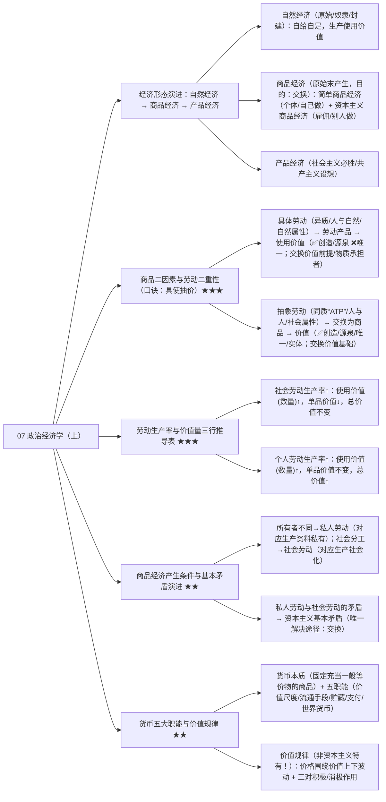
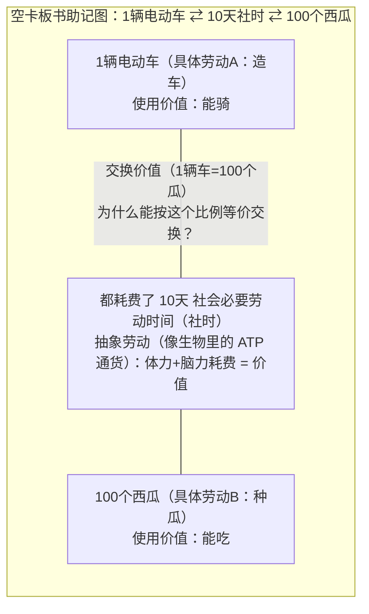
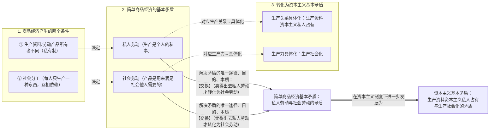

# 07-政治经济学（上）｜商品经济、具使抽价、劳动生产率公式与货币价值规律

> [!info] 考情定位与使用说明
> - **题型靶向**：`【100% 仅考选择题！（空卡强调：政经和科社绝不会考34题分析大题，只考单选与多选！）】`
>   - **核心高频考法**：① 自然经济 vs 商品经济 vs 产品经济；② **“具使抽价”**（具体劳动与使用价值、抽象劳动与价值的唯一源泉/实体辨析）；③ **劳动生产率变化三行公式秒杀表**；④ 简单商品经济基本矛盾（私人劳动与社会劳动）向资本主义基本矛盾的转化；⑤ 货币五大职能与价值规律的作用（积极 vs 消极一一对应）。
> - **视频来源**：[空卡《30分钟学完政治经济学、科学社会主义》P1：27政经(上)（18:00）](https://www.bilibili.com/video/BV1YnYL6SESt/?p=1)
> - **配套《1000题》范围**（空卡片尾布置）：单选 `P15-17 T95-119`；多选 `P46-47 T114-127`。

---

## 🗺️ 全节思维导图（还原视频上下两屏完整板书）

---

## 一、经济形态演进、商品二因素与劳动二重性（视频 [00:00–10:15]）`【仅考选择·单选/多选必考★★★】`

> [!note]- 原始视频板书截图（溯源：P1 第一屏「商品经济、具使抽价与劳动生产率表格」）
> ![[考研政治/1-马原/assets/07-政经上-商品经济与劳动生产率板书.jpg]]

### 1.1 三大经济形态历史演进线（板书顶部）

在进入商品分析前，空卡在板书最上方梳理了人类社会经济形态的演进脉络（**单选题常考“商品经济是不是存在于一切社会”！**）：

| 经济形态 | 存在社会阶段 | 核心特征与生产目的 |
| :--- | :--- | :--- |
| **① 自然经济** | **原始社会、奴隶社会、封建社会**（占统治地位） | **自给自足**（自己种地自己吃，不拿去卖），生产的直接目的是获取**使用价值**。 |
| **② 商品经济** | **原始社会末期**开始产生 $\longrightarrow$ 奴隶、封建（补充地位） $\longrightarrow$ 资本主义社会（普遍化/最高阶段） & 社会主义初级阶段 | 以**==交换==**为目的而进行生产的经济形式！分为两个阶段： - **简单商品经济**：以生产资料私有制和**个体劳动（自己做）**为基础； - **资本主义商品经济**：以生产资料私有制和**雇佣劳动（别人做）**为基础。 |
| **③ 产品经济** | 马克思设想的未来**社会主义必胜 / 共产主义高级阶段** | 生产力高度发达，消灭私有制和商品货币交换，全社会按计划生产、按需分配（⚠️ 这说明**商品经济和价值规律是历史范畴，不是永恒范畴**！）。 |

---

### 1.2 商品二因素与劳动二重性（空卡王牌口诀：“具使抽价” + 电动车换西瓜图）

- **什么是商品？**：用来**==交换==**的、能满足人们某种需要的**==劳动产品==**。
  - **两步走**：先通过**具体劳动**生产出有用的**劳动产品**（具有使用价值）；再拿去**交换**，凝结在里面的**抽象劳动**才表现为**价值**，劳动产品才变成**商品**！
- **空卡核心口诀**：“==具使抽价==”（**具**体劳动对应**使**用价值，**抽**象劳动对应**价**值）——**劳动二重性是“理解政治经济学的枢纽”**！

#### 「具使抽价」全考点精析对位表（板书中部红绿标记 100% 还原！）

| 对比维度 | 具体劳动 $\longrightarrow$ 使用价值（“具使”） | 抽象劳动 $\longrightarrow$ 价值（“抽价”） |
| :--- | :--- | :--- |
| **1. 劳动二重性内涵** | **具体劳动**：生产一定使用价值的**具体形式的劳动**（如造电动车和种西瓜，劳动目的、工具、对象、结果都不同）： - 属于**异质**劳动（不同质，没法直接比大小）； - 体现的是**人与自然**的关系，是劳动的==自然属性==。 | **抽象劳动**：撇开一切具体形式的、无差别的一般人类劳动（即人的**体力+脑力**耗费，空卡比喻成生物学里所有生命活动通用的能量货币 **ATP 循环**）： - 属于**同质**劳动（同质的劳动量才能比较多少）； - 体现的是商品生产者之间**人与人**的社会经济关系，是劳动的==社会属性==。 |
| **2. 决定/创造与「唯一源泉」辨析（★极高频陷阱！）** | 具体劳动生产出**劳动产品**，决定/构成商品的**使用价值**： - ✅ 具体劳动**创造**使用价值； - ✅ 具体劳动是使用价值的**源泉**； - ❌ **但具体劳动绝不是使用价值的“唯一源泉”**！（因为造电动车、种西瓜不仅要靠人的具体劳动，还必须有**自然物质/自然界**提供材料，如威廉·配第所说“劳动是财富之父，土地是财富之母”）。 | 抽象劳动通过**交换**使劳动产品成为**商品**，决定商品的**价值**： - ✅ 抽象劳动**创造**价值； - ✅ 抽象劳动是价值的**源泉**； - ✅ **抽象劳动是价值的==唯一源泉==**！（自然界不创造任何价值，价值里不包含任何一个自然物质的原子！）； - ✅ 抽象劳动是价值的==实体==。 |
| **3. 商品二因素内涵与对立统一** | **使用价值**：商品能满足人们某种需要的属性（即商品的**有用性**，构成社会财富的物质内容）： - 属于商品的**自然属性**； - **买家和卖家对使用价值和价值==不可兼得==**（卖西瓜的人必须把西瓜的使用价值让渡给买家，才能拿到钱即实现价值；买家必须付钱让渡价值，才能吃到西瓜获得使用价值）。 | **价值**：凝结在商品中的无差别的一般人类劳动（即耗费的**体力+脑力 / 劳动量**）： - 属于商品特有的**社会属性**（本质属性）； - **价值的衡量尺度**：由生产该商品的==社会必要劳动时间（简称“社时”）==决定和衡量！（❌ 不是由个别劳动时间决定的）。 |
| **4. 与「交换价值」的关系（单选必考帽子词！）** | 使用价值是交换价值的==前提==和==物质承担者==！（如果西瓜烂了没法吃、没有使用价值，就没人买，价值和交换价值就无法实现）。 | 价值是交换价值的==基础==（本质/内容），交换价值是价值的==表现形式==！（先有凝结在里面的 10 天社时价值作基础，才表现出 1 辆电动车换 100 个西瓜的交换比例）。 |

> [!warning] 常见干扰项（❌ 错 vs ✅ 对）
> - ❌ **错误说法1**：「劳动是一切社会财富（使用价值）的唯一源泉。」
>   - ✅ **纠偏**：抽象劳动是**价值的唯一源泉** ✅；但**使用价值（社会财富的物质内容）的源泉有两个——具体劳动 + 自然界（自然物质）**，所以劳动不是使用价值的唯一源泉！
> - ❌ **错误说法2**：「有使用价值的东西一定有价值，有价值的东西不一定有使用价值。」
>   - ✅ **纠偏**：完全说反了！**有使用价值的东西不一定有价值**（如天然空气、阳光，以及农民自己种自己吃不拿去交换的粮食，有使用价值但不是商品，没有价值）；而**有价值的东西（商品）一定具有使用价值**（因为使用价值是价值的物质承担者，没有使用价值的废品卖不出去，价值无法实现）！

---

### 1.3 劳动生产率与商品价值量：空卡三行分数推导秒杀表（板书下部·永不死记硬背！）

很多同学背“社会劳动生产率、个别劳动生产率与单位商品价值量、总价值量”总是背混。空卡在板书下方给出了一套**纯数学分数约分推导法**，考场上 5 秒钟就能推出来：

- **第一步：先记死「社会劳动生产率」的定义公式**：
  $$\text{社会劳动生产率} = \frac{\text{数量}}{\text{总社时}} = \frac{1}{\text{单社时}}$$
  （意思是：单位社会必要劳动时间内生产的产品数量越多，或者生产单个产品所需的单社时越短，劳动生产率就越高！注意：**决定单个商品价值量的永远是“社会劳动生产率 / 单社时”，跟“个人劳动生产率”半毛钱关系都没有！**）。
- **第二步：把三个问题全部写成含有“数量”和“（社）劳动生产率”的公式，直接看分子分母箭头！**

| 考察指标 | 空卡核心转化公式 | ① 当【社会】劳动生产率 $\uparrow$ 时 | ② 当【个人（个别企业）】劳动生产率 $\uparrow$ 时 |
| :--- | :--- | :--- | :--- |
| **1. 使用价值量** （生产出的产品总数量） | $$\text{使用价值量} = \text{数量}$$ | **$\uparrow$ 增加**（全社会效率高了，造出来的商品数量当然变多） | **$\uparrow$ 增加**（个人手脚快了，造出来的商品数量也变多） |
| **2. 单产品价值** （单个商品的价值量） | $$\text{单产品价值} = \text{单社时} = \frac{1}{\text{（社）劳动生产率}}$$ | **$\downarrow$ 降低**！ （推导：分母 $\text{社会劳动生产率}\uparrow \implies \frac{1}{\uparrow} \implies \downarrow$，成反比！） | **不变**！ （推导：公式分母是**社会**劳动生产率，个人效率提高不改变全社会的劳动生产率，即 $\frac{1}{\text{不变}} \implies \text{不变}$！） |
| **3. 总产品价值** （同一劳动时间创造的价值总量） | $$\text{总产品价值} = \text{总社时} = \frac{\text{数量}}{\text{（社）劳动生产率}}$$ | **不变**！ （推导：社会劳动生产率提高 2 倍，分子 $\text{数量}\uparrow$ 2 倍，分母 $\text{社劳率}\uparrow$ 2 倍，$\frac{\uparrow}{\uparrow}$ 分子分母同倍率抵消 $\implies$ **总价值不变**！） | **$\uparrow$ 增加**！ （推导：个人效率提高，分子 $\text{数量}\uparrow$，但分母 **社会劳动生产率不变**，$\frac{\uparrow}{\text{不变}} \implies$ **该个人/企业创造的价值总量增加**！多赚的就是超额价值）。 |

---

## 二、商品经济的基本矛盾、货币五职能与价值规律（视频 [10:15–18:00]）`【仅考选择·超高频】`

> [!note]- 原始视频板书截图（溯源：P1 第二屏「基本矛盾演进、货币五职能与价值规律作用」）
> ![[考研政治/1-马原/assets/07-政经上-基本矛盾与货币价值规律板书.jpg]]

### 2.1 商品经济产生的两个条件与「基本矛盾」演进全图（板书上半部）

空卡用一张极具穿透力的左右对齐图，把**“商品经济产生的两个条件” $\to$ “私人劳动与社会劳动的矛盾” $\to$ “资本主义基本矛盾”**串成了一条线：

- **核心考点提炼**：
  1. **商品经济产生的两个历史条件**：① **社会分工**的出现（决定了劳动具有**社会劳动**的性质）；② **生产资料和劳动产品属于不同的所有者**（决定了劳动具有**私人劳动**的性质）。
  2. **简单商品经济（私有制商品经济）的基本矛盾**：==私人劳动和社会劳动的矛盾==！
     - **解决这一矛盾的唯一途径**：==商品交换==！（只有通过交换把商品卖出去，私人劳动才能被社会承认，转化为社会劳动；如果卖不出去，私人劳动就无法转化为社会劳动，商品生产者就会破产）。
     - **历史演进**：随着简单商品经济发展为资本主义商品经济，**私人劳动与社会劳动的矛盾**就进一步发展成为**资本主义的基本矛盾**——即==生产资料资本主义私人占有和生产社会化之间的矛盾==（其中“生产社会化”是生产力层面的具体表现，“生产资料私有”是生产关系层面的具体表现）。
  3. **复杂劳动转化为简单劳动（板书右侧重点红绿标！）**：
     - 复杂劳动等于**自乘的或多倍的简单劳动**；
     - 在商品经济中，**复杂劳动转化为简单劳动的尺度是如何确定的？**
       - ✅ 是在商品交换过程中**==自发==实现的**（由社会过程在生产者背后自发地完成）；
       - ❌ **绝不是靠人为事先“计算”或按固定数学公式算出来的！**（选项里只要出现“通过科学计算将复杂劳动折算为简单劳动”，直接打 ❌！）。

---

### 2.2 货币的产生、本质与五大职能（板书左下角）

- **商品价值形式发展的四个阶段**：简单的或偶然的价值形式（1只羊换2把斧子） $\to$ 总和的或扩大的价值形式 $\to$ 一般价值形式 $\to$ **货币形式**（用金银固定充当一般等价物）。
- **货币的本质**：从商品世界中分离出来==固定地充当一般等价物的商品==。
  - **货币产生后的后果**：整个商品世界分化为两极——一极是各种各样的**具体商品**（分别代表不同的**使用价值**），另一极是**货币**（代表**价值**）。从此，**商品内部使用价值与价值的内在矛盾，就外化为商品与货币的外部对立**！
- **货币的五大职能（前两个是基本职能）**：

| 货币职能 | 是否基本职能 | 核心判定词与考题标志 |
| :--- | :---: | :--- |
| **① 价值尺度** | ⭐ **基本职能** | 给商品**标价**（衡量和表现一切商品价值大小）。**特点**：只需要**观念上的货币**（吊牌上写“售价 299 元”，不需要在吊牌上真贴 299 块钱）。 |
| **② 流通手段** | ⭐ **基本职能** | **一手交钱，一手交货**（充当商品交换的媒介，即商品流通 $W-G-W$）。**特点**：必须是**现实的货币**，但可以由不足值的铸币或纸币/电子货币代为执行。（注：货币作为流通手段打破了直接物物交换的时空限制，买卖脱节，**蕴含了经济危机的抽象可能性**）。 |
| **③ 贮藏手段** | 派生职能 | 货币退出流通领域，作为社会财富的一般代表被保存起来（传统上必须是足值的金属货币或金银条块）。 |
| **④ 支付手段** | 派生职能 | **钱货分离 / 延期支付 / 先拿货后给钱或先给钱后交货**！ 🔥 **秒选标志词**：**清偿债务（还债）、交房租/地租、发工资、缴税款、分期付款、赊购赊销、定金**。（货币作为支付手段使商品生产者之间形成债权债务链条，进一步加深了经济危机的可能性）。 |
| **⑤ 世界货币** | 派生职能 | 越出国内市场，在国际市场上充当一般等价物（国际支付手段、国际购买手段、社会财富国际转移手段）。 |

---

### 2.3 价值规律：内容、表现形式与「积极 vs 消极」三对作用（板书右下角）

1. **价值规律的适用范围（空卡视频 [14:00] 互动提问弹窗原题！）**：
   - > ❓ **空卡现场提问**：「价值规律是资本主义社会特有的经济规律吗？」
   - > **答案**：❌ **绝对错误！价值规律是==商品经济==的基本规律**！只要存在商品生产和商品交换（无论是奴隶社会、封建社会的简单商品经济，还是资本主义商品经济，乃至社会主义市场经济），价值规律就必然存在并发生作用！它绝不是资本主义特有的经济规律（**剩余价值规律**才是资本主义特有的基本经济规律）。
2. **价值规律的基本内容**：
   - 商品的价值量由生产商品的**社会必要劳动时间**决定；
   - 商品交换以价值量为基础，按照**等价交换**的原则进行。
3. **价值规律的表现形式（板书右侧波浪图）**：
   - **==商品的价格围绕商品的价值自发波动==**（价格受供求关系影响，供不应求时价格高于价值，供过于求时价格低于价值，但从长期和全社会来看，高出的部分和低出的部分相互抵消，平均价格依然与价值相符，所以**价格围绕价值上下波动不仅没有违背价值规律，反而正是价值规律发生作用的唯一表现形式**！）。
   - **顺带记忆价格的三个延伸考点**：
     - ① 价格是价值的货币表现（**价值决定价格**，供求关系和货币币值影响价格）；
     - ② 当生产价格形成后，表现形式演变为**市场价格围绕生产价格上下波动**；到了垄断阶段，表现为**垄断价格**。
4. **价值规律的三大积极作用 vs 三大消极后果（板书右下角一一对应表，多选必背！）**：

| 维度 | ✅ 积极作用（自发调节的三方面） | ❌ 消极后果（自发调节带来的三大弊端，与左列严格一一对应！） |
| :--- | :--- | :--- |
| **1. 资源配置** | 自发地调节**生产资料和劳动力**在社会各生产部门之间的**分配比例**（什么赚钱大家就一窝蜂去生产什么）。 | 事后调节具有盲目性，可能导致**==社会资源浪费==**（比例失调、重复建设、产能过剩）。 |
| **2. 技术与生产力** | 自发地**刺激社会生产力的发展**（商品生产者为了降低个别劳动时间赚取超额利润，拼命改进技术、改善经营管理）。 | 可能导致**==阻碍技术的进步==**！（为什么会阻碍技术进步？因为率先采用先进技术的商品生产者为了长期独占超额利润，往往会**保守技术秘密、搞技术封锁**，阻碍新技术在全社会的普及！）。 |
| **3. 收入分配** | 自发地**调节社会收入的分配**（优胜劣汰，效率高的多赚钱）。 | 导致商品生产者优胜劣汰，引起**==收入两极分化==**（富者愈富，贫者愈贫）。 |

---

## 🎙️ 假装当老师·遮挡自测（念逐字稿留存 90%）

1. **商品经济的目的是什么？它分为哪两个阶段？“具使抽价”四个字分别代表什么？谁是价值的“唯一源泉”？具体劳动是不是使用价值的“唯一源泉”？使用价值和价值分别与“交换价值”是什么关系？** ⌜⌟
2. **请用空卡的三个分数公式推导：当“社会劳动生产率提高”和“个人劳动生产率提高”时，使用价值量（数量）、单产品价值、总产品价值分别怎么变？** ⌜⌟
3. **商品经济产生的两个条件分别决定了什么劳动？简单商品经济的基本矛盾是什么？它是怎么转化为资本主义基本矛盾的？复杂劳动转化为简单劳动是靠“人为计算”还是“自发实现”？** ⌜⌟
4. **货币的本质是什么？五大职能中哪两个是基本职能？发工资、交房租、还债、交税属于什么职能？价值规律是资本主义特有的规律吗？它的三大积极作用分别对应哪三个消极后果（为什么会阻碍技术进步）？** ⌜⌟

> [!note]- 点击核对本节复述标准答案
> 1. **商品经济与“具使抽价”**：
>    - 商品经济以**交换**为目的，分为**简单商品经济**（个体劳动、自己做）和**资本主义商品经济**（雇佣劳动、别人做）。
>    - **具使抽价**：**具体劳动**（异质、人与自然、自然属性）生产劳动产品，创造**使用价值**（**不是唯一源泉**，还要加上自然界物质条件）；**抽象劳动**（同质“ATP”、人与人、社会属性）通过交换成为商品，创造**价值**（**是价值的唯一源泉和实体**，由社会必要劳动时间决定）。
>    - **使用价值**是交换价值的**前提和物质承担者**；**价值**是交换价值的**基础**，**交换价值**是价值的**表现形式**（买家卖家对使用价值和价值不可兼得）。
> 2. **劳动生产率三行分数公式推导**：
>    - 定义：$\text{社会劳动生产率} = \frac{\text{数量}}{\text{总社时}} = \frac{1}{\text{单社时}}$。
>    - ① **使用价值 $=\text{数量}$**：社会$\uparrow \implies \uparrow$；个人$\uparrow \implies \uparrow$。
>    - ② **单产品价值 $=\frac{1}{\text{社劳率}}$**：社会$\uparrow \implies \frac{1}{\uparrow} \implies \downarrow$（降低）；个人$\uparrow \implies \frac{1}{\text{不变}} \implies \text{不变}$。
>    - ③ **总产品价值 $=\frac{\text{数量}}{\text{社劳率}}$**：社会$\uparrow \implies \frac{\uparrow}{\uparrow} \implies \text{不变}$；个人$\uparrow \implies \frac{\uparrow}{\text{不变}} \implies \uparrow$（增加）。
> 3. **商品经济条件与基本矛盾**：
>    - ① 生产资料/产品所有者不同 $\to$ 决定**私人劳动**（对应生产关系 $\to$ 生产资料私有）；② 社会分工 $\to$ 决定**社会劳动**（对应生产力 $\to$ 生产社会化）。
>    - 简单商品经济基本矛盾是**私人劳动与社会劳动的矛盾**（解决唯一途径是**交换**），在资本主义下发展为**生产资料资本主义私人占有与生产社会化的矛盾**。
>    - 复杂劳动转化为简单劳动是在交换中**✅ 自发实现的**（❌ 不是靠人为计算出来的）。
> 4. **货币与价值规律**：
>    - 货币本质：**固定充当一般等价物的商品**。两大基本职能是**价值尺度**（观念货币、标价）和**流通手段**（现实货币、一手交钱一手交货）；还债、房租、工资、税款属于**支付手段**。
>    - 价值规律是**商品经济**的规律（❌ 不是资本主义特有），表现形式是**价格围绕价值自发波动**。
>    - 三对积极 vs 消极作用：① 调节生产资料分配 $\leftrightarrow$ **社会资源浪费**；② 刺激生产力发展 $\leftrightarrow$ **阻碍技术进步**（为保超额利润保守技术秘密）；③ 调节收入分配 $\leftrightarrow$ **收入两极分化**。
