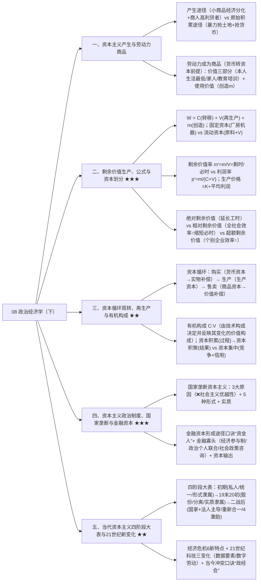
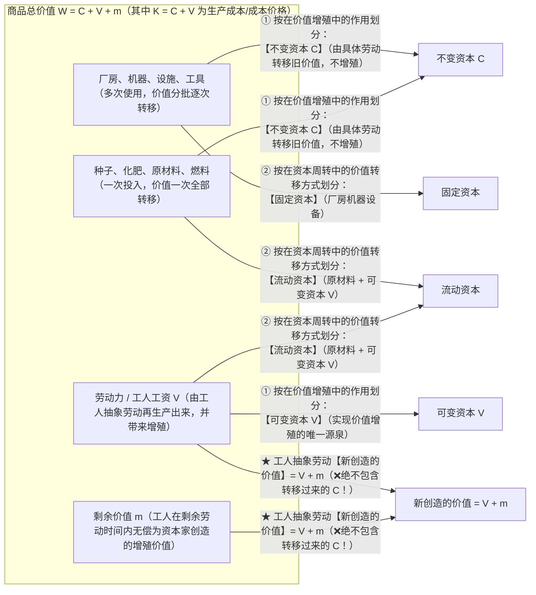

# 08-政治经济学（下）｜剩余价值公式、资本循环危机、金融垄断与四阶段新变化

> [!info] 考情定位与使用说明
> - **题型靶向**：`【100% 仅考选择题！（空卡强调：政经绝不考34题分析大题，只考单选计算/概念辨析与多选！）】`
>   - **核心高频考法**：① 资本主义产生途径 vs 原始积累途径、劳动力商品价值最低界限；② **$W=C+V+m$、不变资本/可变资本 vs 固定资本/流动资本、利润率 $p'$ 与剩余价值率 $m'$ 计算**；③ 绝对/相对/超额剩余价值；④ 资本循环三阶段（实物补偿 vs 价值补偿）与经济危机；⑤ 资本有机构成 $C:V$、资本积累 $\to$ 资本积聚 vs 资本集中（杠杆：竞争+信用）；⑥ 国家垄断资本主义形成原因（❌ 社会主义优越性）、金融资本口诀**“资金人”**、资本输出；⑦ **所有制与劳资关系四阶段演变大表**、21世纪新变化与冲突口诀**“政经会”**。
> - **视频来源**：[空卡《30分钟学完政治经济学、科学社会主义》P2：27政经（下）（26:03）](https://www.bilibili.com/video/BV1YnYL6SESt/?p=2)
> - **配套《1000题》范围**（空卡片尾布置）：单选 `P17-24 T120-174`；多选 `P48-55 T128-190`。

---

## 🗺️ 全节思维导图（还原视频四屏完整板书）

---

## 一、资本主义产生途径与劳动力成为商品（视频 [00:00–05:15]）`【仅考选择·单选/多选高频】`

> [!note]- 原始视频板书截图（溯源：P2 第一屏顶部「资本主义产生、原始积累与劳动力商品」）
> ![[考研政治/1-马原/assets/08-政经下-资本主义产生与劳动力商品板书.jpg]]

### 1.1 资本主义的两大基础、「生产关系产生途径」 vs 「资本原始积累途径」（板书顶部必背区分！）

- **资本主义经济制度的两大基础**：① **生产资料资本主义私有制**；② **雇佣劳动**（核心标志：**劳动力成为商品**）。
- ⚠️ **极易混淆的两组“两个途径”（考题经常张冠李戴！）**：

| 必考问题 | 两个具体途径（视频板书原文精准对位） | 核心记忆点 |
| :--- | :--- | :--- |
| **① 资本主义生产关系产生的两个途径** （从封建社会内部是怎么长出来的？） | 1. 从**小商品经济**分化出来； 2. 从**==商人和高利贷者==**转化而成。 | 问“生产关系产生途径”找**小商品分化 + 商人高利贷者**！ |
| **② 资本原始积累的两个途径** （如何用暴力加速催化资本主义？） | 1. **用暴力手段剥夺农民的土地**（如英国“羊吃人”的圈地运动，制造大批一无所有的自由雇佣工人）； 2. **用暴力手段掠夺货币财富**（殖民掠夺、贩卖黑奴、国债制度等，积累大量货币资本）。 | **资本原始积累的实质**：用**暴力手段**迫使生产者与生产资料相分离，并把生产资料和货币财富集中到少数资本家手中（“资本来到世间，从头到脚，每个毛孔都滴着血和肮脏的东西”）。 |

---

### 1.2 劳动力成为商品与货币转化为资本（板书顶部右侧）

1. **货币转化为资本的前提**：==劳动力成为商品==！（在奴隶社会、封建社会货币只是买东西的钱，只有当货币能买到“劳动力”这种特殊商品、用来剥削剩余价值时，货币才变成了**资本**）。
   - **劳动力成为商品的两个基本条件**：① 劳动者是自由人，能够把自己的劳动力当作自己的商品来支配（**有人身自由**）；② 劳动者没有别的商品可以出卖，“自由”得**一无所有**，没有任何实现自己劳动力所必需的生产资料和生活资料。
2. **劳动力商品的「价值」（即工资的本质）与最低界限**：
   - 像任何商品一样，劳动力商品的价值也是由**生产和再生产劳动力商品的社会必要劳动时间**决定的，这可以还原为生产**维持劳动者生存所必需的生活资料的价值**，具体包括**三部分**（此外还包含**历史和道德的因素**）：
     - ① 维持劳动者**本人生活**所必需的生活资料的价值（★ 板书红字强调：这是劳动力价值的==最低界限==！如果工资连工人的基本温饱生存都维持不了，劳动力就无法正常再生产）；
     - ② 维持劳动者**家人（家属/子女）生活**所必需的生活资料的价值（保证劳动力的延续和替补）；
     - ③ 劳动者接受**教育和培训**所支出的费用。
3. **劳动力商品的「使用价值」（即劳动）的特殊性**：
   - 一般商品（如苹果）在消费掉使用价值时，它的价值也随之消失或仅发生转移；
   - 但**劳动力商品的使用价值就是==劳动==**，==它的使用价值本身就是价值的源泉，不仅能创造出价值，而且能够创造出比它自身价值（工资 $V$）更大的价值（$V+m$，多出来的就是剩余价值 $m$）==！
4. **资本主义所有制的本质**：
   - 资本家凭借对生产资料的占有，在**等价交换原则的掩盖下**，雇佣工人从事劳动，**无偿占有雇佣工人创造的剩余价值**。

---

## 二、剩余价值生产、政经核心计算公式与资本双重划分（视频 [05:15–11:30]）`【仅考选择·计算题必考★★★】`

> [!note]- 原始视频板书截图（溯源：P2 第一屏全貌「商品价值 W、资本划分、公式与循环危机」）
> ![[考研政治/1-马原/assets/08-政经下-剩余价值与资本循环危机板书.jpg]]

### 2.1 商品价值构成（$W = C + V + m$）与资本的两种交叉划分（板书左中）

空卡用种西瓜的例子（投入种子化肥设施 + 雇工人种瓜 = 产出西瓜商品价值 $W$），把**按价值增殖划分（不变资本 $C$ / 可变资本 $V$）**与**按价值周转方式划分（固定资本 / 流动资本）**画成了极其清晰的包含括号图：

- **资本主义生产过程的二重性**：
  - 一方面是生产物质资料的**劳动过程**（工人的**具体劳动**创造商品的**使用价值**，并把生产资料即**不变资本 $C$ 的旧价值转移**到新商品中去）；
  - 另一方面是生产剩余价值的**价值增殖过程**（资本主义生产关系的**本质特征**！工人的**抽象劳动**创造了**新价值 $V+m$**：在**必要劳动时间**内==再生产==出劳动力自身的价值 $V$，在超过必要劳动时间的**剩余劳动时间**内为资本家==创造==出剩余价值 $m$）。
- **资本主义工资的本质与伪装**：
  - 工资的**本质**是==劳动力的价值或价格（即 $V$）==；
  - 但在现象上却表现为**“劳动的价值或价格”**（好像工人干满 8 小时拿到了全部 8 小时的劳动报酬），从而**模糊了工人必要劳动时间和剩余劳动时间的界限，掩盖了资本主义的剥削关系**！（记住：**劳动不是商品，没有价值也没有价格；成为商品的是“劳动力”！**）。

---

### 2.2 政经必背计算公式群（板书中部公式卡 100% 还原！）

| 公式名称 | 空卡板书核心公式 | 本质含义、变形与考场防坑指南 |
| :--- | :--- | :--- |
| **1. 商品价值（$W$）与生产成本（$K$）** | $W = C + V + m$ $K\text{（成本价格）} = C + V$ | - **$C$**：消耗并转移的生产资料价值； - **$V+m$**：工人**新创造的价值**（考题问“工人新创造的价值”，只算 $V+m$，千万别加 $C$！）； - **$K = C+V$**：资本家生产商品实际耗费的资本（成本价格 $K$ 抹杀了 $C$ 和 $V$ 在价值增殖中的区别，掩盖了剩余价值的真正来源）。 |
| **2. 剩余价值率（$m'$）** （剥削率） | $m' = \dfrac{m}{V} = \dfrac{\text{剩余劳动时间}}{\text{必要劳动时间}}$ | - 准确反映了**资本家对雇佣工人的剥削程度**！ - **注意**：剩余价值 $m$ **只跟可变资本 $V$ 有关**，所以算剥削率 $m'$ 时分母**只除以 $V$**！ |
| **3. 利润率（$p'$）** | $p' = \dfrac{m}{C + V}\text{（分母为全部预付总资本）}$ | - 当资本家把剩余价值 $m$ 看作**全部预付资本（$C+V$）的产物**时，剩余价值就转化为**利润（$P$）**（即**剩余价值是利润的本质，利润是剩余价值的转化形式**）。 - 因为分母多了 $C$，所以恒有**利润率 $p' < \text{剩余价值率 } m'$**，从而**掩盖了资本家对工人的真实剥削程度**！ - ⚠️ **单选计算大坑**：若厂房机器总预付 $100$ 万（可用 10 年，每年折旧转移 $10$ 万），原料 $20$ 万，工资 $V=10$ 万，$m=10$ 万：算当期**商品价值 $W$** 时，$C$ 只算当期转移的 $10+20=30$ 万（$W=30+10+10=50$ 万）；但算**利润率 $p'$** 时，分母必须除以**全部预付总资本** $100+20+10=130$ 万！ |
| **4. 平均利润（$\bar{P}$）与生产价格** | $\text{平均利润率} = \dfrac{\sum m}{\sum (C+V)}$ $\text{生产价格} = \text{生产成本 } K(C+V) + \text{平均利润 } \bar{P}$ | - **部门之间的竞争**（资本从利润率低的行业投向利润率高的行业）形成了**平均利润率**，使等量资本获得等量利润（平均利润 $\bar{P}$）。 - 此时，商品的**价值就转化为生产价格**，价值规律的表现形式也由“市场价格围绕价值上下波动”演变为==“市场价格围绕生产价格上下波动”==（从全社会看，平均利润总额 $=$ 剩余价值总额，生产价格总额 $=$ 商品价值总额，并未违背价值规律）。 |
| **5. 年剩余价值量（$M$）与年剩余价值率（$M'$）** | $M = m \cdot n = V \cdot m' \cdot n$ $M' = \dfrac{M}{V} = m' \cdot n$ | **$n$** 为一年内流动资本（可变资本 $V$）的**周转次数**。资本周转越快（$n$ 越大），一年内实际剥削到的年剩余价值量 $M$ 和年剩余价值率 $M'$ 就越高。 |

---

### 2.3 生产剩余价值的三种方法：绝对 vs 相对 vs 超额（板书中右）

空卡用**“8 小时工作日线段切割图”**（如原本 4 小时必要劳动时间生产工资 $V$ + 4 小时剩余劳动时间生产 $m$，$m' = \frac{4}{4} = 100\%$）直观拆解了三种剩余价值：

| 对比维度 | ① 绝对剩余价值生产 | ② 相对剩余价值生产 | ③ 超额剩余价值 |
| :--- | :--- | :--- | :--- |
| **线段怎么变？** | 必要劳动时间（4h）不变，**把总工作时间拉长**（如加班到 10h，剩余劳动时间变成 6h），或者**提高劳动强度**（让工人在 8h 内干出 10h 的活，实质上也是延长劳动时间）。 | 工作日总长度（8h）不变，通过**缩短必要劳动时间**（如从 4h 缩短到 2h），从而**相应延长剩余劳动时间**（从 4h 变成 6h，$m' = \frac{6}{2} = 300\%$）。 | **个别企业**率先改进技术，提高**个别劳动生产率**，使本企业商品的**个别价值低于社会价值**（按社会价值卖，多赚的差额就是超额剩余价值）。 |
| **实现前提/途径** | 直接延长工时或加大劳动强度（资本主义早期常用）。 | 必须以**==全社会劳动生产率的提高==**为条件！（社会劳动生产率提高 $\to$ 工人吃穿住行等生活资料的价值降低 $\to$ 劳动力价值 $V$ 降低 $\to$ 再生产劳动力价值所需的必要劳动时间缩短！）。 | **个别企业**提高个别劳动生产率（体现的是**同一部门内部**各个企业之间的竞争）。 |
| **两者/三者关系** | 绝对剩余价值生产是相对剩余价值生产的**起点和基础**。 | **相对剩余价值生产，是各个资本家竞相追逐==超额剩余价值==的必然结果！** | 超额剩余价值只是**个别资本家暂时获得**的；当所有企业都普及了新技术，个别企业的超额剩余价值就**消失**了，但全社会的劳动生产率因此普遍提高，从而转化为整个资本家阶级普遍获得的**相对剩余价值**！ |

---

## 三、资本循环与周转、再生产与经济危机、资本有机构成（视频 [11:30–14:40]）`【仅考选择·高频】`

### 3.1 资本循环三阶段、三种职能形式与两大补偿（板书左下角）

空卡用**“拿钱买种子化肥 $\to$ 种西瓜 $\to$ 卖西瓜换更多钱”**的流程图，把**资本循环三阶段**与**社会再生产的两大补偿（实物补偿 vs 价值补偿）**直接绑在一起记：

| 循环阶段 | 对应的资本职能形式 | 核心作用与「两大补偿」精准对位 |
| :--- | :--- | :--- |
| **① 购买阶段** （$G \to W$：买生产资料和劳动力） | **货币资本**（💰 钱） | 为剩余价值生产准备条件。 ★ 对应社会再生产中的**==实物补偿（物质替换）==**：资本家得在市场上买得到下一轮生产所需的种子、化肥、机器和劳动力等实物！ |
| **② 生产阶段** （$W \dots P \dots W'$：种西瓜） | **生产资本**（🪨 生产要素） | **★ 决定性阶段！** 生产出包含剩余价值 $m$ 的商品。 |
| **③ 售卖阶段** （$W' \to G'$：卖西瓜换钱） | **商品资本**（🍉 西瓜商品） | 实现剩余价值（“商品的惊险的跳跃”）。 ★ 对应社会再生产中的**==价值补偿==**：只有把西瓜卖出去换成钱（💰），前面耗费的 $C+V$ 以及新创造的 $m$ 才能在价值上收回并得到补偿！ |

- **产业资本连续循环的两个基本条件**：
  1. 三种职能形式（货币资本、生产资本、商品资本）在**==空间上同时存在（空间上并存）==**；
  2. 三种职能形式在**==时间上相继进行（时间上继起）==**。
- **影响资本周转快慢的两个主要因素**：① **资本周转时间**（生产时间+流通时间，越短越快）；② **生产资本中固定资本和流动资本的构成**（流动资本占比越大、固定资本周转越快，总资本周转就越快）。
- **社会总资本再生产**：
  - **核心问题**：**社会总产品的实现问题**，即社会总产品的**价值补偿**（怎么卖出去换回钱）和**实物补偿**（怎么买到下一轮所需的生产资料和生活资料）。
  - **两大理论前提**：① 从**价值形态**看，社会总产品分为 **$C + V + m$** 三个部分；② 从**实物形态**看，社会总生产分为**两大部类**——**第 $\text{I}$ 部类（生产生产资料的部门）**和**第 $\text{II}$ 部类（生产消费资料的部门）**。

---

### 3.2 资本主义经济危机（板书下部中间）

1. **本质特征**：==生产相对过剩==！（注意：❌ **绝不是“绝对过剩”**！不是生产出来的东西比老百姓实际需要的多，而是**相对于劳动人民有支付能力的需求（买得起的需求）来说显得过剩**——资本家宁可把牛奶倒进河里，也不发给买不起的穷人）。
2. **经济危机的可能性 vs 根本原因**：
   - **抽象的一般的可能性**：由**货币作为流通手段和支付手段**引起的（买卖脱节、债务链断裂）；
   - **爆发的==根本原因==**：**资本主义的基本矛盾**，即==生产资料资本主义私人占有和生产社会化之间的矛盾==！
   - **资本主义基本矛盾在经济上的两个具体表现**：
     - ① **生产无限扩大的趋势与劳动人民有支付能力的需求相对缩小的矛盾**；
     - ② **个别企业内部生产的有组织性和整个社会生产的无政府状态之间的矛盾**。
3. **经济危机的四个阶段**：**危机**（★ **基本阶段 / 必经阶段 / 决定性阶段**） $\longrightarrow$ 萧条 $\longrightarrow$ 复苏 $\longrightarrow$ 高涨。（危机周期性爆发的物质基础是**固定资本的周期性更新**）。

---

### 3.3 资本有机构成（$C:V$）、资本积累与生产集中/资本集中（板书右下角）

1. **资本的三种构成（单选计算与概念辨析极高频！）**：

| 构成名称 | 比较的是什么比例？ | 核心关系与考场秒判标准 |
| :--- | :--- | :--- |
| **① 资本技术构成** | **生产资料的数量 : 劳动力的数量** （物质形态的比例，如 10 台织布机配 5 个工人 = $2:1$） | 由生产技术水平决定，是**基础/决定因素**。 |
| **② 资本价值构成** | **不变资本 $C$ 的价值 : 可变资本 $V$ 的价值** （价值形态的比例，如 $100\text{万} : 20\text{万} = 5:1$） | 价格变动（如棉花涨价）也会改变价值构成。 |
| **③ 资本有机构成** | **==由资本的技术构成决定，并反映技术构成变化的资本价值构成==**（公式仍记作 **$C : V$**） | 🔥 **秒杀铁律**：**只有当“技术构成”（机器与工人的物理数量比例）发生改变而引起的 $C:V$ 变化，才叫“资本有机构成变化”！** 如果机器和工人的数量比例根本没变，纯粹是因为原材料涨价或工资涨跌导致 $C:V$ 变了，那**只改变了价值构成，资本有机构成不变**！ |

2. **资本积累 $\to$ 资本积聚 vs 资本集中（板书右下角精准关系链）**：
   - **资本积累**：把**剩余价值转化为资本**（即剩余价值的资本化）。
     - **源泉链条**：**剩余价值**是资本积累的源泉 $\longrightarrow$ **资本积累**是资本主义扩大再生产的源泉！
     - **关系**：**资本积累（过程） $\xrightarrow[\text{是资本积聚的基础}]{\text{导致}}$ 资本积聚（结果）**！（个别资本家通过不断把剩余价值转化为新资本，使自己的资本总额越来越大，这就是资本积聚）。
     - **资本积累的必然结果**：随着资本积累和技术进步，资本有机构成（$C:V$）不断提高（机器排挤工人，对劳动力的需求相对减少），必然产生**==相对过剩人口==**（即**失业人口**），并导致**贫富两极分化**。
   - **生产集中与资本集中**：
     - **生产集中**：生产资料、劳动力和商品的生产日益集中于少数大企业的过程；
     - **资本集中**：大资本吞并小资本，或由许多小资本合并而成大资本的过程（“大鱼吃小鱼”或联合组建股份公司）。
     - ★ **推动生产集中和资本集中的两个==最强有力的杠杆==**：**==竞争==** 和 **==信用==**！
     - **历史趋势**：自由竞争引起生产集中和资本集中；当生产集中和资本集中发展到一定程度时，就自然而然地走向**垄断**！

---

## 四、资本主义政治制度、国家垄断资本主义与金融资本（视频 [14:40–20:50]）`【仅考选择·多选重灾区★★★】`

> [!note]- 原始视频板书截图（溯源：P2 第二屏「政治制度、国家垄断、金融资本与世界扩张」）
> ![[考研政治/1-马原/assets/08-政经下-政治制度与国家金融垄断板书.jpg]]

### 4.1 资本主义国家的职能、政治制度与「所有制 vs 所有权」（板书左上角）

1. **资本主义国家的对内与对外职能**：
   - **对内职能**：① **政治统治职能**（★ **主要职能 / 基本职能**，即资产阶级作为统治阶级运用手中掌握的政府、军队、警察、法庭、监狱等国家机器，对被统治阶级进行压迫、控制）；② **社会公共管理职能**（管理邮政、铁路、水利、文教卫生等社会公共事务，服务于政治统治）。
   - **对外职能**（是国家**对内政治统治职能的延伸**）：国际交往职能 + 维护国家安全和利益的职能。
2. **资本主义政治制度及其四大宪法原则**：
   - **资本主义法律体系的核心**：**==宪法==**。资本主义宪法是建立在**四大基本原则**基础之上的：
     - ① **==私有制原则==**（★ 是整个资本主义法律体系的**支柱**，“私有财产神圣不可侵犯”）；
     - ② **“主权在民”原则**（表面上全民选举，实际上金钱操纵选举）；
     - ③ **分权与制衡原则**（立法、行政、司法三权分立）；
     - ④ **人权原则**（实质上是资产阶级特权）。
   - **政治制度的组成部分**：资本主义**民主制度、法制、国家制度、政权组织形式（政体：君主立宪制/民主共和制）、选举制度、政党制度**（两党制或多党制，无论哪个资产阶级政党上台执政，都代表资产阶级利益）。
   - ⚠️ **必考概念辨析：所有制 vs 所有权（谁决定谁？）**：
     - **所有制（经济关系） $\xleftrightarrow[\text{是所有制的法律形态}]{\text{决定、是所有权的基础}}$ 所有权（法律关系）**！
     - 记住：**所有制**是生产关系范畴（属于**经济基础**），**所有权**是法律规定范畴（属于**上层建筑**）；**所有制决定所有权，所有制是所有权的基础，所有权是所有制的法律形态**（❌ 绝不能反过来说“所有权决定所有制”！）。

---

### 4.2 国家垄断资本主义：历史地位、形成原因、五种形式与实质（板书右上角）

1. **列宁对国家垄断资本主义的著名历史定位（单选帽子词必背！）**：
   - 列宁指出：**“国家垄断资本主义是==社会主义的最充分的物质准备==，是==社会主义的前奏==（入口），是历史阶梯上的一级，从这一级就上升到叫做社会主义的那一级，没有任何中间级。”**
2. **国家垄断资本主义形成和发展的三大原因（板书红叉防坑！）**：
   - ① **社会生产力的发展**，要求资本主义生产资料在更大范围内被支配（根本原因）；
   - ② **经济波动和经济危机的深化**，要求借助国家力量干预经济；
   - ③ **缓和社会矛盾、协调利益关系**的需求（国家出面搞社会福利和再分配）。
   - > 🚫 **空卡板书特别警示**：❌ **“社会主义制度初步显示的优越性”绝不是国家垄断资本主义形成的原因**！（“社会主义优越性”是后面讲的**“二战后当代资本主义发生新变化”的四大原因之一**，命题人极爱把这两个原因混在一起考，看到问“国家垄断资本主义形成原因”选了社会主义优越性直接打 ❌！）。
3. **国家垄断资本主义的五种主要形式**：
   - ① **国家所有并直接经营的企业**（国有企业，多在公共事业、基础设施、国防工业）；
   - ② **国家与私人共有、合营企业**（国有资本与私人垄断资本在企业内部结合）；
   - ③ **国家通过多种形式参与私人垄断资本的再生产过程**（国家向私人垄断企业订货/政府采购、提供国家补贴和贷款，是国家与私人垄断资本在企业外部结合）；
   - ④ **宏观调节**（国家运用**财政政策、货币政策**等经济手段，调节社会总供给和总需求，目标是实现经济快速增长、充分就业、物价稳定和国际收支平衡）；
   - ⑤ **微观规制**（国家运用**法律手段**规范市场秩序，限制垄断、保护竞争，主要包括三类：**反托拉斯法、公共事业规制、社会经济规制**）。
4. **国家垄断资本主义的实质**：
   - 尽管国家垄断资本主义有各种形式，但其**实质**都是：**==私人垄断资本利用国家机器来为其发展服务的手段==**（是私人垄断资本为了维护自身统治和获取高额垄断利润，而同国家政权相结合的一种形式，**并没有从根本上改变资本主义私有制的性质**）。

---

### 4.3 垄断利润、垄断价格与金融资本、金融寡头（板书下部）

1. **垄断与竞争、垄断利润与垄断价格公式**：
   - **垄断不能消除竞争**：垄断是在自由竞争基础上产生的，但垄断并没有也不可能消除竞争，而是**凌驾于竞争之上，与之并存**，使竞争更加激烈复杂（原因：① 没有消除竞争的经济条件即商品经济；② 垄断必须通过竞争来维持；③ 任何垄断组织都不能包揽全部社会生产）。
   - **垄断利润**：垄断资本家凭借其在社会生产和流通中的垄断地位而获得的**大大超过平均利润的高额利润**（归根到底来自国内外无产阶级和其他劳动人民创造的剩余价值）。
   - **垄断价格公式（板书左下角）**：
     $$\text{垄断价格} = \text{生产成本 } K(C+V) + \text{平均利润 } \bar{P} + \text{垄断利润 } X$$
     - 包括**垄断高价**（垄断组织卖商品时定的高价）和**垄断低价**（垄断组织向小生产者或发展中国家买原料时压的低价）。
     - **垄断价格的产生==并没有否定价值规律==**！（从全社会看，垄断高价多赚的正是别人少赚或亏损的，全社会商品的价格总额依然等于商品的价值总额，它是价值规律在垄断阶段发生作用的新表现形式）。
2. **金融资本：形成途径口诀“资金人”与金融化 5 大表现（板书左下中）**：
   - **定义与地位**：金融资本是由**工业垄断资本**和**银行垄断资本**融合在一起而形成的一种垄断资本。**金融资本的垄断是==当代资本主义最突出、最鲜明、最主要的特征==！**
   - **金融资本形成的三大途径——空卡口诀：“==资金人==”**：
     - ① **资**本参与（银行买工业企业的股票，工业企业也买银行的股票，相互参股控股）；
     - ② **金**融联系（银行通过信贷控制工业企业）；
     - ③ **人**事参与（银行和工业垄断企业互派董事、监事，人事交叉兼职）。
   - **当代资本主义“金融自由化与金融创新”（制造业空心化、金融化）的 5 大表现**：
     1. 金融业在国民经济中的地位大幅上升；
     2. 实体经济部门不得不把利润的一部分投向金融领域（脱实向虚）；
     3. **制造业就业人数严重减少**，以金融为核心的服务业就业人数逐步增加；
     4. 虚拟经济越来越脱离实体经济；
     5. 金融危机频繁发生（全球性金融危机风险剧增）。
3. **金融寡头的三大领域统治方式（必背一一对位！）**：
   - **金融寡头**：指操纵国民经济命脉，并在实际上控制国家政权的少数垄断资本家或垄断资本家集团。
   - **三大领域统治手段**：
     - ① **在经济领域**：主要通过**==“参与制”==**（掌握一个总公司即母公司，母公司再去控股子公司、孙公司，层层控股操纵巨额资本）；
     - ② **在政治领域**：主要通过**==“个人联合”==**（亲自出马担任政府要职，或用金钱收买政府高官、国会议员作为自己的代理人）；
     - ③ **在社会生活领域**：通过建立**==政策咨询机构==**（智库），掌握新闻出版、广播电视、科学教育、文化体育等上层建筑领域来左右国家内政外交与社会舆论。

---

### 4.4 垄断资本向世界范围的扩展（板书右下角）

1. **主要组织载体**：**跨国公司**。
2. **垄断资本向世界扩展的三种基本形式（注意区分哪个阶段以谁为主导！）**：
   - ① **借贷资本输出**（政府或银行贷款收利息） $\}$ **这两项是==垄断资本主义阶段==占主导地位的输出形式（资本输出）！**
   - ② **生产资本输出**（到国外直接投资建厂） $\}$
   - ③ **商品资本输出**（出口商品卖到国外） $\longrightarrow$ **这一项是==自由竞争资本主义阶段==占主导地位的形式（商品输出）！**
3. **垄断资本向世界范围扩展的四大经济社会动因（板书右下角）**：
   - ① 将国内**过剩的资本**输出，以在国外谋求高额利润；
   - ② 将部分**非要害的技术**转移到国外，以取得在别国的垄断优势；
   - ③ **争夺商品销售市场**（绕开别国关税壁垒）；
   - ④ **确保原材料和能源的可靠来源**。
4. **国际垄断同盟与国际经济协调机构**：
   - **早期国际垄断同盟**：主要形式是**国际卡特尔**；
   - **当代国际垄断同盟**：主要形式是**国家垄断资本主义的国际联盟**（如七国集团 G7、欧盟等）；
   - **战后三大国际经济组织**：**国际货币基金组织（IMF）、世界银行（WB）、世界贸易组织（WTO）**（它们在维护国际经济秩序的同时，实质上主要受发达资本主义国家主导，服务于国际垄断资本的利益）。

---

## 五、当代资本主义新变化：四阶段演变大表与 21 世纪新趋势（视频 [20:50–26:03]）`【仅考选择·新大纲重点★★】`

> [!note]- 原始视频板书截图（溯源：P2 第三屏「所有制劳资关系四阶段大表、21世纪新变化与“政经会”」）
> ![[考研政治/1-马原/assets/08-政经下-当代资本主义四阶段与新变化板书.jpg]]

### 5.1 当代资本主义「生产资料所有制」与「劳资关系」历史演变四阶段终极大表（板书顶部核心表！）

空卡把教材里极难梳理的“资本所有制演变”和“劳资关系演变”按时间轴合成了一张四阶段对比表，**多选题考哪个阶段是什么所有制、所有权与控制权是否统一、劳动如何隶属资本家，看这张表一眼秒杀**：

| 历史发展阶段 | 生产资料所有制形式（谁占主导？） | 所有权与控制权的关系 | 劳资关系与阶级状况的变化 |
| :--- | :--- | :--- | :--- |
| **① 资本主义发展初期** （自由竞争早期） | **==私人资本所有制（个体资本所有制）==**占主导地位 | **==统一==**！（资本家自己既是老板即所有权人，又亲自在工厂里管事即控制权人）。 | 劳动对资本的隶属还是**==形式上的隶属==**（工人虽然受雇于资本家，但手工工场还得靠工人的手艺技能）。 |
| **② 19世纪末20世纪初** （私人垄断与股份制兴起） | **==私人股份资本所有制==**取代个体资本所有制占主导地位 | **==不统一（分离）==**！（**所有权**在广大股东手上，而企业的日常经营**控制权**掌握在职业经理人 **CEO** 手上）。 | 随着机器大工业普及，工人的个人手工技能不再具有决定意义，劳动对资本的隶属转变为**==实质上的隶属==**！ |
| **③ 二战后** （国家垄断与法人资本崛起） | 1. **==国家资本所有制==**形成并发挥重要作用（即资本主义**国企**，国家同时拥有**所有权和控制权**；主要存在于**基础设施和公共事业部门**，任务是**推行政府的社会政策和经济政策**）； 2. **==法人资本所有制==**崛起并成为**居主导地位**的资本所有制形式（包括企业法人资本所有制和机构法人资本所有制）。 | 在法人资本所有制下，所有权与控制权**==重新趋于合一==**！（企业法人/机构法人既掌握股权又直接控制企业重大决策）。 | 资本家为了缓和劳资矛盾，采取了**四大激励制度**： ① **职工参与决策**； ② **终身雇佣**； ③ **职工持股**； ④ 建立并实施了**普及化、全民化的社会福利制度**。 🚫 **两大必考红叉陷阱**： - ❌ **经济上：绝没有“建立职工选举管理者的制度”**（工人不可能投票选掉资本家和CEO！）； - ❌ **政治上：公民权利有所扩大，但绝没有“允许民众直接参与政策制定”**！ |
| **④ 21世纪以来** （国际金融垄断与数字时代） | **国际金融垄断资本主义**深入发展（金融资本全球垄断） | 跨国金融寡头与科技巨头深度融合控制 | 阶级结构呈现**多层次化、复杂化**（白领工人超过蓝领，“数字劳动”兴起，但雇佣劳动受剥削的本质从未改变！）。 |

---

### 5.2 二战后经济危机的 6 大新特点与 21 世纪科技创新的三大变化（板书中部）

1. **二战后资本主义经济危机的 6 大新特点（多选熟悉印象）**：
   - ① 去工业化和产业空心化日趋严重，产业竞争力下降；
   - ② 经济高度金融化，虚拟经济与实体经济严重脱节；
   - ③ 财政严重债务化，债务危机频繁爆发；
   - ④ 两极分化和社会对立加剧；
   - ⑤ 经济增长乏力，发展活力不足，**周期性危机与结构性危机交织在一起**（且危机周期缩短、破坏性在局部减轻但金融危机传染性极强）；
   - ⑥ 金融危机频发，全球经济屡受打击。
2. **21 世纪以来科学技术创新推动资本主义出现的三大新变化（新大纲高频！）**：
   - **① 生产力方面**：**==“数据”==成为一种新的生产要素**！**==“数字劳动”==**在生产中的地位日益突出（外卖骑手、网约车司机、算法训练员、内容创作者等在数字平台算法控制下创造剩余价值）；
   - **② 生产关系（经济结构）方面**：产业结构调整，传统制造业比重下降，现代服务业、高新技术产业比重上升；
   - **③ 阶级结构方面**：无产阶级内部结构呈现出**多层次化**（出现了高薪科技白领、平台零工劳动者等不同阶层，但他们依然没有生产资料所有权，依然属于受资本剥削的雇佣劳动者！）。
3. **当代资本主义新变化的原因与实质（背熟核心帽子！）**：
   - **四大原因**：① **科学技术革命和生产力的发展**（★ **根本推动力量**）；② 工人阶级争取自身权利和利益的斗争（重要力量）；③ **社会主义制度初步显示的优越性**对资本主义产生了重要影响；④ 主张改良主义的政党对资本主义制度的改革。
   - **两大实质**：① 从根本上说是人类社会发展一般规律和资本主义经济规律作用的结果；② **是在资本主义制度基本框架内的变化，并不意味着资本主义生产关系的根本性质发生了变化**！

---

### 5.3 国际金融垄断资本主义的霸权主义表现与当今资本主义三大冲突口诀“政经会”（板书底部）

1. **国际金融垄断资本主义推行霸权主义和强权政治的 4 大表现**：
   - ① **制造军事冲突**（地区代理人战争、军工复合体牟利）；
   - ② **插手别国内政**（搞“颜色革命”、长臂管辖）；
   - ③ **推行新殖民主义**（利用不对等的国际金融贸易规则掠夺发展中国家）；
   - ④ **挑起贸易保护主义**（筑墙设垒、“脱钩断链”、技术封锁）。
2. **当今资本主义制度的三大深层冲突/弊端——空卡防交叉口诀：“==政、经、会==”**（板书最底部！命题人最爱把这三顶帽子下的具体表现交叉张冠李戴，必须严格对号入座！）：

| 三大冲突帽子（“政经会”） | 各自对应的具体表现（严禁跨栏混搭！） |
| :--- | :--- |
| **① 【政】政治体制失灵** | 1. **西式选举**往往难以选出真正代表人民利益的政治家（变成金钱游戏）； 2. **政党利益**凌驾于国家利益之上（党争极化、“否决政治”）； 3. **“民主陷阱”**阻碍国家治理（政府停摆、决策低效）； 4. **传统精英政治**走向衰落（大众对建制派失去信任）。 |
| **② 【经】经济发展失调** | 1. **虚拟经济与实体经济发展失衡**（过度金融化）； 2. **福利风险增加**（高福利难以为继）； 3. **债务负担沉重**（主权债务危机高企）。 |
| **③ 【会】社会融合机制失效** | 1. **社会极端思潮抬头**（种族主义、民粹主义、排外主义泛滥）； 2. **社会流动性退化**（阶层固化，“寒门再难出贵子”）； 3. **社会矛盾激化**（贫富悬殊、“占领华尔街”等街头抗议不断）。 |

---

## 🎙️ 假装当老师·遮挡自测（念逐字稿留存 90%）

1. **“资本主义生产关系产生的两个途径”和“资本原始积累的两个途径”分别是什么？劳动力商品价值的最低界限是哪一部分？它的使用价值有什么特殊性？** ⌜⌟
2. **请写出 $W$、生产成本 $K$、剩余价值率 $m'$、利润率 $p'$、生产价格、垄断价格的公式！不变资本/可变资本与固定资本/流动资本是怎么交叉对应的？相对剩余价值和超额剩余价值是什么关系？** ⌜⌟
3. **资本循环的购买阶段和售卖阶段分别对应社会再生产的什么补偿？什么是“资本有机构成”？推动生产集中和资本集中的两个最强有力杠杆是什么？资本主义所有制和所有权谁决定谁？** ⌜⌟
4. **国家垄断资本主义形成的三大原因包含“社会主义制度显示优越性”吗？金融资本形成的三个途径口诀是什么？金融寡头在经济、政治、社会领域分别靠什么统治？所有制四阶段大表中，二战后哪种所有制占主导、所有权与控制权关系如何？当今资本主义三大冲突“政经会”各自包含什么表现？** ⌜⌟

> [!note]- 点击核对本节复述标准答案
> 1. **产生途径与劳动力商品**：
>    - **生产关系产生两途径**：① 从**小商品经济**分化出来；② 从**商人和高利贷者**转化而成。
>    - **资本原始积累两途径**：① 用暴力剥夺农民的**土地**；② 用暴力掠夺**货币财富**。
>    - 劳动力价值三部分（本人生活、家人生活、教育培训）中，**维持劳动者本人生活所需的生活资料价值**是**最低界限**。其使用价值（劳动）的特殊性是：**本身就是价值的源泉，能创造出比自身价值 $V$ 更大的价值（$V+m$）**。
> 2. **公式群、资本划分与三种剩余价值**：
>    - $W = C + V + m$（其中**新创造价值 $= V+m$**，**生产成本 $K = C+V$**）；剩余价值率 $m' = \frac{m}{V} = \frac{\text{剩余劳动时间}}{\text{必要劳动时间}}$；利润率 $p' = \frac{m}{C+V}$（分母为全部预付总资本，$p' < m'$）；**生产价格 $= K + \text{平均利润}$**；**垄断价格 $= K + \text{平均利润} + \text{垄断利润}$**。
>    - **固定资本** $=$ 厂房机器设施（属于 $C$ 的一部分）；**流动资本** $=$ 原材料种子化肥（属于 $C$ 的另一部分）$+$ 可变资本工资 $V$。
>    - **相对剩余价值**以**全社会劳动生产率提高**为前提（缩短必要劳动时间），它是各个资本家竞相追逐**超额剩余价值**（个别企业提高个别劳动生产率）的必然结果。
> 3. **资本循环、有机构成、集中杠杆与所有制**：
>    - 购买阶段（货币资本）对应**实物补偿**；生产阶段（生产资本）是**决定性阶段**；售卖阶段（商品资本）对应**价值补偿**。连续循环条件：**空间上同时存在（并存）、时间上相继进行（继起）**。
>    - **资本有机构成（$C:V$）**：由**资本技术构成决定并反映技术构成变化**的资本价值构成。
>    - 生产集中和资本集中的两个最强有力杠杆：**竞争和信用**（注意：资本积累是过程，导致资本积聚这个结果）。
>    - **所有制（经济关系）决定所有权（法律关系）**，所有制是所有权的基础，所有权是所有制的法律形态。
> 4. **国家垄断、金融资本、四阶段表与“政经会”**：
>    - 国家垄断资本主义形成三大原因：生产力发展、经济波动和危机深化、缓和社会矛盾需求（**❌ 不包含“社会主义显示优越性”**，那是当代资本主义新变化的原因！）。
>    - 金融资本形成三途径口诀：**“资金人”**（资本参与、金融联系、人事参与）。金融寡头统治：经济上**“参与制”**、政治上**“个人联合”**、社会上建立**政策咨询机构**和掌握传媒。
>    - **四阶段大表**：① 初期：私人资本所有制（所有权与控制权**统一**，劳动**形式上**隶属）；② 19末20初：私人股份资本所有制（**不统一/分离**，劳动**实质上**隶属）；③ 二战后：国家资本所有制 $+$ **法人资本所有制（主导）**（所有权与控制权**重新趋于合一**；缓和劳资4制度：职工参与决策、终身雇佣、职工持股、普及化全民化社会福利，**❌ 绝无职工选举管理者制度、绝无民众直接参与政策制定**）。
>    - **“政经会”防混**：**政治体制失灵**（西式选举、政党利益凌驾国家、民主陷阱、精英政治衰落）；**经济发展失调**（虚拟与实体失衡、福利风险增加、债务负担沉重）；**社会融合机制失效**（极端思潮抬头、社会流动性退化、社会矛盾激化）。
