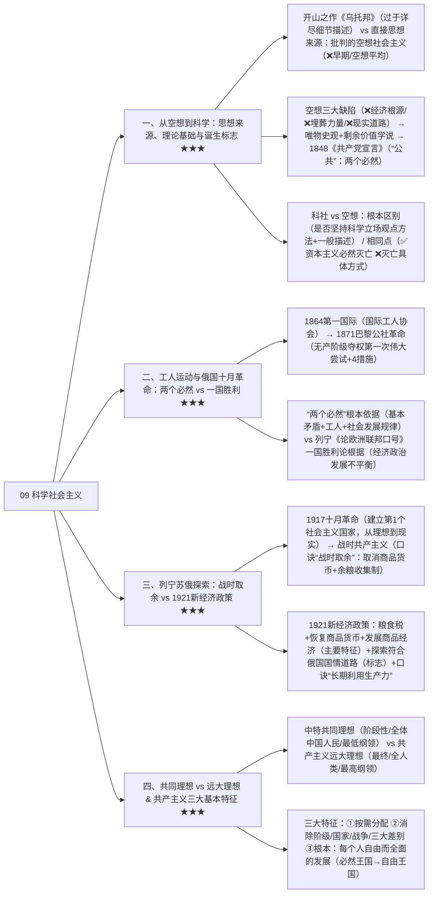

# 09-科学社会主义｜空想与科社对比、列宁新经济政策、共产主义三大基本特征

> [!info] 考情定位与使用说明
> - **题型靶向**：`【100% 仅考选择题！（每年固定 1 道单选或 1 道多选 = 1~3 分，绝不考 34 题分析题！）】`
>   - **核心高频考法**：① 空想社会主义开山之作《乌托邦》 vs 科学社会主义直接思想来源（19世纪批判的空想社会主义，❌ 早期/空想平均）与三大缺陷；② 科社与空想的根本区别与相同点；③ 第一国际 vs 巴黎公社革命（首次尝试）；④ **《共产党宣言》“两个必然”的根本依据 vs 列宁《论欧洲联邦口号》“一国或数国首先胜利论”的根据**；⑤ 十月革命（从理想到现实）、**战时共产主义口诀“战时取余” vs 1921新经济政策**（主要特征、标志、原因、意义、列宁论述口诀“长期利用生产力”）；⑥ 社会主义建设长期性4原因；⑦ 中特共同理想 vs 共产主义远大理想、**共产主义社会三大基本特征**（按需分配 / ❌ 阶级、国家、战争、三大差别 / 根本：每个人自由而全面的发展）。
> - **视频来源**：[空卡《30分钟学完政治经济学、科学社会主义》P3：27科学社会主义（09:13）](https://www.bilibili.com/video/BV1YnYL6SESt/?p=3)
> - **配套《1000题》范围**（空卡片尾布置）：单选 `P24-25 T175-184`；多选 `P56-59 T191-212`。

---

## 🗺️ 全节思维导图（还原视频一镜到底长卷板书）

---

## 一、社会主义从空想到科学（视频 [00:00–02:35]）`【仅考选择·单选/多选必考★★★】`

> [!note]- 原始视频板书截图（溯源：P3 第一屏「空想社会主义、科学社会主义诞生与两者对比」）
> ![[考研政治/1-马原/assets/09-科社-空想与科学社会主义诞生板书.jpg]]

### 1.1 空想社会主义的三个阶段、直接思想来源与三大缺陷（板书上部）

1. **空想社会主义的发展三阶段与两顶必背帽子**：
   - **① 16—17世纪早期空想社会主义**：代表作是 1516 年英国**莫尔《乌托邦》**——它是==空想社会主义的开山之作==！（以及意大利康帕内拉《太阳城》）。其特点是：**对未来社会有==过于详尽的细节描述==**（连未来社会穿什么衣服、几点吃饭都写得清清楚楚，具有浓厚的文学游记虚构色彩）。
   - **② 18世纪空想平均共产主义**：以法律条文形式提出绝对平均主义、禁欲主义纲领（摩莱里《自然法典》等）。
   - **③ 19世纪初期==批判的空想社会主义==**（法国**圣西门、傅立叶**，英国**欧文**）：
     - ★ **空卡板书重点红叉**：科学社会主义的**直接思想来源**，特指第三阶段**==19世纪初期批判的空想社会主义==**！（**❌ 绝不是“早期空想社会主义”，也 ❌ 不是“空想平均共产主义”！**）。
2. **空想社会主义的三大致命缺陷 vs 马克思主义如何补齐（板书右上角连线！）**：
   - **缺陷①**：只看到资本主义必然灭亡的命运，却**❌ 未能揭示资本主义必然灭亡的==经济根源==** $\longrightarrow$ 马克思发现了**资本主义基本矛盾**（生产社会化与生产资料资本主义私人占有的矛盾）和**剩余价值学说**，找出了经济根源！
   - **缺陷②**：要求埋葬资本主义，却**❌ 看不到==埋葬资本主义的力量==**（只把无产阶级看成值得同情的受苦人） $\longrightarrow$ 马克思指明了**无产阶级（工人阶级）**是掘墓人和社会变革的主力军！
   - **缺陷③**：憧憬理想社会，却**❌ 找不到通往理想社会的==现实道路==**（空想家反对阶级斗争和暴力革命，幻想靠道德说教和示范实验感化资本家） $\longrightarrow$ 马克思指明了通过**无产阶级革命和无产阶级专政**实现社会主义的现实道路！
   - **哲学总病根**：空想社会主义在历史观上是**唯心史观**。

---

### 1.2 科学社会主义的理论基础、诞生标志与「两个必然」的根本依据（板书中上部）

1. **社会主义从空想发展到科学的理论基础（两大基石）**：
   - **==唯物史观==** + **==剩余价值学说==**（马克思一生的两大伟大发现）。
2. **科学社会主义的诞生标志**：
   - 1848 年 2 月马克思、恩格斯发表**《共产党宣言》**！
   - **空卡谐音助记“==公共==”**：《**共**产党宣言》标志着科学社会主义**公**开问世，里面提出了著名的**“两个必然”**（“资产阶级的灭亡和无产阶级的胜利是同样不可避免的”，即资本主义必然灭亡、社会主义必然胜利）。
   - ★ **“两个必然”的==根本依据==是什么？（板书右侧粗黑连线！）**：
     - 正是建立在：**资本主义基本矛盾**（经济根源） $+$ **工人阶级（无产阶级）的历史使命**（埋葬力量） $+$ **人类社会发展客观规律**（唯物史观）这三者之上！
   - 📌 **【考纲补充：两个必然 vs 两个决不会】**：1859 年马克思在《〈政治经济学批判〉序言》中又提出了**“两个决不会”**（“无论哪一个社会形态，在它所能容纳的全部生产力发挥出来以前，是决不会灭亡的；而新的更高的生产关系，在它的物质存在条件在旧社会的胎胞里成熟以前，是决不会出现的”）。“两个必然”讲的是历史发展的**必然趋势**（坚定信念），“两个决不会”讲的是实现这一趋势所需的**客观物质条件与长期性**（脚踏实地）。

---

### 1.3 科学社会主义 vs 空想社会主义的「不同点」与「相同点」（板书中部）

| 对比维度 | 核心要点（视频板书原文精准还原） | 考题避坑详解 |
| :--- | :--- | :--- |
| **1. 二者的不同点** | ① **==根本区别==**：**是否坚持“==科学==”的立场、观点、方法**（即是否以唯物史观和剩余价值学说为基础）！ ② **在预见未来社会的方法论上不同**：科学社会主义只立足于**对未来社会作==一般特征==的描述**，而**不对未来社会的各种具体细节作详尽描绘**（对比：空想社会主义《乌托邦》喜欢对未来社会作**过于详尽的细节描述**！）。 | 考题若问“科学社会主义比空想社会主义对未来社会的细节描绘得更加详尽具体”，直接打 ❌！越是科学，越只揭示一般特征与规律，不替后人画具体细节死框框。 |
| **2. 二者的相同点** | - ✅ 都对资本主义旧制度进行了深刻批判，都认为**==资本主义必然灭亡==**，并对未来美好新社会提出了许多积极构想； - ❌ **但在“资本主义灭亡的==具体方式/现实道路==”上绝不相同**！（空想社会主义幻想和平说教改良，科学社会主义主张无产阶级革命）。 | 多选题若说“空想社会主义和科学社会主义都阐明了资本主义灭亡的具体方式”，直接打 ❌！ |

---

## 二、工人运动、巴黎公社与俄国十月革命（视频 [02:35–04:15]）`【仅考选择·高频】`

> [!note]- 原始视频板书截图（溯源：P3 第二屏「第一国际、巴黎公社、列宁一国胜利论与十月革命」）
> ![[考研政治/1-马原/assets/09-科社-第一国际巴黎公社与十月革命板书.jpg]]

### 2.1 第一国际（1864）与巴黎公社革命（1871）

1. **1864 年“第一国际”（国际工人协会）**：马克思是第一国际的灵魂，促进了马克思主义的传播和与国际工人运动的结合。
2. **1871 年巴黎公社革命（马克思写《法兰西内战》高度赞扬并总结其经验）**：
   - **历史地位帽子词**：巴黎公社革命是**==无产阶级夺取政权的第一次伟大尝试==**！
   - **巴黎公社采取的 4 大革命措施（板书中部，多选常考！）**：
     - ① 打碎旧的国家机器，建立**立法兼行政**合一的公社委员会（议行合一）；
     - ② 废除资产阶级常备军，代之以武装的人民（国民自卫军），解除旧警察武装；
     - ③ 取消高薪制，规定**公职人员的薪金不得超过熟练工人的最高工资**；
     - ④ **政教分离**（没收教会财产，学校教育摆脱教会控制）。

---

### 2.2 马克思「共同胜利论」 vs 列宁「一国或数国首先胜利论」（板书中部黄金对比！）

为什么马克思当年认为社会主义革命要在主要资本主义国家“同时发生”，而列宁却在经济文化相对落后的俄国率先取得了十月革命胜利？空卡在板书中间把这两大著名论断及著作做了严密对位：

| 对比维度 | 马克思、恩格斯（19世纪自由竞争资本主义阶段） | 列宁（19世纪末20世纪初帝国主义/垄断资本主义阶段） |
| :--- | :--- | :--- |
| **代表著作** | **《共产党宣言》**（1848）、《共产主义原理》 | **《论欧洲联邦口号》**（1915）、《无产阶级革命的军事纲领》（1916） |
| **核心论断** | **“两个必然”** + 社会主义革命将在欧美各文明国家（发达资本主义国家）**同时发生 / 共同胜利**。 | **==“一国或数国首先胜利论”==**：社会主义不能在所有国家同时获得胜利，它将**首先在一个或者几个国家中获得胜利**（突破帝国主义统治链条中最薄弱的环节）！ |
| **理论根据/根本依据** | **“两个必然”的根本依据**：资本主义基本矛盾 + 工人阶级力量 + 人类社会发展一般规律。 | **“一国或数国首先胜利论”的==根据==**：**==经济和政治发展的不平衡是资本主义的绝对规律==**！（在帝国主义时代，各资本主义国家经济政治发展极不平衡，引发帝国主义战争如一战，暴露出统治链条的薄弱环节俄国）。 |

---

## 三、列宁领导苏俄社会主义建设的探索：战时取余 vs 1921 新经济政策（视频 [04:15–06:50]）`【仅考选择·重中之重★★★】`

> [!note]- 原始视频板书截图（溯源：P3 第三屏「战时共产主义、1921新经济政策与建设长期性」）
> ![[考研政治/1-马原/assets/09-科社-新经济政策与长期性板书.jpg]]

### 3.1 1917 十月革命与「战时共产主义政策」（口诀：“战时取余”）

1. **1917 年俄国十月社会主义革命**：
   - 建立了世界上**第一个社会主义国家**（苏维埃俄国），实现了社会主义**==从理想到现实的伟大飞跃==**，开辟了人类历史的新纪元！
2. **战时共产主义政策（1918夏—1921春，外国武装干涉和国内战争时期）**：
   - **空卡秒记口诀**：“==战时取余==”！
     - **战时**：**战时**共产主义政策；
     - **取**：**取**消商品货币关系（取消自由贸易，实行实物配给制）；
     - **余**：主要特征是实行**==余粮收集制==**（把农民除口粮种子外的余粮全部征集上来保卫前线）。

---

### 3.2 1921 年「新经济政策」全维度精析与两大必考红叉陷阱（板书中下部）

国内战争结束后，战时共产主义政策引发了严重的经济和政治危机，列宁于 **1921 年春**果断转向实行**==新经济政策（NEP）==**（**真题单选与多选的超级宠儿，每一行都考过！**）：

| 考察维度 | 核心内容与标准表述（视频板书逐行还原） | 空卡板书红叉陷阱 & 现场互动提问避坑！ |
| :--- | :--- | :--- |
| **1. 主要内容** | ① 用**==粮食税==**代替余粮收集制（农民交完税后剩下的粮食可以自己拿去市场上自由买卖！）； ② **==恢复商品货币关系==**，允许私人自由贸易； ③ 允许私人小工业企业发展，采取租让制、租借制等**国家资本主义**形式恢复工业生产。 | 对比记忆： - **战时共产主义（“战时取余”）**：余粮收集制 + **取消**商品货币关系； - **1921 新经济政策**：粮食税 + **恢复**商品货币关系！ |
| **2. 主要特征** | **==发展商品经济==**！（利用市场和商品货币关系来建设社会主义）。 | 单选题问“新经济政策的主要特征是什么？”，秒选**发展商品经济**！ |
| **3. 历史标志** | 标志着列宁**==正在探索一条符合俄国国情的社会主义建设道路==**！ | ❓ **空卡视频 [06:43] 现场互动提问**：「“十月革命”标志着列宁正在探索一条符合俄国国情的社会主义道路，对吗？」 👉 **答案**：❌ **错误！张冠李戴！** 十月革命标志着社会主义从理想变为现实、建立了第一个社会主义国家；而**1921年实行“新经济政策”才标志着列宁正在探索一条符合俄国国情的社会主义道路**！ |
| **4. 实行原因** | ① 战争结束，进入**和平**经济建设时期； ② 长期战争加旱灾导致**国民经济濒临崩溃**； ③ 继续推行战时共产主义政策导致农民不满，苏维埃政权面临**将失去广大群众和阶级基础**（工农联盟破裂）的政治危机。 | 🚫 **板书右侧红叉 1**：❌ **绝不是因为“农村集体化”**！（农业集体化是后来斯大林在 20 世纪 20 年代末 30 年代初搞苏联模式时的事，跟 1921 年列宁新经济政策的原因毫无关系！）。 |
| **5. 重大意义** | ① **扭转了经济和政治危机**； ② 活跃了**城乡经济**，促进了生产力恢复； ③ 改善了**工农生活**，巩固了工农联盟和苏维埃政权。 | 🚫 **板书右侧红叉 2**：❌ **新经济政策的意义绝不包含“完成了农村合作化”或“创立了苏联模式”**！（斯大林后来恰恰是**终止**了列宁的新经济政策，才搞了农业全盘集体化和高度集中的计划经济“苏联模式”！）。 |
| **6. 列宁晚年关于社会主义建设的重大理论论述** （口诀：“==长期利用生产力==”） | - **长期**：把建设社会主义作为一个**长期探索、不断实践的过程**； - **生产力**：**把大力发展生产力、提高劳动生产率放在首要地位**； - **利用（两个利用）**：在多种经济成分并存条件下，**利用商品、货币和市场发展经济**；**利用资本主义，建设社会主义**（以及加强执政党建设和思想文化建设）。 | 口诀“**长期利用生产力**”直接串起列宁晚年《论合作制》等政治遗嘱的 4 条核心精髓！ |

---

### 3.3 经济文化相对落后国家建设社会主义的长期性（板书下部）

1. **为什么社会主义首先在经济文化相对落后的国家取得胜利？（视频 [06:35] 互动提问）**：
   - > ❓ **空卡现场提问**：「经济文化相对落后的国家可以率先进入社会主义，这违背了生产力决定生产关系的规律吗？」
   - > **答案**：✅ **可以率先进入社会主义**，且**❌ 绝没有违背生产关系一定要适合生产力状况的规律**！（这是历史发展一般规律在特定历史条件下的特殊表现，体现了社会形态更替统一性与多样性的统一、必然性与历史选择性的统一）。
2. **经济文化相对落后国家建设社会主义具有「长期性」的 4 大原因**：
   - ① **生产力**发展状况的制约（物质基础薄弱，大力发展生产力需要很长时间）；
   - ② **经济基础和上层建筑**（板书简写：**“经+上”**）发展状况的制约；
   - ③ **国际环境**的严峻挑战（国际资本主义在经济科技军事上仍占优势，对社会主义国家进行围堵遏制）；
   - ④ 马克思主义执政党对社会主义发展道路的探索和对社会主义建设规律的**认识需要一个长期的过程**。
3. **坚持科学社会主义基本原则的正确态度（板书底部绿勾红叉）**：
   - ✅ **必须充分吸收人类一切文明成果**（包括资本主义国家创造的先进科学技术、管理经验等文明成果）；
   - ❌ **科学社会主义基本原则绝不是一成不变的教条，也绝不提供各国社会主义建设的现成固定模式**（必须把科学社会主义基本原则同本国具体实际和时代特征相结合，如中国特色社会主义的成功实践；东欧剧变、苏联解体只是“苏联模式”的失败，绝不是社会主义和马克思主义的失败！）。

---

## 四、共产主义崇高理想及其三大基本特征（视频 [06:50–09:13]）`【仅考选择·约1分】`

> [!note]- 原始视频板书截图（溯源：P3 第四屏「共同理想 vs 远大理想、共产主义三大基本特征与必然/自由王国」）
> ![[考研政治/1-马原/assets/09-科社-共产主义三大基本特征板书.jpg]]

### 4.1 中国特色社会主义共同理想 vs 共产主义远大理想（板书顶部三对关系）

| 理想类型 | ① 时间维度 | ② 主体/范围维度 | ③ 纲领/层次维度 |
| :--- | :---: | :---: | :---: |
| **中国特色社会主义共同理想** | **阶段性**理想 | **全体中国人民** | **最低纲领**（当前阶段性纲领） |
| **共产主义远大理想** | **最终**理想 | **全人类** | **最高纲领** |

- **辩证关系**：二者是辩证统一的，任何时候都不能把它们割裂开来。离开共产主义远大理想，共同理想就会迷失方向；离开中国特色社会主义共同理想的扎实奋斗，共产主义远大理想就会变成空谈。

---

### 4.2 共产主义社会的三大基本特征（板书下部·多选与单选必考！）

#### 特征一：物质财富极大丰富，消费资料**==按需分配==**

- **生产资料所有制**：实行单一的社会公有制；商品、货币、市场消亡。
- **个人消费品分配方式（空卡视频 [06:55] 互动提问弹窗原题！）**：
  - > ❓ **空卡现场提问**：「我们想要实现的共产主义远大理想，是一个物质财富极大丰富、**按劳分配**的社会吗？」
  - > **答案**：❌ **错误！** **“各尽所能，按劳分配”**是**社会主义社会（共产主义第一阶段/低级阶段）**的分配方式；而**共产主义社会（高级阶段）**实行的是**==“各尽所能，按需分配”==**！

#### 特征二：社会关系高度和谐，人们精神境界极大提高

- **到了共产主义社会，哪些东西会彻底消亡？（板书两行红叉 ❌ 表示在共产主义社会不存在！）**：
  1. **❌ 阶级、国家、战争消亡**：剥削制度和阶级消灭；作为阶级统治暴力工具的**政治国家自行消亡**（让位于社会公共自治管理）；战争不复存在。
  2. **❌ “三大差别”消失**：
     - ① **工业与农业**的差别；
     - ② **城市与乡村**的差别；
     - ③ **脑力劳动与体力劳动**的差别！
     - （以及把人终身束缚在某一职业上的**旧式分工**也将消除；但注意：**协调社会生产的合理社会分工和非对抗性的社会矛盾依然存在**！）。

#### 特征三（★ 根本特征！）：实现==每个人自由而全面的发展==，人类从必然王国向自由王国飞跃

- **地位帽子词**：实现**人的自由而全面的发展**，是马克思主义追求的**==根本价值目标==**，也是共产主义社会的**==根本特征==**！
- **关于“每个人自由而全面的发展”的两大必考辨析（板书左下角绿勾红叉！）**：
  1. ✅ 是指**==全体社会成员==**的自由全面发展，**❌ 绝不是像资本主义社会那样仅仅是“一部分人（少数资产者）”的发展**！
  2. ✅ 那时，每个人的自由发展是一切人的自由发展的条件，人与人之间和谐统一，**==不必以牺牲某个人（或另一部分人）的发展为代价==**！（而在阶级社会中，少数人的发展总是以牺牲绝大多数劳动者的发展为代价的）。
  3. **劳动的性质变化**：在共产主义社会，**劳动不再仅仅是谋生的手段，而已成为==生活的第一需要==**！
- **从「必然王国」向「自由王国」的飞跃（板书右下角）**：
  - **必然王国**：指人们对社会历史的客观规律还没有认识和掌握，盲目地受客观必然性支配和奴役的状态；
  - **自由王国**：指人们通过**认识客观规律**和**改造世界**，**==摆脱了盲目必然性的奴役，成为自己社会关系和自然界的自觉主人==**的状态！

---

## 🎙️ 假装当老师·遮挡自测（念逐字稿留存 90%）

1. **空想社会主义的“开山之作”和科学社会主义的“直接思想来源”分别是什么？空想社会主义有哪三大缺陷？科学社会主义与空想社会主义的“根本区别”和“相同点”是什么？** ⌜⌟
2. **巴黎公社革命的历史地位是什么？马克思在《共产党宣言》中提出的“两个必然”的根本依据是什么？列宁在《论欧洲联邦口号》中提出的“一国或数国首先胜利论”的根据是什么？** ⌜⌟
3. **战时共产主义政策口诀“战时取余”指什么？1921年新经济政策的“主要内容、主要特征、历史标志、实行原因、重大意义”分别是什么（注意哪两个红叉陷阱不能选）？列宁晚年建设社会主义的论述口诀“长期利用生产力”指什么？** ⌜⌟
4. **中特共同理想与共产主义远大理想在“时间、范围、纲领”上是什么关系？共产主义社会的三大基本特征是什么（哪个是根本特征、哪三大差别会消失、是按劳分配还是按需分配）？** ⌜⌟

> [!note]- 点击核对本节复述标准答案
> 1. **空想社会主义 vs 科学社会主义**：
>    - **开山之作**：莫尔**《乌托邦》**（特点：对未来社会有**过于详尽的细节描述**）；**直接思想来源**：19世纪初期**批判的空想社会主义**（圣西门、傅立叶、欧文；❌ 不是早期空想或空想平均）。
>    - **空想三大缺陷**：① 未能揭示资本主义必然灭亡的**经济根源**（不懂基本矛盾和剩余价值）；② 看不到**埋葬资本主义的力量**（工人阶级）；③ 找不到通往理想社会的**现实道路**。
>    - **根本区别**：**是否坚持“科学”的立场、观点、方法**（唯物史观+剩余价值学说），且科社只对未来社会作**一般特征的描述**，不作具体细节描绘。**相同点**：都认为**资本主义必然灭亡**（✅），但在**灭亡的具体方式**上不同（❌）。
> 2. **巴黎公社、“两个必然”与“一国胜利论”**：
>    - 1871年**巴黎公社革命**是**无产阶级夺取政权的第一次伟大尝试**（打碎旧国家机器、立法兼行政、取消高薪制不超过熟练工人工资、政教分离）。
>    - **《共产党宣言》“两个必然”**（资本主义必然灭亡、社会主义必然胜利）的**根本依据**：资本主义基本矛盾 + 工人阶级力量 + 人类社会发展客观规律。
>    - **列宁《论欧洲联邦口号》“一国或数国首先胜利论”**的**根据**：**经济和政治发展的不平衡是资本主义的绝对规律**。
> 3. **战时共产主义（“战时取余”） vs 1921 新经济政策**：
>    - **1917十月革命**：建立第一个社会主义国家，实现**从理想到现实**的飞跃。
>    - **战时共产主义（“战时取余”）**：**取**消商品货币关系 + **余**粮收集制（主要特征）。
>    - **1921新经济政策**：① 内容：**粮食税** + **恢复商品货币关系** + 允许私人贸易/小工业企业/国家资本主义；② 主要特征：**发展商品经济**；③ 标志：**正在探索一条符合俄国国情的社会主义道路**（❌ 不是十月革命标志！）；④ 原因：和平时期、经济濒临崩溃、将失去广大群众和阶级基础（**❌ 不是因为农村集体化**）；⑤ 意义：扭转危机、活跃城乡经济、改善工农生活（**❌ 不是完成农村合作化或创立苏联模式**）。
>    - **列宁论述（“长期利用生产力”）**：建设社会主义是**长期过程**；把提高**生产力**和劳动生产率放在首位；**利用商品、货币、市场**发展经济；**利用资本主义**建设社会主义。
>    - **长期性4原因**：生产力制约、经济基础+上层建筑制约、国际环境挑战、认识需长期过程。
> 4. **共同理想 vs 远大理想 & 共产主义三大特征**：
>    - 中特共同理想 vs 共产主义远大理想：**阶段性 vs 最终**、**全体中国人民 vs 全人类**、**最低纲领 vs 最高纲领**。
>    - **三大特征**：① 物质财富极大丰富，消费资料**按需分配**（❌ 不是按劳分配）；② 社会关系高度和谐，精神境界极大提高——**阶级、国家、战争消亡**，**三大差别（工业与农业、城市与乡村、脑力劳动与体力劳动）消失**；③ **根本特征**：实现**每个人自由而全面的发展**（✅ 全体社会成员 ❌ 一部分人；✅ 不必以牺牲某个人的发展为代价；劳动成为生活第一需要），人类通过认识和改造实现从**必然王国向自由王国的飞跃**（摆脱盲目必然性奴役，成为社会关系和自然界的自觉主人）。
