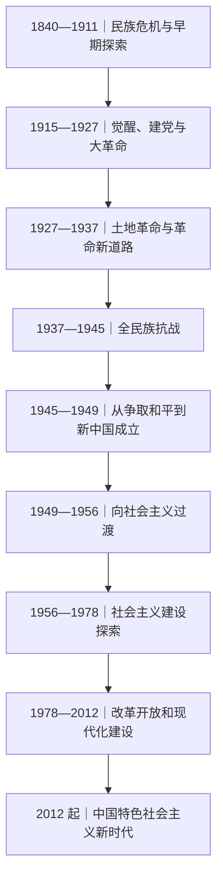

# 史纲图推·必背速查与遮挡自测

> [!info] 15 分钟怎么用
> **3 分钟**：沿阶段图复述「哪一年、哪件事、换了什么阶段」。**7 分钟**：只背各阶段正文，卡住才展开补背。**5 分钟**：合上正文，口答篇末自测；错在哪一类，就回看对应对照。
>
> **标记**：==高亮==是选择题容易调换的题眼；「补背」是第二遍再看的细节。「分析题卡」是材料题组织思路，不是押题。范围以原图第 1 页为准（1840—2022），不含 2022 年之后的时政更新。

## 一、先背这张主线图

**全图主线：争取民族独立、人民解放 → 实现国家富强、人民幸福。** 前一项为后一项创造必要的前提；不能把两大历史任务都说成在 1949 年已经完成。

**三句定位**：近代中国的**基本国情**是半殖民地半封建社会；两对**主要矛盾**是帝国主义和中华民族的矛盾、封建主义和人民大众的矛盾，其中前者是最主要的矛盾；贯穿史纲的**四个选择**是马克思主义、中国共产党、社会主义道路、改革开放。

**只背五个分界**：**1840** 近代史起点 → **1919** 新民主主义革命开端 → **1949** 新民主主义革命基本胜利、新中国成立 → **1956** 社会主义基本制度确立 → **1978** 改革开放和社会主义现代化建设新时期开启。

## 二、分段必背：年份 → 事件 → 一句话定位

### 1. 1840—1911｜危机与救亡：四种探索为什么没完成任务

- **1840 鸦片战争**：中国近代史==起点==，中国社会开始逐步沦为半殖民地半封建社会。条约顺序：**1842《南京条约》→ 1895《马关条约》→ 1901《辛丑条约》**。
- **太平天国**：先记《天朝田亩制度》＝平均分配土地的设想；再记《资政新篇》＝提出发展资本主义的方案。一个重分田，一个重变革发展，不是同一套纲领。
- **洋务运动**：中体西用，办工业、海军、学堂；甲午战败==标志==洋务运动破产。**戊戌维新**：爱国救亡、政治改良、思想启蒙；依赖皇帝、脱离群众。
- **1911 辛亥革命**：推翻清王朝统治，结束两千多年的君主专制制度，建立共和；**没有改变中国半殖民地半封建的社会性质，没有完成反帝反封建的革命任务**。

> [!note]- 补背｜三个条约、四次探索的区别
> - 条约抓三个词：南京条约 → **破坏主权、开启进程**；马关条约 → **允许日本在通商口岸设厂，资本输出扩张**；辛丑条约 → **清政府成为列强统治中国的工具，半殖民地半封建社会完全形成**。不是说甲午战后商品输出就停止了。
> - 四次探索按「谁在找路」记：**农民阶级**起义 → **地主阶级洋务派**自救 → **资产阶级维新派**改良 → **资产阶级革命派**革命。
> - 辛亥革命的局限按三点答：没有提出彻底反帝反封建的革命纲领，没有充分发动和依靠群众，没有建立坚强的革命政党。根子是民族资产阶级的软弱性和妥协性。选项若写「结束了封建制度」则把君主专制制度和封建制度混为一谈。

### 2. 1915—1927｜觉醒、建党与大革命：成立、纲领、合作

- **1915 新文化运动**：民主与科学，冲击封建礼教。**1919 五四运动**：彻底反帝反封建的伟大爱国革命运动，是新民主主义革命的==开端==。
- **1921 中共一大**：中国共产党正式成立。**1922 中共二大**：制定最高纲领和最低纲领，==首次==明确提出反帝反封建的民主革命纲领。
- **1923 中共三大**：决定共产党员以个人身份加入国民党。**1924 国民党一大**：第一次国共合作==正式形成==，推进国民革命。
- **1925 五卅运动、省港大罢工**推动群众运动 → **1926 北伐开始**，北伐战争基本推翻北洋军阀统治 → **1927 四一二、七一五反革命政变**，大革命失败。

> [!note]- 补背｜会议不要只背「几大」
> - 中共一大确定党的名称、纲领和中心工作，选举中央局。背时和二大分工：**一大建党，二大定民主革命纲领**。
> - 中共三大作合作的组织准备，保持党的独立性；国民党一大重新解释三民主义，新三民主义成为国共合作的政治基础。**联俄、联共、扶助农工**是三大政策，不能把这三个词写成新三民主义本身。

### 3. 1927—1937｜土地革命：从城市转向农村

- **1927 南昌起义**：打响武装反抗国民党反动派的==第一枪==。**八七会议**：确定土地革命和武装反抗国民党反动派的总方针。
- **1927 秋收起义 → 三湾改编 → 进军井冈山**：三湾改编把支部建在连上；**1928 井冈山会师**。**1929 古田会议**：思想建党、政治建军。**1931 中华苏维埃共和国临时中央政府成立**。
- **革命新道路**：农村包围城市、武装夺取政权。**土地革命**是基本内容，**武装斗争**是主要形式，**农村革命根据地**是战略依托。
- **1934 长征开始 → 1935 遵义会议 → 1936 红军三大主力会师、长征胜利结束**。遵义会议集中解决当时具有决定意义的**军事和组织问题**，是党的历史上==生死攸关的转折点==。
- **1935 瓦窑堡会议**：制定抗日民族统一战线的策略方针。**1936 西安事变和平解决**：时局转换的==枢纽==，十年内战局面基本结束，国内和平初步实现。

> [!note]- 补背｜一条路、两组容易错配的词
> - 井冈山拆两年：**1927 进军并开始创建根据地；1928 朱毛会师**。原图横轴只在 1928 标「井冈山」，不能由此反推 1927 没有进军。
> - **三湾改编**答「支部建在连上，从组织上确立党对军队的领导」；**古田会议**答「思想建党、政治建军」，不要互换。
> - **遵义**开始确立毛泽东同志在党中央和红军的领导地位，党开始独立自主解决中国革命实际问题；**瓦窑堡**处理统一战线的政治策略问题，反对关门主义。两会都是 1935 年，不是同一个历史作用。
> - 西安事变和平解决 ≠ 第二次国共合作正式形成。后者在 **1937 年 9 月**，要联系国共合作宣言公开发表与次日蒋介石发表谈话。

### 4. 1937—1945｜全民族抗战：两个战场、三个阶段

- **1931 九一八事变**是中国人民抗日战争的==起点==；**1937 七七事变**是全民族抗战的==开端==。同年**洛川会议**制定全面抗战路线，通过《抗日救国十大纲领》。
- **1938《论持久战》批驳亡国论和速胜论，分为**战略防御 → 战略相持 → 战略反攻。国民党正面战场在战略防御阶段发挥重要作用；进入相持阶段，敌后战场逐步成为全国抗战的主战场。
- **1938 六届六中全会**提出马克思主义中国化的命题；**1945 中共七大**确立毛泽东思想为党的指导思想并写入党章，概括理论联系实际、密切联系群众、批评与自我批评三大作风。
- **1945 抗战胜利**：中国共产党发挥中流砥柱作用；这是近代以来中国抗击外敌入侵的==第一次完全胜利==。

> [!note]- 补背｜三三制、减租减息、延安整风
> - 抗日根据地：政权建设抓**三三制**（共产党员、非党的左派进步分子、不左不右的中间派各约三分之一）；经济与群众工作抓**减租减息**和**大生产运动**。记住抗战时不沿用土地革命时期的没收地主土地政策。
> - **1940 百团大战**；**1941 皖南事变**，同年《改造我们的学习》为整风作思想动员；**1942 全党普遍整风**。原图把皖南事变和整风并列在 1941，复习时要分开：1941 是准备和动员，普遍开展看 1942。
> - 整风内容：反对主观主义以整顿学风，反对宗派主义以整顿党风，反对党八股以整顿文风。**最主要任务是反对主观主义**。

### 5. 1945—1949｜解放战争：争和平、转进攻、建国家

- **1945 重庆谈判、《双十协定》 → 1946 政治协商会议（旧政协）**：争取和平民主；**1946 年 6 月**国民党军队大举进攻中原解放区，全面内战爆发。
- **1947 刘邓大军挺进大别山**：揭开人民解放军战略进攻序幕；同年《中国土地法大纲》规定实行**耕者有其田**。**1948—1949 辽沈、淮海、平津三大战役**，基本摧毁国民党军队的主要军事力量。
- **1949 七届二中全会**：党的工作重心由乡村转移到城市，提出**两个务必**。**1949 中国人民政治协商会议第一届全体会议**通过《共同纲领》，它起临时宪法作用。
- **1949 年 10 月 1 日中华人民共和国成立**：新民主主义革命==基本胜利==，是新民主主义社会向社会主义社会过渡的起点，不等于社会主义基本制度已经确立。

> [!note]- 补背｜总路线与两次政协
> - 新民主主义革命总路线：**无产阶级领导的、人民大众的，反对帝国主义、封建主义和官僚资本主义的革命**。背法：谁领导 → 为谁 → 反对谁；「官僚资本主义」不能偷换成「一切资本主义」。
> - 七届二中全会的两个务必：务必继续保持**谦虚、谨慎、不骄、不躁**的作风，务必继续保持**艰苦奋斗**的作风。不要把 2022 年提出的「三个务必」提前放到 1949 年。
> - **1946 旧政协**看「和平建国、避免内战」；**1949 新政协**看「《共同纲领》、筹建新中国、多党合作和政治协商制度」。

### 6. 1949—1956｜社会主义革命：一化三改，先记改造对象

- **1950《中华人民共和国土地改革法》**：废除地主阶级封建剥削的土地所有制，实行农民的土地所有制。也别漏记同年**抗美援朝**。
- **1953 过渡时期总路线**：**一化三改**，即社会主义工业化，加上对**农业、手工业、资本主义工商业**的社会主义改造。同年开始实施第一个五年计划。
- **1954 第一届全国人大**：通过新中国第一部社会主义类型的宪法，确立人民代表大会制度。
- **1956 三大改造基本完成**：社会主义基本制度==确立==，中国进入社会主义初级阶段。注意是「基本完成」，不要写成所有改造都已彻底结束。

> [!note]- 补背｜两类改变、三个对象
> - **土地改革**使土地由封建地主所有转为农民所有；**农业合作化**使个体农民私有制逐步转向社会主义集体所有制。这不是同一步。
> - 农业、手工业的改造主要走合作化道路；资本主义工商业采取**和平赎买**，通过由低级到高级的**国家资本主义**形式逐步改造。不要把和平赎买套到农业、手工业，也不要把它等同于没收官僚资本。

### 7. 1956—1978｜社会主义建设探索：开端、曲折、调整、成就

- **1956《论十大关系》、中共八大**：探索适合中国国情的社会主义建设道路的良好开端。八大判断国内主要矛盾已不再是工人阶级同资产阶级的矛盾，要求**集中力量发展社会生产力**。
- **1957《关于正确处理人民内部矛盾的问题》**：区分敌我矛盾和人民内部矛盾。**1958 大跃进、人民公社化运动 → 1961 调整、巩固、充实、提高 → 1962 七千人大会**，注意先有八字方针调整，再开大会总结教训。
- **1966—1976 “文化大革命”**是严重曲折；**1976 粉碎“四人帮”**，结束“文化大革命”。
- 成就不因曲折被抹去：建立独立的、比较完整的工业体系和国民经济体系，取得**“两弹一星”**等成就；**1971 恢复中华人民共和国在联合国的合法权利**。这些探索为后续改革开放积累了制度基础、物质条件和经验教训。

> [!note]- 补背｜八大主要矛盾的原意
> - 人民对于**建立先进工业国**的要求同**落后农业国**现实之间的矛盾；人民对于**经济文化迅速发展**的需要同**当前经济文化不能满足人民需要**的状况之间的矛盾。抓住「先进工业国/落后农业国」「经济文化」，不把十九大的「美好生活/不平衡不充分」套进来。
> - 八大提出在综合平衡中稳步前进；七千人大会初步总结“大跃进”的经验教训，强调发扬民主、开展批评和自我批评，有利于推进国民经济调整。

### 8. 1978—2012｜改革开放：转中心、定路线、建体制

- **1978 十一届三中全会**：重新确立解放思想、实事求是的思想路线，把党和国家工作重点转移到社会主义现代化建设上来，作出实行改革开放的历史性决策。**1981 十一届六中全会**通过第二个历史决议，标志党在指导思想上的拨乱反正胜利完成。
- **1982 十二大**：「走自己的道路，建设有中国特色的社会主义」。**1987 十三大**：系统阐述社会主义初级阶段理论，概括**一个中心、两个基本点**的基本路线，提出“三步走”发展战略。
- **1992 南方谈话**：从理论上进一步解放思想，计划和市场都是经济手段；**同年十四大**：确立建立社会主义市场经济体制的==改革目标==；**1993 十四届三中全会**：把目标落成==基本框架==。
- 理论接力抓三次**写入党章并确立为指导思想**的大会：**1997 十五大—邓小平理论；2002 十六大—“三个代表”重要思想；2012 十八大—科学发展观**。**2007 十七大**是深入阐述科学发展观，不是已经确立其为党的指导思想。

> [!note]- 补背｜转折前后连起来背
> - **1978 中央工作会议**：邓小平作《解放思想，实事求是，团结一致向前看》讲话，为十一届三中全会作思想准备；不要把这场讲话的场合记成三中全会本身。**1981 第二个历史决议**科学评价毛泽东和毛泽东思想、否定“文化大革命”。
> - 实践分两条记，**不是把开放排在城市改革之后**：对内抓农村家庭联产承包责任制到城市经济体制改革；对外抓经济特区到多层次开放格局。两条时间锚：**1997 香港回归，2001 中国加入世界贸易组织**。
> - 十五大提出社会主义初级阶段基本纲领，明确公有制为主体、多种所有制经济共同发展的基本经济制度；十六大提出**全面建设**小康社会；十七大提出全面建设小康社会新要求，提出建设生态文明。
> - 改革的性质：社会主义制度的**自我完善和发展**，不是改变社会主义制度的性质；改革开放是决定当代中国命运的关键一招。

### 9. 2012—2022｜新时代：布局、矛盾、使命

- **2012 十八大**：明确中国特色社会主义事业**五位一体**总体布局，提出**全面建成**小康社会。**2013 十八届三中全会**部署全面深化改革，提出改革总目标，使市场在资源配置中起决定性作用和更好发挥政府作用；**2014 十八届四中全会**专题部署全面依法治国。
- **2017 十九大**：作出中国特色社会主义进入新时代的重大判断；社会主要矛盾转化为**人民日益增长的美好生活需要和不平衡不充分的发展之间的矛盾**；确立习近平新时代中国特色社会主义思想为党的指导思想并写入党章，提出现代化建设“两步走”战略安排。
- **2021**：宣告全面建成小康社会、实现第一个百年奋斗目标；**十九届六中全会**通过第三个历史决议，总结百年奋斗重大成就和历史经验，强调「两个确立」。这两件事不要合成同一场会议的成果。
- **2022 二十大**：明确新时代新征程中国共产党的中心任务，关键词是**建成社会主义现代化强国、实现第二个百年奋斗目标、以中国式现代化全面推进中华民族伟大复兴**。

> [!note]- 补背｜会议题再细一格
> - 十八届三中全会，全面深化改革总目标：**完善和发展中国特色社会主义制度，推进国家治理体系和治理能力现代化**。十八届四中全会，全面依法治国总目标：**建设中国特色社会主义法治体系，建设社会主义法治国家**。后者的工作环节按「科学立法、严格执法、公正司法、全民守法」记。
> - 「小康」三个记忆点：**2002 十六大 → 全面建设；2012 十八大 → 全面建成作为目标；2021 → 宣告全面建成**。再问十八大和十九大时：**2012 是新时代进程的起点，2017 作出进入新时代的重大政治判断**。
> - 十九届六中全会的「两个确立」：确立习近平同志党中央的核心、全党的核心地位，确立习近平新时代中国特色社会主义思想的指导地位。「两个确立」不等于「两个维护」。
> - 现代化“两步走”的两个时间锚：**到 2035 年基本实现社会主义现代化，到本世纪中叶建成社会主义现代化强国**。

## 三、横着背：选项最容易偷换的三条线

### 1. 土地政策：先问时期，再问谁拥有土地

| 时期 | 政策记忆点 | 最容易错在哪 |
| --- | --- | --- |
| 土地革命 | 没收地主土地，分配给农民 | 不是只减轻租息 |
| 全民族抗战 | 地主减租减息，农民交租交息 | 统一战线条件下，不是普遍没收地主土地 |
| 解放战争 | 1947《中国土地法大纲》：耕者有其田 | 占住「1947、解放区」两个关键词 |
| 新中国成立初期 | 1950 土地改革：废除封建地主土地所有制，实行农民土地所有制 | 还不是社会主义集体所有制 |
| 社会主义改造 | 农业合作化，逐步实现集体所有 | 不等于再搞一次分田到户 |

**顺口记**：**土革没收 → 抗战减息 → 解放纲领 → 建国土改 → 农业合作。**

### 2. 统一战线：看任务和形成标志

| 时期 | 对应统一战线 | 抓手 |
| --- | --- | --- |
| 大革命 | 国民革命联合战线 | 1924 国民党一大，第一次国共合作正式形成 |
| 土地革命 | 工农民主统一战线 | 主线是工农动员、土地革命与根据地 |
| 全民族抗战 | 抗日民族统一战线 | 1935 瓦窑堡定策略 → 1936 西安事变和平解决 → 1937 第二次国共合作正式形成 |
| 解放战争与建国 | 人民民主统一战线 | 关键落点：1949 新政协召开 |
| 改革开放以来 | 爱国统一战线 | 与社会主义现代化建设、祖国统一相联系 |

### 3. 题眼排雷：先圈范围，再配事件

> [!warning] 常见干扰项：错配 → 正确配对
> - 「1919 中国近代史开端」→ **1840** 才是近代史起点，**1919** 是新民主主义革命开端。
> - 「中共三大标志第一次国共合作正式形成」→ **三大作决定，国民党一大正式形成**。
> - 「遵义会议解决抗日统一战线策略」→ **遵义抓军事和组织，瓦窑堡抓统一战线策略**。
> - 「七七事变是中国人民抗日战争起点」→ **九一八**是起点，**七七**是全民族抗战开端。
> - 「《共同纲领》是新中国第一部社会主义类型宪法」→ 前者有**临时宪法作用**；后者是**1954 年宪法**。
> - 「1949 社会主义基本制度确立」→ **1949 新民主主义革命基本胜利，1956 社会主义基本制度确立**。
> - 「十一届三中全会完成指导思想上的拨乱反正」→ **1978 三中作转折，1981 六中以历史决议标志胜利完成**。
> - 「南方谈话/十四届三中全会确立社会主义市场经济体制目标」→ **南方谈话破误区，十四大定目标，十四届三中搭框架**。
> - 「新时代主要矛盾变化意味着脱离社会主义初级阶段」→ **主要矛盾变了，社会主义初级阶段的基本国情没有变**。

**做题动作**：先圈出「开始／正式形成／基本胜利／确立／胜利完成」，再用年份定位事件，最后检查限定范围。例：「抗日战争开端」必须先看题干到底指**中国人民抗日战争**还是**全民族抗战**，再在九一八、七七之间选。

## 四、分析题短背诵卡：材料触发词 → 史实 → 结论

> [!tip] 卡 1｜早期探索与历史选择
> **触发词**：甲午战败、改良受挫、辛亥革命局限、救亡图存。  
> **展开**：近代中国半殖民地半封建的基本国情决定了首先要争取民族独立和人民解放。洋务、维新、辛亥各有历史作用，但没有完成反帝反封建的任务。联系五四运动、马克思主义传播和中国共产党成立，说明中国革命有了新的指导思想和领导力量。  
> **落笔提醒**：不要只写「旧路失败」；至少举一个探索，交代它做成了什么、又没解决什么。

> [!tip] 卡 2｜为什么说中国共产党是全民族抗战的中流砥柱
> **触发词**：持久战、敌后根据地、抗日民族统一战线。  
> **展开**：政治上，倡导并推动建立、巩固抗日民族统一战线；战略上，提出全面抗战路线和持久战战略；实践上，开辟敌后战场，建设抗日根据地，广泛发动和依靠群众。  
> **落笔提醒**：一边写清中流砥柱作用，一边承认正面战场在战略防御阶段的重要作用；二者并不矛盾。

> [!tip] 卡 3｜为什么 1978 年是伟大转折
> **触发词**：真理标准讨论、工作重心转移、改革开放。  
> **展开**：用「思想路线 → 工作重点 → 历史决策」作答。重新确立解放思想、实事求是的思想路线；工作重点转向社会主义现代化建设；作出实行改革开放的历史性决策，开启改革开放和社会主义现代化建设新时期。  
> **落笔提醒**：材料若问社会主义市场经济体制改革目标，再接 **1992 十四大**；不要把后来的目标提前写给 1978 年。

## 五、原图回看：重点看正文看不出的并行线索

这张图按位置读：**先沿中轴**从年份说出阶段；**再看左栏**串路线、政策和意义；**最后看右栏**用「提出／决定什么」「解决／标志什么」给会议配对。核对 **1927／1928 井冈山、1941／1942 整风**时，以对应段落的拆分记忆为准，不按图上并列的年份硬背。

![[考研政治/2-史纲/assets/数飞-考研政治_史纲图推.pdf#page=1]]

## 六、假装当老师·遮挡自测

先口答，每题尽量在 **30—60 秒**说完。只说出事件名、不知道它「开始了什么／解决了什么」，也算没背牢。

1. ⌜**断代**⌟ 不看笔记说出 1840、1919、1949、1956、1978 各自打开了哪一段历史；1949 和 1956 为什么不能互换？
2. ⌜**建党与合作**⌟ 用「成立、纲领、决定、形成」给中共一大、二大、三大、国民党一大配对。1924 和 1937 分别对应哪一次合作？
3. ⌜**土地与战争**⌟ 不看表说出五段土地政策；再说出九一八、七七、《论持久战》分别记什么。
4. ⌜**会议与改革**⌟ 给遵义、瓦窑堡、十一届三中全会各配一个「解决的问题」；说出南方谈话、十四大、十四届三中全会的区别。
5. ⌜**新时代**⌟ 「小康」在哪次大会由“建设”进入“建成”的目标表述、何时宣告建成？十九大判断的主要矛盾是什么？
6. ⌜**材料复述**⌟ 题干给出「敌后根据地、正面战场、持久战」三个词，用三点说明中国共产党为什么是全民族抗战的中流砥柱。

> [!note]- 点击核对复述答案
> 1. 1840 近代史起点；1919 新民主主义革命开端；1949 新民主主义革命基本胜利、新中国成立、进入过渡阶段；1956 三大改造基本完成、社会主义基本制度确立；1978 开启改革开放和社会主义现代化建设新时期。**1949 看革命胜利和建国，1956 看所有制改造和制度确立。**
> 2. 一大建党，二大首次明确反帝反封建民主革命纲领，三大决定共产党员以个人身份加入国民党，国民党一大标志第一次国共合作正式形成。1924 第一次；1937 年 9 月第二次。
> 3. 土地革命没收地主土地；抗战减租减息；解放战争《中国土地法大纲》实行耕者有其田；1950 土改实行农民土地所有制；农业合作化逐步转向集体所有制。九一八是抗战起点，七七是全民族抗战开端，《论持久战》抓防御—相持—反攻，反对亡国论、速胜论。
> 4. 遵义：军事和组织；瓦窑堡：抗日民族统一战线政治策略；十一届三中：思想路线、工作重点、改革开放。南方谈话破观念束缚，十四大定改革目标，十四届三中全会搭体制框架。
> 5. 十六大讲全面建设，十八大提出全面建成目标，2021 年宣告全面建成。十九大：**人民日益增长的美好生活需要和不平衡不充分的发展之间的矛盾**。
> 6. 推动建立并巩固抗日民族统一战线；提出全面抗战路线和持久战战略；开辟敌后战场、建设根据地、动员群众。补一句：国民党正面战场在战略防御阶段发挥了重要作用。

**背过的标准**：不看年份表能说出五个分界，不看政策表能顺背五段土地政策，看到一组相近会议能说明各自解决了什么。只记混的一组，下轮优先答它。
